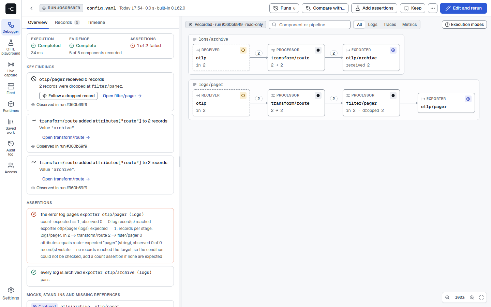
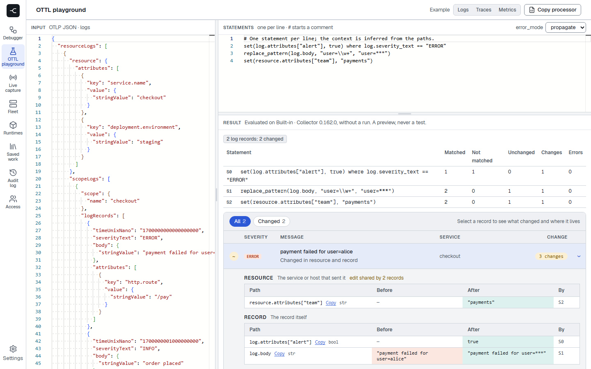
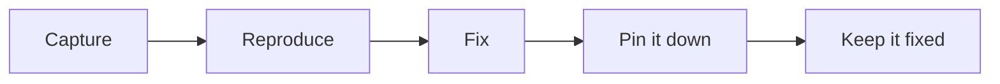

<h1>
  <picture>
    <source media="(prefers-color-scheme: dark)" srcset="docs/images/logo-dark.svg">
    
  </picture>
  Linea
</h1>

Linea is a debugger for OpenTelemetry Collector pipelines. Give it your
Collector configuration, unchanged, and some telemetry: it runs the real
Collector components, records what every receiver, processor, connector and
exporter did to each record, and explains the result. Why was this span
dropped? Which routing rule matched? What did this OTTL statement change?

<picture>
  <source media="(prefers-color-scheme: dark)" srcset="docs/images/debugger-run-dark.png">
  
</picture>

## What you can do with it

- **See inside a pipeline.** Every stage is recorded: what each processor
  changed, dropped or added, and the path each record took through
  processors, connectors and aggregations.
- **Get answers, not just output.** Reports explain routing decisions, tail
  sampling, batching and filters, and point at the component that lost your
  data.
- **Debug OTTL.** The playground evaluates statements on sample telemetry and
  shows what each one changed; every transform processor in a run is replayed
  statement by statement.
- **Turn a bug into a test.** Scenarios add inputs, environment values, mocks
  and assertions to a configuration. `linea test` runs them in CI and writes
  JUnit.
- **Change with confidence.** Compare two configurations on the same input,
  check a configuration against a newer Collector release before you upgrade,
  or find the fleet config version that broke a pipeline.
- **Trust the result.** Linea runs your configuration as it is, never edited,
  and can check that its output matches an uninstrumented Collector's.
- **Bring your own Collector.** Run on another Collector release or with your
  own components in a runtime Linea builds for you.
- **Debug with your AI assistant.** Linea is an MCP server: an assistant can
  inspect a configuration, run it, read the report and test a fix, with the
  same evidence you see.
- **Use it your way.** A CLI for your terminal and CI, a web client with an
  editor and the pipeline graph, and an HTTP API.
- **Work as a team.** A shared server keeps saved work and run history, with
  projects, sign-in and an audit log.

<picture>
  <source media="(prefers-color-scheme: dark)" srcset="docs/images/ottl-playground-dark.png">
  
</picture>

## From production to CI

Something looks wrong in production: spans go missing, a password shows up in
the logs, a route sends data to the wrong backend. Linea takes you from that
moment to a fix that stays fixed.



1. **Capture.** Copy the records that misbehave out of your running
   Collectors, on request and bounded in time and volume.
   [Live capture](docs/debugger/livecapture.md)
2. **Reproduce.** Run your unchanged configuration on those records and see
   exactly which stage drops, changes or misroutes them.
3. **Fix.** Change the configuration and compare each version with the last
   until every stage does what you expect.
4. **Pin it down.** Add assertions for what must and must not happen: what
   reaches which backend, which attributes are gone.
5. **Keep it fixed.** Commit the scenario next to your configuration; `linea
   test` runs it in CI on every change. [CI](docs/debugger/ci.md)

No live capture yet? Start at **Reproduce** with telemetry of your own or one
of the samples Linea ships with.

## Try it

Download `linea` from the [releases page](https://github.com/lineahq/linea/releases),
then run one of the samples it ships with:

```sh
linea samples get broken-routing
linea test --config broken-routing/config.yaml --scenario broken-routing/scenario.yaml
```

This sample fails as shipped. `linea run` shows why; fix the configuration
until `test` passes. Then point `--config` at your own Collector configuration.

For the web client, start a server on your machine with Docker Compose and
choose **Try an example**. [Installing Linea](docs/install.md) covers both, and
Kubernetes.

## Beyond the debugger

- **Fleet**: an OpAMP fleet server that keeps an inventory of your Collectors,
  with optional config management and plugins. [Fleet](docs/fleet/README.md)
- **Live capture**: copy selected records out of running Collectors on
  request, and replay them in the debugger.
  [Live capture](docs/fleet/livecapture.md)

## Documentation

- [Installing Linea](docs/install.md)
- [Debugger](docs/debugger/README.md): commands, scenarios, CI, runtimes and
  the team server
- [Fleet](docs/fleet/README.md) and the
  [Collector components](docs/collector-components/README.md)
- [How the parts fit together](docs/README.md)

## Contributing

See [CONTRIBUTING.md](CONTRIBUTING.md). Commits are signed off under the
[Developer Certificate of Origin](https://developercertificate.org).
Developer documentation is in [docs/internals](docs/internals/README.md).
Report security issues privately, as described in [SECURITY.md](SECURITY.md).

## License

Apache-2.0, see [LICENSE](LICENSE).
