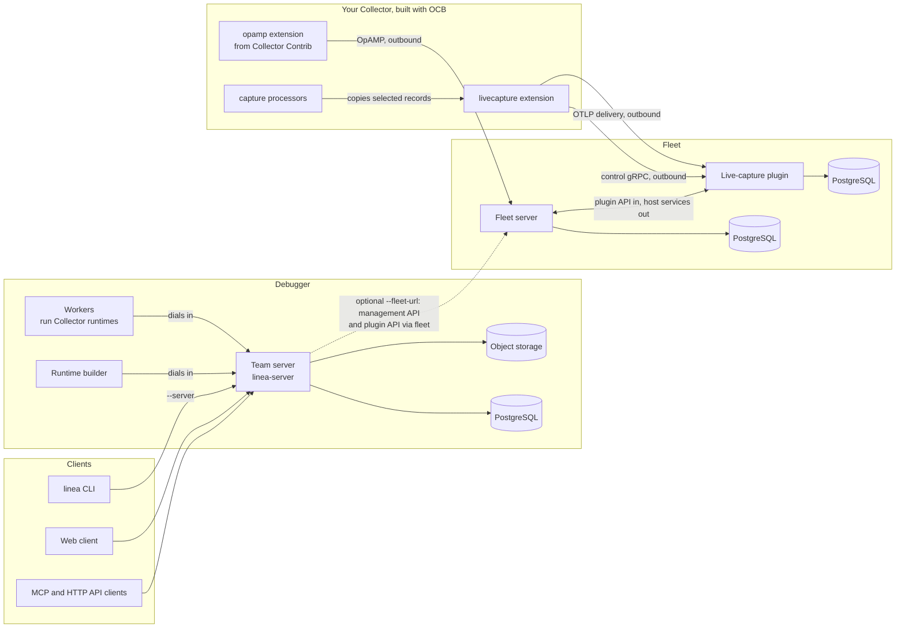

# Linea documentation

Linea is a debugger and fleet platform for OpenTelemetry Collector
pipelines. It has three parts that work alone or together:

| Part | What it does |
| --- | --- |
| **Debugger** | Runs your unchanged Collector configuration on recorded or scenario input, records what every stage did to each record, and explains the result. A CLI runs direct commands on your machine; a team server adds the web client, HTTP API and MCP, with workers that run Collector runtimes and a builder that compiles them. |
| **Fleet** | A standalone OpAMP fleet server. Collectors report to it, and it keeps their inventory, credentials and groups. Optional plugins extend it, including the live-capture plugin, which copies selected records out of running Collectors on request. |
| **Collector components** | The `capture` processor and the `livecapture` extension, which let a running Collector copy selected records when asked. |

Linea ships no Collector. You build your own with OCB and add our components
and the contrib `opamp` extension to it.

## How the parts fit together

| Connection | Behavior |
| --- | --- |
| Collectors | Only dial out: OpAMP to the fleet server, and control and OTLP delivery to the live-capture plugin. Both use the Collector's fleet agent credential. |
| Debugger to plugin | Never direct, and the debugger has no Collector-facing listener. It uses fleet's management API and the plugin's public API through fleet: it creates a capture channel, polls it for batches, and stores them in its own PostgreSQL and object storage. You then turn them into fixtures and scenarios and replay them on workers. |
| Debugger to fleet | Optional. Without `--fleet-url`, live capture is off; the debugger's Docker Compose stack has no fleet connection. |
| Workers and builder | Dial the team server. |
| CLI direct commands | `inspect`, `run`, `test` and `diff` run in process and need no server. |

## Where to go next

| Document | Topic |
| --- | --- |
| [Installing Linea](install.md) | The CLI, a team server with Docker Compose or Kubernetes, release assets and their signatures, and building from source |
| [Debugger](debugger/README.md) | Install the CLI, run and test a configuration, set up a team server, and use the web client, HTTP API and MCP |
| [Fleet](fleet/README.md) | Deploy the OpAMP fleet server with Docker, enroll Collectors, manage groups and the API |
| [Live-capture plugin](fleet/livecapture.md) | Install the plugin, connect Collectors to it and capture bounded telemetry |
| [Collector components](collector-components/README.md) | The `capture` processor and `livecapture` extension, and the [build recipe](collector-components/README.md#build-a-collector-with-the-components) for a Collector with them and the contrib `opamp` extension. Needs Collector 0.162.0 or newer. |
| [Internals](internals/README.md) | Developer notes: package map, build and test commands, and verified Collector behavior |
