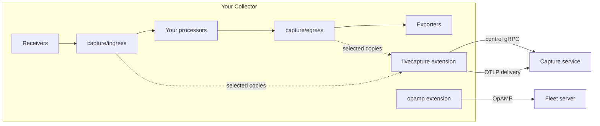

# Collector components for live capture

Two OpenTelemetry Collector components let a running Collector copy selected
telemetry to a capture service on demand:

| Component | What it is |
| --- | --- |
| `capture` processor | A pass-through processor. Each named instance, such as `capture/ingress`, is a capture point in a pipeline. |
| `livecapture` extension | Owns sessions, OTTL filters, selected-record copies, redaction, limits, an internal stock OTLP exporter and an outbound control client. Supports traces, logs and metric datapoints. |

**Linea ships no Collector.** You build your own with the OpenTelemetry
Collector Builder (OCB) and add these components to the manifest, as shown
in [Build a Collector](#build-a-collector-with-the-components). The
components are not a debugging platform. A capture service, such as the
[fleet `livecapture` plugin](../fleet/livecapture.md), starts and receives
captures.

- Both components sit inside your pipelines and never change the data that
  flows through them.
- The Collector only opens outbound connections: to the fleet server over
  OpAMP (from the `opamp` extension), and to the capture service for control
  and for delivery of the copies (from `livecapture`).
- Copies leave the Collector only over those control and delivery
  connections, never through your exporters.



## Requirements

| Item | Requirement |
| --- | --- |
| Collector | 0.162.0 or newer. Tested with 0.162.0, 0.163.0, 0.164.0 and 0.165.0. |
| OCB | The same release as your Collector modules. |
| Go | 1.26 or newer. |

`collector/livecapture/go.mod` requires the Collector modules at
`v0.162.0` (unstable) and `v1.68.0` (stable), OTTL at `v0.162.0`, and
`go 1.26.0`. Go picks the highest required version, so these are minimums,
not pins: your manifest's release wins.

- A Collector release older than 0.162.0 fails to build.
- Use OCB and all Collector modules, including the contrib `opamp`
  extension, from one release.
- For 0.163.0 and newer, add this line to the manifest's `replaces`, with
  your release. Without it the build fails with `ambiguous import:
  go.opentelemetry.io/collector/internal/statusutil`:

  ```yaml
  replaces:
    - go.opentelemetry.io/collector => go.opentelemetry.io/collector v0.165.0
  ```

This is unrelated to the debugger's runtime builder, which builds the
debugger's own runtimes for Collector 0.160.0 and later.

## Build a Collector with the components

Install OCB at your Collector release:

```sh
go install go.opentelemetry.io/collector/cmd/builder@v0.162.0
```

Add these to your OCB manifest next to the components you already use:

| Component | Module and package | Needed for |
| --- | --- | --- |
| `capture` processor | `github.com/lineahq/linea/collector/livecapture`, package `.../captureprocessor` | The capture points |
| `livecapture` extension | `github.com/lineahq/linea/collector/livecapture`, package `.../livecaptureextension` | Sessions, copies and the control and delivery connections |
| `opamp` extension | `github.com/open-telemetry/opentelemetry-collector-contrib/extension/opampextension`, same release as the Collector | Enrolling the Collector in Linea fleet |

- The `opamp` extension is independent of capture. Capture works without it,
  but fleet then does not see the Collector as an OpAMP agent and cannot
  address it by agent, group or selector.
- The OTLP exporter that delivers copies is linked into `livecapture`. Add
  `otlpexporter` only for your own pipelines.
- Each Linea release `vX.Y.Z` tags the module as
  `collector/livecapture/vX.Y.Z` and the provider SDK it requires as
  `collector/provider/vA.B.C`, so OCB fetches both like any other module.
  Use a Linea release that supports your Collector release.

```yaml
dist:
  module: example.com/otelcol-custom
  name: otelcol-custom
  output_path: ./otelcol-custom

receivers:
  - gomod: go.opentelemetry.io/collector/receiver/otlpreceiver v0.162.0
processors:
  - gomod: github.com/lineahq/linea/collector/livecapture vX.Y.Z
    import: github.com/lineahq/linea/collector/livecapture/captureprocessor
exporters:
  - gomod: go.opentelemetry.io/collector/exporter/debugexporter v0.162.0
extensions:
  - gomod: github.com/lineahq/linea/collector/livecapture vX.Y.Z
    import: github.com/lineahq/linea/collector/livecapture/livecaptureextension
  - gomod: github.com/open-telemetry/opentelemetry-collector-contrib/extension/opampextension v0.162.0
```

Replace `vX.Y.Z` with the Linea release. The receiver and exporter are
placeholders for your own. Build with `builder --config manifest.yaml`.

To build from a checkout of this repository, for example an unreleased
commit, add `path: /path/to/linea/collector/livecapture` to both
`livecapture` entries and replace the provider SDK, because a `replace` in
the component's own `go.mod` does not apply to your build:

```yaml
replaces:
  - github.com/lineahq/linea/collector/provider => /path/to/linea/collector/provider
```

- The [test-only distribution's
  manifest](../../collector/distribution/builder-config.yaml) shows the same
  entries with relative paths. It has no `opamp` extension, so it does not
  enroll in fleet.
- [Live capture in the
  debugger](../debugger/livecapture.md#a-collector-with-fleet-and-live-capture-and-a-matching-worker)
  shows how to build a replay runtime from the same components.

## Minimal configuration

Enable both extensions, add named `capture/ingress` and `capture/egress`
processors, and place them in the pipelines you want to capture from. This
connects to a Linea fleet server and its
[`livecapture` plugin](../fleet/livecapture.md). Every key exists in the
components and in the Collector's `opamp` extension. It is the fleet
[configuration fragment](../../examples/fleet-livecapture/collector-fragment.yaml)
with a pipeline around it.

```yaml
extensions:
  opamp:
    server:
      ws:
        endpoint: ${env:LINEA_FLEET_OPAMP_ENDPOINT}
        headers:
          Authorization: "Bearer ${env:LINEA_FLEET_AGENT_TOKEN}"
    agent_description:
      non_identifying_attributes:
        k8s.pod.name: ${env:POD_NAME}
        k8s.namespace.name: ${env:POD_NAMESPACE}
        k8s.cluster.name: ${env:CLUSTER_NAME}
  livecapture:
    enabled: true
    environment: production
    collector_group: ${env:OTEL_CAPTURE_GROUP}
    pod: ${env:POD_NAME}
    cluster: ${env:CLUSTER_NAME}
    namespace: ${env:POD_NAMESPACE}
    control:
      endpoint: ${env:OTEL_CAPTURE_CONTROL_ENDPOINT}
      headers:
        Authorization: "Bearer ${env:LINEA_FLEET_AGENT_TOKEN}"
      tls:
        ca_file: /certs/capture-ca.pem
    delivery:
      endpoint: ${env:OTEL_CAPTURE_DELIVERY_ENDPOINT}
      headers:
        Authorization: "Bearer ${env:LINEA_FLEET_AGENT_TOKEN}"
      tls:
        ca_file: /certs/capture-ca.pem

receivers:
  otlp:
    protocols:
      grpc:
        endpoint: 0.0.0.0:4317

processors:
  capture/ingress:
    sensitivity: raw
  capture/egress:
    sensitivity: redacted

exporters:
  debug:
    verbosity: basic

service:
  extensions: [opamp, livecapture]
  pipelines:
    traces:
      receivers: [otlp]
      processors: [capture/ingress, capture/egress]   # your processors go between them
      exporters: [debug]
```

Notes:

- Capture is disabled until a session starts. This configuration opens no
  capture listener.
- `environment: production` requires TLS on `control` and `delivery`, and
  certificate verification cannot be skipped.
- `pod` is required whenever `control.endpoint` is set.
- The agent credential needs a `capture` label that lists `collector_group`;
  see [connect existing
  Collectors](../fleet/livecapture.md#connect-existing-collectors). The
  `agent_description` attributes let fleet link the capture connection to the
  OpAMP agent.
- Repeat the two processors in the `logs` and `metrics` pipelines; one
  extension manages all signals. Pipelines named like `traces/checkout` need
  distinct processor instances with an explicit `pipeline`; see
  [configuration](configuration.md#capture-points).
- `sensitivity` labels a point `raw` or `redacted`. It does not change the
  data. It tells the extension whether to apply its redaction policy to
  copies from that point. A session may select a `raw` point only with
  elevated permission.
- Check the file with `<your collector> validate --config <file>` before you
  roll it out.

## Configure capture

[Configuration and sessions](configuration.md) covers extension and
processor settings, limits, redaction, session filters and sampling, and the
local development control.

## For contributors

Developer documentation: how the components are specified, tested and
measured. You do not need it to use the components.

| Document | Topic |
| --- | --- |
| [Control protocol](control-protocol.md) | The outbound gRPC protocol; for implementers of a capture service. Schema: [control.proto](../../api/livecapture/control/v1/control.proto), with generated Go bindings under `collector/livecapture/controlpb`, which the fleet `livecapture` plugin imports. |
| [Testing and the lab](testing.md) | Interactive Docker lab, Docker build and test commands, native development, pre-release commands |
| [Validation](validation.md) | What the automated checks cover, microbenchmarks, self-telemetry, what to validate yourself |
| [Load and failure experiments](performance.md) | The performance fixture and what it showed |
| [Testbed benchmarks](benchmarks.md) | Capture processor cost on the Collector Contrib testbed: baseline, passthrough, capture with and without a filter, and stock processors and a second exporter for comparison |
| [Design references](design-references.md) | Upstream sources and architectural choices |

Linea builds a Collector only for its own tests. The distribution in
[`collector/distribution`](../../collector/distribution/) (OCB manifest
`builder-config.yaml`, with the `linea-collector` image built from
`deploy/docker/linea-collector.Dockerfile`) is **test-only**. The Docker lab
and smoke tests use it; it is never released and Linea publishes no
Collector image. The components live under `collector/livecapture/`.
