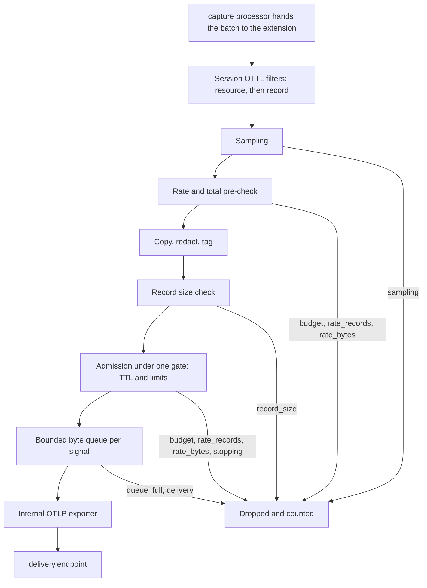

# Configuration and sessions

The extension configuration is deployment-owned.

| Rule | Detail |
| --- | --- |
| Session messages cannot change | The destination, TLS and authentication, the redaction policy, the queue and the hard ceilings |
| Default | Capture is disabled |
| Connections | Outbound only: to the control service and the OTLP capture ingress. Production opens no capture listener. |

## Extension configuration

Example fragment to merge into an existing distribution configuration:

```yaml
extensions:
  livecapture:
    enabled: true
    environment: production
    collector_group: gateways-prod
    cluster: ${env:CLUSTER_NAME}
    namespace: ${env:POD_NAMESPACE}
    pod: ${env:POD_NAME}
    control:
      endpoint: capture-control.example:443
      tls:
        ca_file: /certs/control-ca.pem
        cert_file: /certs/collector.pem
        key_file: /certs/collector-key.pem
    delivery:
      endpoint: capture-ingress.example:443
      tls:
        ca_file: /certs/ingress-ca.pem
        cert_file: /certs/collector.pem
        key_file: /certs/collector-key.pem
    limits:
      default_session_duration: 60s
      max_session_duration: 5m
      max_queue_bytes: 8MiB
      max_bytes_per_second: 1MiB
      max_records_per_second: 5000
      max_record_bytes: 64KiB
      max_total_bytes: 64MiB
      max_total_records: 100000
    redaction:
      deny_attributes: [http.request.header.authorization, db.query.text]
      max_string_length: 4096
      max_log_body_length: 16384
      masks: ['Bearer [A-Za-z0-9._-]+']
processors:
  capture/ingress:
    sensitivity: raw
  capture/egress:
    sensitivity: redacted
service:
  extensions: [livecapture]
  # Add capture/ingress and capture/egress to the existing pipeline lists.
```

| Key | Notes |
| --- | --- |
| `pod` | Required whenever `control.endpoint` is set: the control service targets and audits sessions per pod. Set it from the Kubernetes downward API, as above. |
| `control` | The Collector's `configgrpc.ClientConfig`. |
| `delivery` | The stock OTLP/gRPC exporter configuration: TLS, headers, compression and authentication extension references. Compression defaults to gzip; `snappy` or `none` cut the CPU an active session costs (see [benchmarks](benchmarks.md#where-the-cost-goes)). |
| TLS | This distribution supports mTLS directly. Other authentication extensions must be registered in the host distribution. Production connections require TLS and certificate verification cannot be skipped. |
| Secrets | Keep secret values in mounted secrets or environment providers. |

### Internal exporter

The internal exporter always overrides the queue, batching, timeout and retry
settings:

| Setting | Value |
| --- | --- |
| Queue | Nonblocking in-memory byte queue, one consumer per signal |
| Batching | 100 ms / 256 KiB |
| Attempt timeout | 1 s |
| Retries | Start at 100 ms, 5 s retry budget |

- A signal's exporter starts when the first session capturing that signal
  starts, and runs until the Collector shuts down.
- Stopping a session ends admission immediately. The session keeps
  reporting `STOPPING` until the copies already queued were exported or
  failed, at most 7 s (one flush, the attempt timeout and the retry budget),
  so the service still accepts them.
- Collector shutdown does not wait for this; it drains the queues within its
  own deadline.
- `max_queue_bytes` is split equally between the three signals, so each can
  queue a third of it. Unused capacity in one signal is not borrowed by
  another.
- There is no disk storage.
- Encoded OTLP size is the budget unit. Go object and transport overhead are
  additional memory, as described in [validation notes](validation.md).

## Capture points

Processor settings:

| Key | Default | Meaning |
| --- | --- | --- |
| `extension` | `livecapture` | The extension that manages the point |
| `pipeline` | The signal name | The pipeline the point belongs to |
| `sensitivity` | | `raw` or `redacted` |

The Collector does not pass a pipeline ID to processor factories
(verified for 0.162.0), so a named pipeline such as `traces/checkout` needs
an explicit `pipeline` and a distinct processor instance:

```yaml
processors:
  capture/checkout-ingress:
    extension: livecapture
    pipeline: traces/checkout
    sensitivity: raw
```

The reported point is `checkout-ingress`. Reusing a processor instance
across multiple pipelines of the same signal is rejected to prevent
ambiguous identity.

### Sensitivity

Sensitivity describes the point's position in your pipeline.

| | `redacted` | `raw` |
| --- | --- | --- |
| Redaction policy | Applied to copies | Not applied: nothing is removed, masked or truncated |
| Copy content | Redacted | The records exactly as the processor saw them, plus the reserved attributes |

- Selecting a raw point requires trusted elevated authorization.
- A raw record over `max_record_bytes` is dropped, never cut.

### Copies

- Copies preserve resource and instrumentation-scope context, schema URLs
  and selected record data.
- Metrics retain type, temporality, monotonicity, descriptor, metadata,
  exemplars and selected datapoints.
- Only copies receive these resource attributes. They replace input
  attributes with the same names on the copy.

| Resource attribute | Value |
| --- | --- |
| `capture.session.id` | Session ID |
| `capture.point` | Processor instance name |
| `capture.pipeline` | Pipeline ID |
| `capture.collector.pod` | Configured pod |
| `capture.cluster` | Configured cluster |

- Original pdata is forwarded synchronously and unchanged. Only downstream
  errors are returned to the pipeline.
- Capture failures are counted or terminate the session. A capture panic is
  recovered without exposing its value.

### Capture data path

Each time a capture point sees a batch, the extension walks it through these
steps while a session selects that point and signal. Without one, the call
returns at once and nothing is copied. The original data goes on to the next
processor either way.



- Records that fail a filter are not selected and are not drops. An
  evaluation error counts as no match and is reported under `filter_errors`.
- Redaction applies to redacted points only.
- A drop is counted under its reason in the session's `dropped` stats.
- The queue step drops as `queue_full` when the byte queue is full, or
  `delivery` when the exporter refuses a copy for another reason.

## Sessions

A session selects what to copy. Each pod runs at most one.

### Filters

| Rule | Detail |
| --- | --- |
| Combination | All condition lists are ANDed |
| Order | Resource conditions run first, then span, log, metric and datapoint conditions, in the standard OTTL contexts |
| Limits | At most 16 conditions per session, each at most 256 characters. The Collector reports them to the control service as `filter_limits`. |
| Functions | `IsMatch` with a literal, precompiled regex; `IsString`, `IsInt`, `IsDouble`, `IsBool`, `IsMap`, `IsList`; `TraceID` and `SpanID` literals |
| Not available | Mutation and external lookups |
| Errors | A runtime evaluation error counts as no match |

### Sampling and limits

| Topic | Behavior |
| --- | --- |
| Default sampling | 100% |
| Trace sampling | Always hashes the trace ID, consistently across pods |
| Log and metric sampling | Hash the selected content before capture tags or redaction by default; `random` is available |
| Limits | Zero or omitted limits use the configured ceilings; larger values are clamped |
| Scope of rates and budgets | Every selected signal and point together |
| Record | One span, log record or metric datapoint; two points consume two records |
| Export | At most one per processor call, grouped by resource and scope like the input |
| A limit runs out mid-call | The copy keeps the records before that point, in input order. The rest are dropped and counted under the first limit that refused them. |
| Byte budgets | Count the encoded size of what is exported and are never exceeded |

### Lifetime and updates

| Topic | Behavior |
| --- | --- |
| `expires_at`, local | Omitting it uses the configured default |
| `expires_at`, remote | An absolute RFC3339 time is required. A shorter remaining lifetime is accepted so a joining pod can participate without extending the original group session. The service creating a fresh session should enforce a 5 s minimum. |
| Identical request | Idempotent |
| Same ID, changed settings | Replaces the selection settings in place with no gap in capture. Keeps the cumulative totals and the rate window. Can bring the deadline forward, never extends it. |
| Different active session | Conflicts |
| History | Completed IDs are remembered in a bounded 64-entry in-memory history. Remote absolute expiry stops an old replay from extending capture after eviction. A restart loses the history. |

The wire-level rules for desired state are in the
[control protocol](control-protocol.md#desired-state).

## Local development control

For a development or test configuration:

```yaml
extensions:
  livecapture:
    enabled: true
    environment: development
    collector_group: development
    local_control:
      enabled: true
      endpoint: 127.0.0.1:17777
      allow_raw: false
    delivery:
      endpoint: 127.0.0.1:14317
      tls:
        insecure: true
```

This fragment still needs the existing receiver, processors, exporters and
service registration. Supply an OTLP/gRPC capture receiver at the fixed
delivery endpoint.

| Property | Detail |
| --- | --- |
| Bind | Literal loopback only. Rejected for production environments or groups containing `prod`. |
| Requests | Rejects browser Origin headers and non-loopback Host headers |
| Authentication | None. It is a development interface. |
| Docker | Loopback is inside the Collector's network namespace; publishing a container port does not make the listener host-accessible. Use a client sharing that namespace for manual container development. |
| Fixture | [collector.capture-test.yaml](../../deploy/compose/collector/config/collector.capture-test.yaml) is the complete isolated Docker fixture; `DockerTest` supplies its synthetic ingress and backend. |

The API is strict JSON: unknown fields are rejected and the body limit is
64 KiB.

| Method | Path | Result |
| --- | --- | --- |
| GET | `/v1/status` | Enabled flag, point catalog and session statuses |
| POST | `/v1/sessions` | Start or update one session; returns status |
| DELETE | `/v1/sessions/{session_id}` | Stop; returns 204 once admission has ended |

Example POST body, with `Content-Type: application/json`:

```json
{
  "session_id": "checkout-errors-001",
  "principal": "local-developer",
  "target": {"collector_group": "development"},
  "capture_points": [{"pipeline": "traces", "point": "egress"}],
  "signals": ["traces"],
  "filter": {
    "resource": ["attributes[\"service.name\"] == \"checkout\""],
    "traces": {"span": ["status.code == STATUS_CODE_ERROR"]}
  },
  "sampling": {"rate": 1, "mode": "hash"},
  "limits": {"total_records": 1000}
}
```
