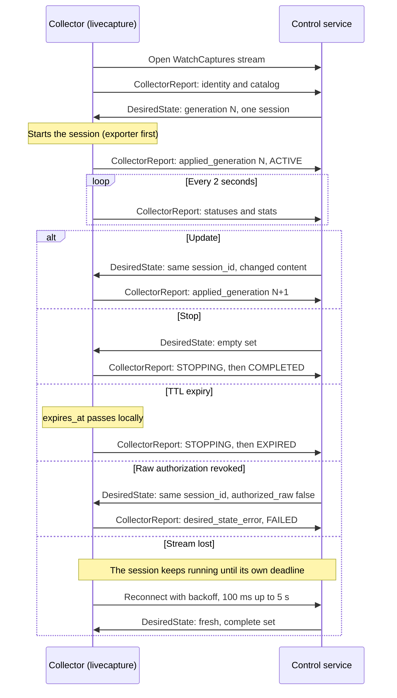

# Outbound control protocol v1

Developer documentation, for implementers of a capture service. To
configure the Collector side, see [configuration](configuration.md).

The Collector implements only the gRPC client. The external debugging
platform owns the service, authentication, RBAC, targeting and OTLP ingress.
The fleet `livecapture` plugin is one implementation.

| Item | Detail |
| --- | --- |
| Schema | [api/livecapture/control/v1/control.proto](../../api/livecapture/control/v1/control.proto); its comments are the field reference |
| Generated Go | Checked in under `collector/livecapture/controlpb`. Regenerate with `./scripts/collector/dev.sh DockerProto` (`dev.ps1` on Windows) after changing the schema. |
| Reuse | The fleet plugin imports the generated package instead of keeping a copy. A service in another repository should keep a verbatim copy of the proto file and generate its own bindings. |
| Method | `/livecapture.control.v1.CaptureControl/WatchCaptures` |
| Stream | Bidirectional, one stream per extension |
| Messages | The Collector sends `CollectorReport`, up to 1 MiB, and receives `DesiredState`, up to 64 KiB |

## A session on the stream

The Collector connects out; the service never dials in. A session lives
inside one stream, and its end is always visible in the next reports.



The `alt` branches are alternatives: each shows one thing that can happen to
an active session. A report after a desired state echoes its `generation` in
`applied_generation`, whether or not it applied.

## Reports

The first report carries the Collector's `Identity` and capture-point
catalog. Further reports follow every two seconds and right after each
desired state is processed.

| Field | Meaning |
| --- | --- |
| `identity` | Cluster, namespace, pod, collector group, versions, whether capture is enabled, the catalog, the protocol `capabilities` the Collector implements, and its `filter_limits`. `collector_version` comes from the binary's build information. |
| `sessions` | The current session, if any, followed by bounded terminal history |
| `applied_generation` | The last `DesiredState.generation` processed on this stream; 0 before the first |
| `desired_state_error` | Why that desired state was rejected; empty when it was applied |

- `filter_limits` is the largest filter the Collector compiles: 16
  conditions across every list, 256 characters each, and 256-character
  `IsMatch` patterns. The platform should refuse a larger filter before it
  targets the Collector. A Collector that omits the field applies these
  version 1 limits.
- Extensions start before processors, so the first catalog may be empty.
  Later reports list points as they register. The platform should target
  only reported points. Each catalog entry is one pipeline, point and signal.
- Reports never contain telemetry payloads.

### Session status

A `SessionStatus` carries `session_id`, `state`, `reason`, `expires_at` and
`stats`.

| Stats | Fields |
| --- | --- |
| Counts | Selected records, enqueued records, filter errors |
| Bytes | Enqueued bytes (encoded) |
| Drops by reason | `queue_full`, `rate_bytes`, `rate_records`, `record_size`, `sampling`, `stopping`, `delivery`, `budget` |

States: `ACTIVE`, `STOPPING`, `COMPLETED`, `EXPIRED`, `LIMIT_REACHED`,
`FAILED`, `DISABLED`. An ending session stays `STOPPING` until its queued
copies left the delivery queue (at most 7 s), so a terminal state means the
Collector sends nothing more for it.

A session is activated only after its exporter has started. If the exporter
fails to start, the session is reported as `FAILED`.

## Desired state

Each `DesiredState` is the complete set of sessions for this Collector. The
service numbers them with an increasing `generation` per stream and sends a
fresh one after every connection and on every change. A typical session:

```text
session_id: "example-unique-id"
principal: "authenticated-engineer"
target { collector_group: "gateways-prod" }        # empty pod: the whole group
capture_points { pipeline: "traces" point: "ingress" }
signals: SIGNAL_TRACES
filter { span: "status.code == STATUS_CODE_ERROR" }
sampling { rate: 0.1 mode: SAMPLING_MODE_HASH }
limits { total_records: 1000 }                      # zero: the Collector maximum
expires_at { seconds: ... }                         # required, absolute
authorized_raw: true
```

- The platform authenticates the principal and sets `authorized_raw` from
  its RBAC decision. The user's own request never sets it, and the local
  HTTP API cannot grant it.
- The control transport must authenticate the service, normally with mTLS as
  shown in [configuration](configuration.md#extension-configuration).
- A group session is the same session delivered to every matching pod. Each
  pod keeps its own budgets.

Each pod runs at most one session. When a desired state arrives:

| Case | Result |
| --- | --- |
| Empty set | Stops the current session |
| New ID | Stops the old session, then starts the new one |
| Same ID, same content | Nothing changes; the exporter is not restarted |
| Same ID, changed content | Updated in place with no gap in capture. Keeps cumulative budgets and counters. Can bring the deadline forward, never extends it. |
| Rejected update to a running ID | Stops that session as `FAILED`. Includes revoked raw authorization. |
| `disabled` | Stops admission immediately, even when the rest of the message is invalid. `false` enables capture only if the Collector's configuration permits it. |

Rejections:

- A rejected desired state does not close the stream. The next report echoes
  its generation in `applied_generation` and the reason in
  `desired_state_error`.
- A session that could not be started also appears in `sessions` as
  `FAILED`, with the reason.
- A message that cannot be converted, such as one with an unknown signal or
  sampling mode, stops the current session.
- A message that lists more than one session is rejected and leaves the
  current session running.

## Evolution

- Each side ignores fields it does not know.
- When an older Collector ignoring a new field would be unsafe, the service
  lists the capability that introduced it in `required_capabilities`. A
  Collector that lacks any listed capability rejects the whole desired state
  and reports why. Version 1 defines no capabilities.
- Enum values a side does not know are treated as invalid, never guessed.

## Connection lifecycle

- Reconnect backoff starts at 100 ms and is capped at five seconds.
- Disconnecting keeps the running session until its existing local deadline.
  A disconnect is not treated as an empty desired set and never extends the
  TTL.
- Remote sessions must carry an absolute expiry, and requests that have
  already expired are rejected.
- A terminal session ID is never reactivated while it stays in the bounded
  local history, so the platform must generate a new ID for each new
  capture.

`Manager.Reconcile` and `AuthorizedRequest` are the transport-independent
control entry point. `AuthorizedRequest.Proto` converts a session to its wire
form. Another transport, such as an OpAMP adapter, can use them without
changes to capture consumers.
