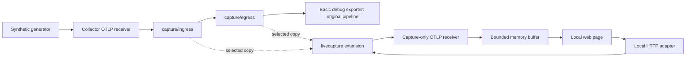

# Testing and the interactive lab

Developer documentation. Everything here uses the test-only distribution in
`collector/distribution/` (OCB manifest `builder-config.yaml`) and the
`linea-collector` image built from `deploy/docker/linea-collector.Dockerfile`.
They exist for the Docker lab, CI and smoke tests. Linea never releases
them: users build their own Collector, as described in the
[README](README.md#build-a-collector-with-the-components).

## Interactive lab

Start with Docker Desktop using Linux containers. No host Go, Node,
frontend framework or external backend is needed. The first build downloads
the pinned Go dependencies.

```sh
./scripts/collector/dev.sh DockerLab
```

```powershell
./scripts/collector/dev.ps1 DockerLab
```

Open [http://localhost:8080](http://localhost:8080). The generator starts
automatically; capture starts off.

The lab uses two containers: the real Collector and a small Go test helper.
The helper provides:

- the generator
- a capture-only OTLP/gRPC receiver
- an HTTP adapter to the extension's development API
- the embedded HTML/JavaScript page



- The helper shares the Collector's Docker network namespace. The OTLP
  input, capture receiver and extension control stay on literal loopback
  addresses. Only the web page is published to the host, at
  `127.0.0.1:8080`. This preserves the extension's localhost-only
  development API without changing product code.
- The normal pipeline ends at the stock debug exporter with basic
  verbosity, printing counts rather than payloads. Its output never enters
  the web buffer.
- The capture receiver requires `capture.session.id`, `capture.point` and
  `capture.pipeline`; untagged input is rejected with OTLP partial-success
  counts. It supports traces, logs and metrics and decodes captures with
  pinned pdata APIs.

### Try it

1. Watch the **Generator → Collector** counter grow while capture is off.
   The captured-data table stays empty on a fresh setup.
2. Click **Start capture**. By default all three signals are captured at
   ingress and egress for 60 seconds. One generated sample produces three
   original records and up to six captured copies.
3. Select a row. The JSON inspector shows official OTLP JSON: resource,
   scope, record fields and capture tags. The generator adds fake
   authorization and SQL attributes to its input; the extension removes them
   from every copy.
4. Click **Stop**. The generator keeps feeding the original pipeline.
   Existing captures stay visible; **Clear** removes the viewer's buffer.
5. Choose a service, **Errors only**, a signal or point subset, or a
   sampling percentage, then start a new session. These controls produce
   real session filters, not browser-side substitutes. Duration is between 5
   and 300 seconds.
6. Let the countdown reach zero to test local expiry. **Pause view** only
   pauses browser updates; **Pause generator** controls input independently.

The page's signal dropdown and search box filter already captured rows
locally. The controls in the left panel change what the extension captures.
The inspector keeps capture metadata visible to help compare points. The two
default points have no modifying processor between them, so record data
should match apart from capture tags. Add your own processors between them
in [collector.lab.yaml](../../deploy/compose/collector/config/collector.lab.yaml)
to test before/after behavior.

### Custom OTTL

Expand **Custom OTTL filters** before starting a session.

- Enter one condition per line in the matching resource, span, log, metric
  or datapoint context. A true condition includes the record.
- All supplied conditions and quick filters are ANDed; use `or` inside a
  condition for alternatives. Empty fields add no filter.
- Signal-specific conditions require that signal to be selected.
- Conditions use the Collector's context-specific OTTL paths, with read-only
  functions such as `IsMatch`, `IsString` and `IsInt`. The Collector
  compiles them on Start and shows syntax errors in the page; expressions
  are never evaluated in the browser.
- Limits: 16 conditions total (including presets), 256 characters per
  condition, 256 characters for a literal regex pattern.

Examples:

| Goal | Context | Condition |
| --- | --- | --- |
| One service | Resource | `attributes["service.name"] == "checkout"` |
| Matching spans | Span | `IsMatch(name, "POST.*checkout")` |
| Error logs (select Logs) | Log | `severity_number >= SEVERITY_NUMBER_ERROR` |

### Synthetic traffic

| Property | Value |
| --- | --- |
| Services | Rotates `checkout`, `inventory` and `billing` |
| Per sample | One span, one log, one gauge datapoint |
| Errors | Every fifth sample: an error span, an ERROR log and a metric point with HTTP status 500 |
| Rate | Five samples per second per signal by default; the control allows 1-100 |
| Pausing | In-flight requests can complete after pausing |

The service/error combination matches periodically, so a filtered capture
can take a few seconds to show its first record.

### Commands and verification

```sh
./scripts/collector/dev.sh DockerLab          # Build and start in the background
./scripts/collector/dev.sh DockerLabCheck     # Exercise the running setup
./scripts/collector/dev.sh DockerLabDown      # Stop and remove its containers
./scripts/collector/dev.sh DockerTest         # Race tests, vet, and Collector smoke checks
```

```powershell
./scripts/collector/dev.ps1 DockerLab
./scripts/collector/dev.ps1 DockerLabCheck
./scripts/collector/dev.ps1 DockerLabDown
./scripts/collector/dev.ps1 DockerTest
```

Equivalent Compose commands:

```sh
docker compose -f deploy/compose/collector/compose.lab.yaml up --build -d
docker compose -f deploy/compose/collector/compose.lab.yaml exec -T lab /testlab -check
docker compose -f deploy/compose/collector/compose.lab.yaml logs --tail=50
docker compose -f deploy/compose/collector/compose.lab.yaml down
```

- The automated lab check stops any current test capture and clears the
  viewer, then verifies off/on/stop, all signals at both points, redaction,
  service/error filters and automatic expiry. It finishes with capture off
  and generation on at five samples/second/signal. Sample captures remain
  available for inspection.
- The main Docker test command includes race-enabled tests and vet for the
  helper's own Go module. Before a release, also start the Compose lab and
  run its end-to-end check.

### Memory and lifetime

| Topic | Detail |
| --- | --- |
| Persistence | None: no database |
| Receiver buffer | At most 500 entries and 8 MiB of encoded OTLP JSON, evicting the oldest. A single entry over 512 KiB is refused. |
| Metric entries | One entry can hold several selected datapoints if the stock exporter merged them. The received counter counts datapoints, not entries. |
| Browser | Retains at most 500 entries. An individually selected record can remain in the inspector while older rows are evicted. |
| Counters | Cumulative for the helper process; clearing the buffer does not reset them |
| Eviction and refusals | Reported by the web page |
| Pausing the view | Does not pause capture; can miss older entries once the buffer fills |
| Restarts | Restarting the helper clears its memory. Restarting the Collector ends its active session. |

The lab handles synthetic data locally and provides no platform
authentication, long-term storage or production viewer. It uses the
extension's development permission for raw points, whose copies are not
redacted. The test distribution's runtime image contains neither the test
helper nor its UI.

## Build and test with Docker

Docker Desktop must use Linux containers. Host Go is optional. First builds
need internet access; later test containers use dependencies materialized in
the test image.

```sh
./scripts/collector/dev.sh DockerBuild
./scripts/collector/dev.sh DockerTest
./scripts/collector/dev.sh DockerRun
```

```powershell
./scripts/collector/dev.ps1 DockerBuild
./scripts/collector/dev.ps1 DockerTest
./scripts/collector/dev.ps1 DockerRun
```

| Command | What it does |
| --- | --- |
| `DockerBuild` | Regenerates the test distribution with OCB, checks tracked generated sources and dependency locks, and builds `linea-collector:dev` (local only) |
| `DockerTest` | Runs component tests under the race detector, vet, configuration validation and two Collector integration scenarios. Repeats the scenarios in the static runtime image as UID 10001 with a read-only filesystem. Fixtures publish no ports and have no external network access. |
| `DockerRun` | Runs [collector.local.yaml](../../deploy/compose/collector/config/collector.local.yaml): capture disabled, synthetic telemetry printed by the debug exporter. OTLP ports are published only at `127.0.0.1:4317` and `127.0.0.1:4318`. Ctrl+C stops it. |
| `DockerDown` | Removes project containers |
| `DockerSmoke` | Runs the baseline runtime smoke alone |
| `DockerPerf` | Isolated load and failure experiments; see [performance](performance.md) |
| `DockerProto` | Regenerates the Go bindings after a `control.proto` change |

Use `./scripts/collector/dev.sh <Command>` (`dev.ps1` on Windows).

The smoke tests:

- **Baseline:** sends traces, logs and metrics over OTLP/HTTP JSON and gRPC.
- **Active:** starts a session on a running Collector, captures all three
  signals at ingress and egress, checks redaction and tags, stops capture,
  and checks byte-identical backend telemetry before, during and after
  capture.
- Package tests also exercise byte-queue overflow, ingress outage, TTL
  during control reconnects, authorization revocation, filter errors, panic
  isolation, updates and ownership.

The same checks with Docker Compose, run before a release:

```sh
docker compose -f deploy/compose/collector/compose.yaml build collector
docker compose -f deploy/compose/collector/compose.yaml --profile test run --build --rm tests
docker compose -f deploy/compose/collector/compose.yaml --profile test run --build --rm smoke
docker compose -f deploy/compose/collector/compose.yaml --profile test run --build --rm capture-smoke
```

The test distribution pins OCB and the unstable Collector modules to
`v0.162.0`, the stable modules to `v1.68.0`, and Docker Go to `1.27.3`.
Both component modules require Go 1.26 or newer. These pins are for the
tests; they are not requirements for your own Collector (see the
[README](README.md#requirements)).

## Native development

With Go and Git installed, `./scripts/collector/dev.sh Setup` (`dev.ps1` on
Windows) installs pinned OCB under `.tools/bin`.

| Command | What it does |
| --- | --- |
| `Setup` | Installs pinned OCB under `.tools/bin` |
| `Build` | Regenerates and builds the test distribution |
| `Validate`, `Test`, `Race`, `Smoke`, `Run` | Also available |
| `Testbed` | Capture processor benchmarks on the Collector Contrib testbed; see [testbed benchmarks](benchmarks.md) |

- Race checks require CGO and a C compiler, supplied by the Docker
  workflow.
- Native scripts temporarily use local Go caches and restore the caller's
  environment.
- Generated Collector sources are tracked under `collector/distribution/`;
  the implementation lives under `collector/livecapture/`.
