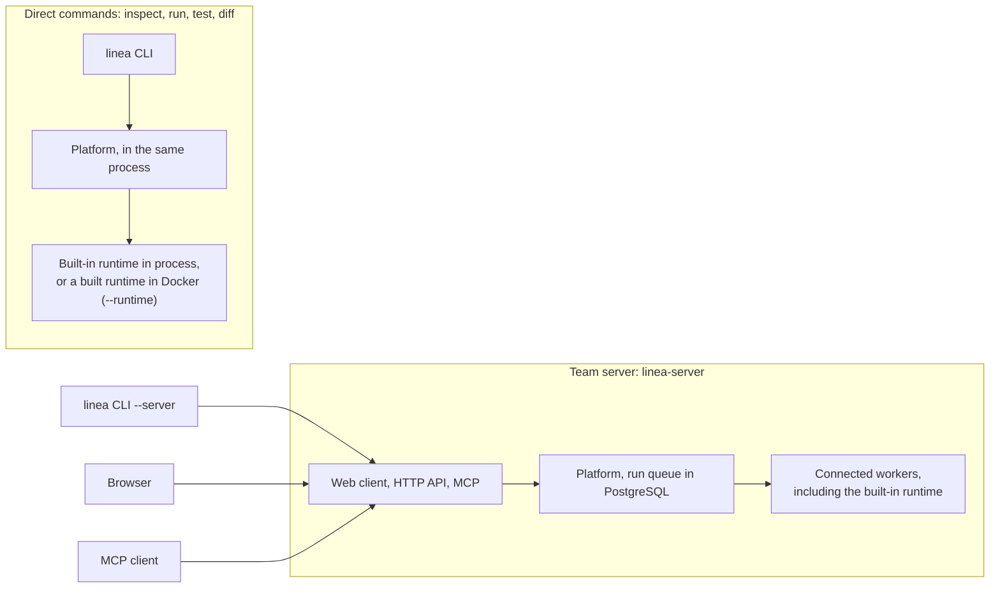
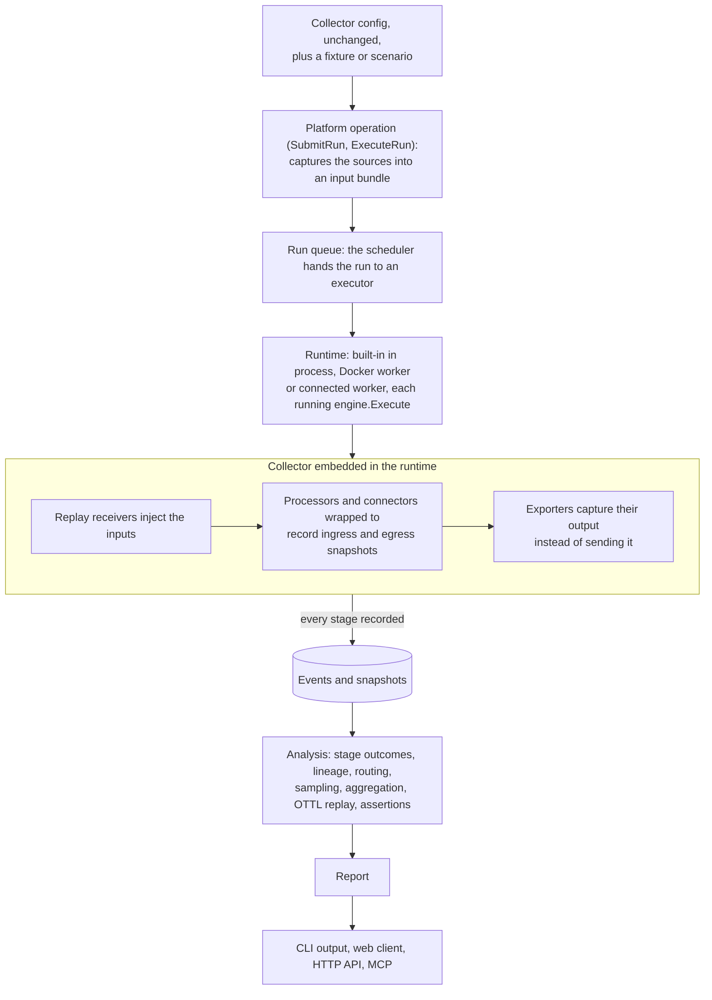

# Linea debugger

Debugger and regression-test engine for OpenTelemetry Collector pipelines. It
runs your unchanged Collector configuration on a fixture or a scenario and
records what every processor and connector did. It then explains the result
through a CLI, a web client, an HTTP API and an MCP server for AI assistants.

| Interface | Runs | Needs |
| --- | --- | --- |
| Direct CLI commands (`inspect`, `run`, `test`, `diff`) | On your machine, in the CLI's process | The `linea` binary and a Collector configuration |
| Web client, HTTP API, MCP, `linea --server` | On a [team server](team-server.md), run with Docker Compose or Kubernetes | A running team server |



## What you need

For the direct commands: the `linea` binary and a Collector configuration. No
Docker and no server. Download it from the [releases
page](https://github.com/lineahq/linea/releases) or build it as below;
[Installing Linea](../install.md) covers every way to install it.

| Add | For |
| --- | --- |
| Docker | A team server with Docker Compose, and building runtimes for other Collector releases or custom components |
| Git, Go 1.27 or later, Node.js with pnpm | Building from source only. Use a POSIX shell (sh or bash) on Linux and macOS, or PowerShell 5.1 or later on Windows. Every developer script has a `.sh` and a `.ps1` form. |

The built-in runtime pins the OpenTelemetry Collector release line to
`v0.162.0`. Do not mix component versions: instrumentation fidelity depends on a
single, reproducible release line. Other releases (0.160.0 and later) and custom
components run in [runtimes](runtime-builds.md) built in Docker, or in a
[CLI of your own](custom-cli.md) built with `linea build`.

## Install or build

A release publishes `linea` archives for Linux, macOS and Windows, and the
container images the [team server](team-server.md) runs from. `linea version`
prints the release; a build that is not a release prints `0.0.0-dev`.

To build from source, from the repository root:

```sh
./scripts/build-web.sh --binary      # writes dist/linea-server
```

```powershell
./scripts/build-web.ps1 -Binary      # writes dist/linea-server.exe
```

The script installs the locked web dependencies, runs the web tests and builds
the web client, which `go build` embeds. With `--binary` it then builds
`linea-server`, the team server with the client embedded. To do the steps
yourself:

```sh
pnpm --dir web install --frozen-lockfile && pnpm --dir web build
go build ./cmd/linea-server
go generate ./internal/debugger/workersrc
go build ./cmd/linea
```

A `linea` built without `go generate` for `workersrc` cannot build runtimes.
The web client is only needed for `linea-server`, which links no Collector.

`build/linea-runtime.yaml` is the source-controlled OCB manifest of the built-in
component set:

| Kind | Components |
| --- | --- |
| Receivers | OTLP, filelog |
| Exporters | OTLP, OTLP/HTTP, debug, nop |
| Processors | 15, among them transform, filter, batch, tail_sampling, k8sattributes |
| Connectors | count, forward, routing, spanmetrics |
| Extensions | eight common ones |

`internal/debugger/registry` is generated from the manifest (`go generate
./internal/debugger/registry`). To compile the standalone debug Collector into
the untracked `dist/linea-runtime/`:

```sh
./scripts/install-tools.sh
./scripts/build-collector.sh         # --generate-only writes the source only
```

```powershell
./scripts/install-tools.ps1
./scripts/build-collector.ps1        # -GenerateOnly writes the source only
```

## Commands

| Command | Purpose |
| --- | --- |
| `inspect --config <yaml>` | Validate a configuration and show pipelines, components and their execution modes. |
| `run --config <yaml> (--fixture <json> \| --scenario <yaml>)` | Replay telemetry and print the report. |
| `test --config <yaml> (--scenario <yaml>... \| --tests <dir>)` | Evaluate scenario assertions, optionally writing `--report junit.xml` or `report.json`. |
| `diff --before <yaml> --after <yaml> (--fixture \| --scenario)` | Run two configurations on one input and compare their outputs. |
| `upgrade-check --config <yaml> --to <runtime>` | Check a configuration and its scenarios on another Collector release. |
| `config-bisect --agent <id> (--scenario <yaml>... \| --tests <dir>) --server <url>` | Find the fleet config version that made the scenarios fail on a managed agent, through a team server; only the server holds a fleet credential. |
| `fleet <command> --server <url>` | Manage fleet's agents, groups, configs, assignments and rollouts through a server's fleet connection (`fleet --help` lists the commands). Output is JSON. |
| `runs --server <url> [--scenario <name>] [--runtime <name>] [--result <result>] [--limit <n>] [--cursor <c> \| --all]` | List a page of a server's runs, newest first, with scenario, runtime, result and assertion counts; `--all` follows every page. Subcommands (`runs show`, `log`, `cancel`, `summary`, `evidence`, `delete`, `prune`, `storage` and more; `runs -h`) read or manage one run. |
| `suite rerun --server <url> --suite <id>` / `suite junit --server <url> --suite <id> --out <xml>` | Rerun a server suite from its members' recorded inputs and print its report like `test`, or write a finished suite's JUnit XML. |
| `artifacts list\|show\|save\|revisions\|export\|import --server <url>` | List and save a server's configurations, fixtures and scenarios and their revisions; `export` writes the "Export for CI" archive and `import` reads one back. |
| `samples [--server <url>]` / `samples get <id> [--dir <dir>]` | List the samples that ship with Linea (`samples/`), or write one to disk (by default to a directory named after it) and print the commands that run it. |
| `ottl preview --config <yaml> --processor <id> --input <json>` | Preview a transform processor's statements on an input. A preview is never verified against a Collector run. |
| `statement candidate\|test` | Validate a proposed configuration or one statement edit, or test it on a server run's recorded inputs. |
| `export --server <url> --run <id> --out <yaml>` | Write a server run as a reviewable scenario file for CI. |
| `audit --server <url> [--principal <id>] [--operation <name>] [--outcome allowed\|denied] [--since <time>]` | Page a server's audit log, newest first: who did what, through which interface, allowed or denied. Needs `audit.read`. |
| `runtime build\|list\|rm\|push\|import\|register\|...` | Build runtimes (debug Collectors) in this machine's Docker and manage them; `register` records a pushed image in a team server's catalog. A worker connects itself to the server. |
| `capture ...` | Discover live Collectors and control bounded captures. |
| `token create\|list\|revoke --server <url>` | Create, list and revoke a team server's API tokens; `create` prints the secret once, for `$LINEA_TOKEN`. |
| `access list\|grant\|revoke --server <url>` | List a team server's role bindings, and grant or revoke the ones it manages beside the server config. Needs `access.manage`. |
| `project list\|create\|update\|archive\|unarchive --server <url>` | List a team server's projects, and create, change or archive one. Changes need `project.manage`. |
| `library list\|publish\|share\|copy --server <url>` | List the library shared with `--project`; publish saved work to it and choose who it is shared with (`library.publish`), or copy an item into a project. |
| `login --server <url> [--ca <pem>]` / `logout --server <url>` | Sign in to a team server's identity provider with the device flow, or forget the sign-in; later `--server` commands present it and trust the kept `--ca`. |
| `build --manifest <yaml> [--docker] [--os <os> --arch <arch>]` | Compile a `linea` CLI whose in-process Collector has the manifest's release and components ([A CLI with your components](custom-cli.md)). |
| `version` | Show debugger, Collector, schema and component versions. |
| `completion bash\|zsh\|fish\|powershell` | Print a shell completion script for commands, subcommands, flags and flag values ([shell completion](#shell-completion)). |

The team server is a separate binary, `linea-server --config <file> [--addr <host:port>] [--tls-cert-file <pem> --tls-key-file <pem> | --allow-http] [--mcp]`: web client, HTTP API and optionally MCP, every request authenticated and authorized by role bindings, on connected workers only (it links no Collector). `linea-server` without `--config` is refused. See [team server](team-server.md).

Run `linea <command> -h` for flags. `inspect`, `run`, `test` and `diff`:

- run in this process by default (direct commands);
- take `--server <url>` to run on a team server. The CLI then reads the scenario
  and the files it names on your machine and sends them inline, so the server
  needs no access to them;
- take `--runtime <name>` to run on a built runtime.

### Output

Text output is plain text for people and language models alike. It starts
with the verdict (`PASS`, `FAIL`, `VALID`, `COMPLETED` and so on), followed
by sections under capitalized headings such as `WARNINGS`, `INPUTS`,
`OUTPUTS`, `ASSERTIONS` and `STAGES`. Single facts are `key: value` lines,
lists are aligned columns, and nothing is wrapped or truncated. A run report
keeps its event log for last, under `EVENTS`. An empty list prints `no runs`
(or `no builds`, `no captures` and so on), and a list with more pages ends
with `next page: --cursor C`. Color appears only on a
terminal, never when `NO_COLOR` is set, and only marks what the words
already say, so a pipe or a file gets the same text without escape codes.
`--format json` is the stable machine format; scripts should read it
rather than the text.

### Shell completion

`linea completion <shell>` prints a script that completes commands,
subcommands, flags, the values of flags with fixed choices (such as
`--format`) and file names for file flags. Load it in your shell, or add the
line to your profile:

```sh
source <(linea completion bash)          # ~/.bashrc
source <(linea completion zsh)           # ~/.zshrc, after compinit
linea completion fish | source           # ~/.config/fish/config.fish
```

```powershell
linea completion powershell | Out-String | Invoke-Expression   # $PROFILE
```

The script asks the `linea` on your `PATH`, so completions always match
its flags.

| Exit code | Meaning |
| --- | --- |
| 0 | Success, pass or same; `config-bisect` found the breaking version. |
| 1 | Usage, configuration or runtime error. Includes an invalid configuration under `inspect` and an assertion error under `test`. |
| 2 | The reference comparison differed (`run`), the runs differ (`diff`), or the configuration breaks or behaves differently (`upgrade-check`); `config-bisect` found no regression, or the good bound already fails. |
| 3 | An assertion failed. |
| 4 | Inconclusive, for example because the run did not complete. |

## Try it

The CLI ships ready-made configurations, each with its input and a scenario
with assertions. `linea samples` lists them, `linea samples get <id>` writes
one to disk, and the web client offers them too. In a checkout they are in
`samples/`.

```sh
linea samples get traces-redact
linea inspect --config traces-redact/config.yaml
linea test --config traces-redact/config.yaml --scenario traces-redact/scenario.yaml
```

Add `--runtime <name>` to run on a [built runtime](runtime-builds.md) instead of
the built-in one. With `go run ./cmd/linea` in place of `linea`, the same
commands run from a checkout.

## Replay a fixture

```sh
linea run --config traces-redact/config.yaml \
  --fixture traces-redact/input.json --compare
```

The debugger runs the unchanged configuration on a runtime: the built-in one
in the CLI's process, a built runtime in Docker, or a connected worker. Each
runtime embeds the Collector in its own process, with no separate Collector
binary. It injects the fixture where the receiver would deliver data, captures exporter
output locally without using the network, and records processor ingress and
egress snapshots.



| Flag | Effect |
| --- | --- |
| `--compare` | Also runs an uninstrumented reference Collector over loopback OTLP and checks that the final telemetry is identical. |
| `--format text\|json` | Text or the full JSON report. Without it, `run` prints text on a terminal and JSON otherwise, so a pipe or a file gets JSON. |
| `--normalize` | Makes the report reproducible: run IDs and times are fixed, so repeated runs give identical bytes. |

Every report records its provenance and the runtime it ran on: versions,
component modules, input hashes and environment variable names, never their
values. The report also contains:

- per-processor stage outcomes with structural diffs, and per-record lineage
  through processors, connectors and aggregations;
- batch emissions reconciled against the batch input;
- a statement-by-statement OTTL replay of each transform processor, marked
  `replay_verified` only when it reproduces the processor's actual output;
- explanations of routing rules and tail_sampling decisions, of why each
  batch or queue_batch processor sent when it did, of how groupbyattrs regrouped each
  record into its resource, and of which filter condition dropped each
  record;
- recommendations: work the run shows was avoidable (a filter condition or
  OTTL statement that never matched, a processor that changed nothing), batch
  settings the input never reached, and orderings that risk data, each with
  its evidence, whether it keeps the exported data the same, what it would
  save as a share of the run's work, and what the input did not cover. They
  are suggestions; nothing changes your configuration. On request
  (Verify on a recommendation in the web client,
  `linea run --verify-recommendations`, or over HTTP or MCP; try
  `samples/filter-order`), a suggested processor order runs on the same input and the output is
  compared with the run's, with the work it saved measured before and after;
- mocked dependencies and stand-ins: components outside the distribution, and
  references with no value supplied.

A scenario declares inputs, environment values, mocks and assertions separately
from the Collector configuration:

```sh
linea run --config traces-redact/config.yaml \
  --scenario traces-redact/scenario.yaml --compare
```

## Web client, HTTP API and MCP

These belong to the team server. `linea-server` always serves one, composed by a
server config (`--config`); there is no single-process mode. The config, not
where the server runs, decides how people sign in, where it listens and what it
keeps. The Docker Compose stack runs it on one machine: two instances behind a
load balancer, PostgreSQL, object storage, a pool worker that runs the built-in
runtime, and a runtime builder. Nothing needs registering.

The stack is one file, `deploy/compose/linea/compose.yaml`, and a `.env`
beside it with five random values and the sign-in mode. `LINEA_AUTH=local`
is one admin on `127.0.0.1` with no sign-in; `oidc` and `proxy` serve a team
([sign-in](deploy-compose.md#sign-in)). In a directory holding the file from
a release's tag:

```sh
for name in POSTGRES_PASSWORD S3_ACCESS_KEY S3_SECRET_KEY WORKER_TOKEN BUILDER_TOKEN; do
  echo "LINEA_$name=$(openssl rand -hex 32)"
done > .env
echo LINEA_AUTH=local >> .env
docker compose up -d
```

This pulls the published images of that release. To build them from a
checkout instead, put `.env` in `deploy/compose/linea/` and run
`LINEA_VERSION=dev docker compose -f deploy/compose/linea/compose.yaml up -d --build`
from its root.

| Endpoint | Address |
| --- | --- |
| Web client | `http://127.0.0.1:7070` |
| MCP | `http://127.0.0.1:7070/mcp` |
| CLI | `--server http://127.0.0.1:7070` |

These are the defaults; `.env` sets another address, port and TLS. See
[deploy-compose.md](deploy-compose.md), or the [Kubernetes
chart](deploy-kubernetes.md) to run it on a cluster. Each instance serves, on one listener
and one platform:

- the web client: an editor, the pipeline graph, record changes, journeys and
  run comparison;
- the HTTP API under `/api/v1`, whose contract is
  `internal/debugger/api/openapi.json`;
- with `--mcp`, an MCP server at `/mcp`; clients present an API token.

A team server keeps saved configurations, fixtures and scenarios and the
evidence of each run in PostgreSQL and object storage across restarts. Each
run's inputs are captured as a private execution bundle. After a restart, an
unfinished run with a bundle is scheduled again; one without a bundle is marked
interrupted. The CLI's direct commands keep no run history.

No command reads the host environment on its own. `${env:NAME}` takes, in order:

1. the scenario's `environment` value;
2. a host value, only when a direct command imports it with `--import-env NAME`;
3. the reference's default;
4. otherwise a stand-in value.

A team server never reads its host environment or host files for a request. See
[artifact storage](../internals/artifact-storage.md) and [execution
bundles](../internals/execution-bundles.md).

## Regression tests

Scenarios can declare assertions about counts, drops and attributes at a captured
exporter, a processor instance or a simulated endpoint:

```yaml
assertions:
  - target: {exporter: otlp/backend, signal: logs}
    count: {equals: 1}
    attributes:
      absent: [user.password]
  - target: {processor: filter/health, pipeline: logs, signal: logs}
    dropped: {equals: 1}
```

```sh
linea test --config config.yaml --tests scenarios/ --report junit.xml
```

- `--tests` runs every `*.yaml` and `*.yml` file of a directory, in name order.
- `--report` also writes the report to a file: JUnit XML for `.xml`, JSON for
  `.json`.
- Failures show the expected and observed values, the offending record locations
  and the record counts per stage. See
  [`assertions.md`](../internals/assertions.md).

### Export a regression scenario for CI

Export a run from a team server as a reviewable scenario file, then run it in CI
with the ordinary `test` command:

```sh
linea export --server http://127.0.0.1:7070 --run <run-id> --out regression.scenario.yaml
linea test --config config.yaml --scenario regression.scenario.yaml --report junit.xml
```

Review the file before you commit it, because its inputs and mock files are
recorded telemetry, stored inline. Its header names the source build and the
environment variables CI must set. The export never contains their values, the
configuration or files captured by providers. See the [CI recipe](ci.md).

### Compare configurations in a pull request

```sh
linea diff --before base-config.yaml --after config.yaml \
  --scenario regression.scenario.yaml --format markdown
```

`--ignore PATH` counts the differences at an OTTL path without making the runs
different. `diff --server URL --runs A B` compares two runs of a team server; the
web client's "Compare runs" view shows the same result. See [Collector checks in
CI](ci.md) and [`examples/ci/github-actions.yml`](../../examples/ci/github-actions.yml).

## Good to know

- Linea never modifies your Collector YAML. Generated plans and fixtures are
  kept separate.
- The built-in runtime has no remote configuration providers: only `env`, `file`
  and `yaml`.

## More documentation

| Page | Covers |
| --- | --- |
| [Glossary](glossary.md) | The words the interfaces show |
| [Running a team server](team-server.md) | The server config, role bindings, projects and the library, sign-in, API tokens and what a team server refuses |
| [Docker Compose](deploy-compose.md) | A team server with two instances, PostgreSQL, object storage and a worker on one machine, configured by `.env` |
| [Kubernetes](deploy-kubernetes.md) | The server image and the Helm chart |
| [Collector checks in CI](ci.md) | `test` and `diff` in a pipeline, with their exit codes and the GitHub Actions example in `examples/ci/` |
| [Building debug Collectors](runtime-builds.md) | Runtimes for another verified release or your own component modules: supported releases, manifests from the catalog, module sources; `upgrade-check` compares one configuration on two runtimes |
| [A CLI with your components](custom-cli.md) | `linea build`: one `linea` binary whose in-process Collector has a manifest's release and components, for machines without Docker, CI and air-gapped hosts |
| [Running workers](remote-workers.md) | Run a runtime's worker where you deploy it, such as Kubernetes (`examples/kubernetes/`). The worker dials a team server with a registration token, so it needs no Service, gateway or kubeconfig access. |
| [The provider SDK](provider-sdk.md) | Lets a component module drive its components during a run (a session, a control service) and declare what it did, compiled into runtimes built with the module |
| [Live capture](livecapture.md) | Discover running Collectors through the fleet server's `livecapture` plugin, capture a bounded amount of telemetry and turn it into fixtures and scenarios, across web, CLI, HTTP and MCP |
| [docs/internals](../internals/README.md) | Developer documentation: the package map, every build and test command, notes on bundles, environment bindings, host reads and Collector internals. Contributor rules are in [CONTRIBUTING.md](../../CONTRIBUTING.md). |
