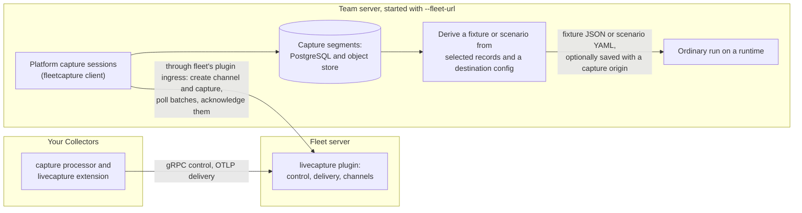

# Livecapture integration

Linea can replay configurations that use the `capture` processor and the
`livecapture` extension offline. It can also capture live telemetry through the
linea-fleet server's `livecapture` plugin: Collector discovery, bounded capture
controls, inspection of the telemetry received, storage and turning a capture
into inputs, through the web client, CLI, MCP and HTTP.

To capture live data you need:

- a running [fleet server](../fleet/livecapture.md) with the `livecapture`
  plugin;
- Collectors that enroll in it and run the components;
- a team server started with `--fleet-url` ([Connecting to
  fleet](#connecting-to-fleet)).

The debugger is a fleet client: fleet owns Collector connections, credentials,
groups, the raw-capture permission and the capture lifecycle. The debugger
selects Collectors, asks fleet to capture and stores the records fleet delivers.
Collectors run the unmodified `capture` processor and `livecapture` extension.



The Collectors deliver to the plugin, the debugger reaches it only as a client of
fleet, and the derived fixture or scenario is replayed like any other input.
How storage, receiving and derivation work:
[live capture internals](../internals/debugger-livecapture.md).

## Replay behavior

The debugger does not link the components: they are the module
`github.com/lineahq/linea/collector/livecapture` in `collector/livecapture/`, and
the debugger has no Collector-facing listener. A configuration containing them
runs unmodified in two ways:

| Runtime | What happens |
| --- | --- |
| Built-in registry | The types are outside the distribution, so they run as stand-ins: `capture` passes data through, `livecapture` is an inert extension, their settings stay untyped, and assertions on data that passed the stand-in processor are inconclusive. |
| A runtime built with the module as a custom source (`runtime build --source github.com/lineahq/linea/collector/livecapture=<repo>/collector/livecapture`) | The real factories validate the settings and run. The clients the configuration declares, such as the delivery exporter, are pointed at loopback sinks of the run (see [components.md](../internals/components.md)). |

Offline replay does not start captures on real Collectors. Remote session
controls are separate platform operations, described below.

### A Collector with fleet and live capture, and a matching worker

Linea ships no Collector: build your own with the OpenTelemetry Collector Builder
and add the `capture` processor, the `livecapture` extension and an OpAMP
extension to its manifest, as described in [Build a Collector with the
components](../collector-components/README.md#build-a-collector-with-the-components).
The distribution under `collector/distribution/` is a test fixture and is never
released. Use one release for the Collector, the OpAMP module and the replay
runtime: `runtime manifest` without `--version` uses the newest catalog.

The matching worker is a runtime built from the same components, so replay runs
the unchanged configuration with the real factories:

```sh
linea runtime manifest --version 0.162.0 \
  --component receivers/otlp --component exporters/debug --component extensions/opamp \
  --source github.com/lineahq/linea/collector/livecapture=<repo>/collector/livecapture \
  --out combined-ocb.yaml
linea runtime build --name combined-0162 --manifest combined-ocb.yaml \
  --source github.com/lineahq/linea/collector/livecapture=<repo>/collector/livecapture
```

Add a `--component` for every other component your configuration uses. Replay
with `--runtime combined-0162` ([CI](ci.md#your-own-collector-build---runtime)).
For a team server, push the image and run it as a worker ([Running
workers](remote-workers.md)).

## Connecting to fleet

Live capture is off unless `linea-server` names a fleet:

```sh
linea-server --config config.yaml --mcp --fleet-url https://fleet.example:8080 --fleet-token-file ./fleet-token
```

| Topic | Detail |
| --- | --- |
| Helm chart | Sets these flags from `fleet.url` and `fleet.existingSecret` (a Secret with the key `token`). |
| Compose stack | Has no fleet connection; the overlay `compose.fleet.yaml` adds fleet and the plugin on the stack's PostgreSQL and sets these flags ([Fleet and live capture](deploy-compose.md#fleet-and-live-capture)). |
| Token file | One fleet API token, at most 4 KiB, surrounding whitespace trimmed. Read once at startup; never accepted as an argument, logged or returned in errors. |
| Credential | Needs fleet admin permission to create captures and channels; a reader credential can only discover. |
| Transport | HTTPS unless the fleet URL is loopback. On a protected network `--fleet-allow-http` permits plaintext HTTP to another host. |
| Changes | Changing the fleet or token needs a restart. |
| Without `--fleet-url` | Inventory reports `enabled: false`, capture creation is refused and recorded captures stay readable. |

## Discovering Collectors

Collectors are fleet peers: one entry per connected Collector, with its
`collector_id` (the fleet peer ID), connection `generation`, agent ID, fleet
credential ID and the cluster, namespace, pod and Collector group it reports.
`enabled` is false when its livecapture extension has capture disabled. Each
Collector lists its capture points with pipeline, point, signal and sensitivity;
`point_count` and `raw_point_count` summarize them.

Lists take `limit` (default 25, at most 100) and fleet's opaque `cursor`.
Discovery responses are `no-store` and never contain credentials.

## Bounded capture controls

Choose Collectors by exactly one of `collector_ids`, `agent_ids`, `group_id` (a
fleet group) or `selector` (a fleet agent selector). A selection resolves to at
most 16 Collectors. Fleet captures only connected members of a group or selector
that report every selected point and signal; the debugger's preflight applies the
same rule and names Collectors with capture disabled or missing points. New
members never join an admitted capture.

| Bound | Value |
| --- | --- |
| Duration | 5 to 280 seconds, default 60 |
| Points, signals | 1 to 64 points, 1 to 3 signals |
| Filter conditions | At most `max_conditions` across all contexts of one capture, each at most `max_condition_chars` characters, regular expressions at most `max_regex_chars`. Each Collector reports them as `filter_limits` on `GET /api/v1/collectors/{id}`; one that predates the report gets 16, 256 and 256. |
| Filter ceiling | 32 conditions per context, 4,096 bytes each, 16 KiB in total |
| Budgets (zero or omitted use fleet's ceilings; larger values clamp down; negative is refused) | 1 MiB/s, 5,000 records/s, 16 MiB and 10,000 records in total, 64 KiB per record. The Collector may clamp further. |

- `filter` and `limits` may be omitted (also in MCP tools).
- A filter no target fits is refused with `invalid_argument` naming the count or
  length and the Collector's limit; a group or selector keeps only the members it
  fits. The web form applies the strictest limit of the chosen Collectors and
  counts characters, not bytes. The Collector's filter compiler stays
  authoritative for syntax.

### Raw capture and permissions

Raw capture is granted only by fleet's `raw_principals` for the debugger's
credential. Selections cannot raise it, and the debugger's own `capture.raw`
permission applies on top (see [team server](team-server.md#fleet-and-live-capture)).

- The web client offers raw points with a "needs fleet permission" label and
  fleet refuses the capture if the credential lacks the grant.
- The default selection permits only points the Collector marks redacted.
- On the Compose stack, whose one user is an admin, that user sees and controls
  every capture.

A [team server](team-server.md#fleet-and-live-capture) authorizes each person
(see [the roles](team-server.md#roles)):

| Permission | Roles | Allows |
| --- | --- | --- |
| `capture.read` | every role | List captures; read their metadata and redacted records |
| `capture.start` | `engineer` and above | Validate, start, stop, delete and label captures |
| `capture.raw` | `raw-capture`, `admin` (not `engineer`) | Start a capture of raw points; read, export or derive inputs from a capture that holds raw data |
| `run.submit` | `engineer` and above | Derive or export a fixture or scenario: it inspects the destination configuration on the runtime |
| `artifact.write` | | Save the derived result |

Fleet's `raw_principals` grant for the debugger's credential still applies. A
call without the permission is `forbidden` and names it.

### In the web client

The page separates **New capture** and **Capture history**.

- The Collector list groups by cluster; **Group by** also offers namespace,
  Collector group or no grouping.
- **Capture group** beside a metadata group resolves matching Collectors across
  all inventory pages. A fleet group can be captured from **Groups** or with
  `?group=<id>`.
- Only points present on every target are offered.
- **Check selection** runs a bounded preflight; Start repeats it before asking
  fleet. Starting opens Capture history with that session selected. Use the
  single **Stop capture** action to stop early.

### CLI and API

The same selection can be saved as `selection.json`:

```json
{
  "collector_ids": ["<id from capture collectors>"],
  "capture_points": [{"pipeline": "logs", "point": "egress"}],
  "signals": ["logs"],
  "filter": {"logs": {"log": ["severity_number >= 9"]}},
  "sampling": {"rate": 0.1, "mode": "hash"},
  "limits": {"bytes_per_second": 1048576, "records_per_second": 5000,
             "total_bytes": 16777216, "total_records": 10000,
             "record_bytes": 65536},
  "duration_seconds": 60
}
```

```sh
linea capture collectors --server http://127.0.0.1:7070
linea capture points --collector <id> --server http://127.0.0.1:7070
linea capture validate --request selection.json --server http://127.0.0.1:7070
linea capture start --request selection.json --server http://127.0.0.1:7070 --format json
linea capture list --server http://127.0.0.1:7070
linea capture status --session <id> --server http://127.0.0.1:7070
linea capture wait --session <id> --server http://127.0.0.1:7070
linea capture stop --session <id> --server http://127.0.0.1:7070
```

| Capability | HTTP | MCP |
| --- | --- | --- |
| List Collectors | `GET /api/v1/collectors` | `linea_list_collectors` |
| Read Collector | `GET /api/v1/collectors/{id}` | `linea_get_collector` |
| List capture points | `GET /api/v1/collectors/{id}/capture-points` | `linea_list_capture_points` |
| Preflight | `POST /api/v1/captures/validate` | `linea_validate_capture` |
| Start | `POST /api/v1/captures` | `linea_create_capture_session` |
| List | `GET /api/v1/captures` | `linea_list_capture_sessions` |
| Status | `GET /api/v1/captures/{id}` | `linea_get_capture_session` |
| Wait | `GET /api/v1/captures/{id}?wait=true` | `linea_wait_capture_session` |
| Stop | `POST /api/v1/captures/{id}/stop` (body `{}`) | `linea_stop_capture_session` |

- At most 1,024 sessions exist; kept sessions hold their slots until deletion.
- List pages hold compact summaries (`target_count`, `active_count`,
  `failed_count`, `uncertain_count`); status returns the full selection and
  per-target state.
- HTTP and MCP waits return the latest state after at most 30 seconds;
  interrupting a wait stops observation only.

### States and reasons

| Level | States |
| --- | --- |
| Capture `state` (fleet's operation state) | `starting`, `active`, `stopping`, then terminal `stopped`, `completed`, `expired`, `failed`, `interrupted`. The debugger adds terminal `uncertain` when it loses track of a capture fleet has not reported finished. |
| Target | `pending`, `active`, `stopping`, then terminal `completed`, `expired`, `limit_reached`, `failed`, `disabled`, `unknown`. Fleet's per-target stats (selected and enqueued records, filter errors) appear when reported. |

- Targets of an `uncertain` capture become `unknown`, as does a target fleet
  leaves unfinished in an ended operation (for example after `interrupted`):
  the debugger cannot claim its outcome.
- Enqueued records are not received records.

| Field | Values |
| --- | --- |
| `reason` | Fleet's code (`absolute_expiry`, `collector_rejected`, `peer_disconnected`), or the debugger's loss reason: `capture_channel_lost`, `fleet_no_longer_reports_capture`, `no_terminal_state_from_fleet_after_expiry`, `platform_restarted; capture_not_resumed` |
| `stop_reason` | Why the debugger asked fleet to stop: `stop_requested`, `capture_storage_error`, `capture_storage_limit`, `capture_processing_limit`, `capture_catalog_changed` |

The web client turns these codes into sentences and marks a capture with failed
or unknown targets as incomplete.

- Stop asks fleet to stop and waits for its terminal report; terminal status does
  not prove that every record was delivered.
- If fleet never reports a terminal state, the debugger marks the capture
  uncertain 30 seconds after expiry; fleet still ends the capture at its expiry.
- A restart never resumes a capture: an unfinished capture recovers as
  uncertain. Graceful shutdown asks fleet to stop open captures and deletes
  their channels, waiting at most two seconds.

## Groups and capture details

**Groups** shows fleet's groups read-only: a static group lists agent IDs and a
selector group matches agents by label. Members show each agent's connection and
Collectors. Capturing a group resolves its members when the capture starts. Only
this view is read-only: the debugger manages fleet's groups, configs,
assignments and rollouts on the **Fleet** page, with `linea fleet --help` (and
`--server`) and under `/api/v1/fleet/`. On a team server, reading needs
`fleet.read`, groups and configs need `fleet.config.write`, and rollouts and
config retries need `fleet.rollout` (role `fleet-operator`; see [the
roles](team-server.md#roles)).

In **Capture history**, select a capture and choose **Edit details** to change
its name and description; clearing a name restores the timestamp-based display.
Its `metadata.revision` protects concurrent edits. Captured data, selection,
status and storage cannot be edited.

| Operation | HTTP | MCP |
| --- | --- | --- |
| List groups | `GET /api/v1/collector-groups` | `linea_list_collector_groups` |
| Read group | `GET /api/v1/collector-groups/{id}` | `linea_get_collector_group` |
| List members | `GET /api/v1/collector-groups/{id}/members` | `linea_list_collector_group_members` |
| Edit capture details | `PATCH /api/v1/captures/{id}` | `linea_update_capture_metadata` |

CLI commands are `capture groups`, `group --group <id>`, `group-members --group
<id>` and `update --session <id> --request <file>`, all using `--server`. A
capture update takes
`{"revision":1,"name":"Checkout sample","description":"Investigate latency"}`.

## Receiving and storing telemetry

For each capture the debugger creates a fleet capture channel and reads the
batches fleet delivers on it; there is no OTLP listener.

| Topic | Detail |
| --- | --- |
| Resource attributes | The five capture routing tags (`capture.session.id`, `capture.point`, `capture.pipeline`, `capture.collector.pod`, `capture.cluster`) are removed on receipt: stored records keep exactly the source's resource attributes. |
| Refused | Batches from Collectors outside the capture, unselected signals or points, or wrong encodings. |
| Bounds | 1 MiB and 8,192 records, resources or scopes per batch; 64 KiB per stored record; 8 MiB and 10,000 records per session; 64 MiB of payload memory in total. |
| Limit reached | The capture stops with `capture_storage_limit` or `capture_processing_limit`; a storage failure with `capture_storage_error`; a changed point catalog with `capture_catalog_changed`. Session `data` reports received and rejected counts. |
| Retention | None. A capture is kept until it is deleted, bounded by `store.storage_limit`, shared with ordinary runs and sources. Only terminal captures can be deleted. |
| Storage | Immutable segments in the platform's store (metadata in PostgreSQL, segments in object storage); restart recovers committed records and frozen metadata. A service without any repository keeps captures memory-only and reports `lost_on_restart` after a restart. |
| Raw points | Stored exactly as the source sent them, unencrypted like any capture. "Redacted" is the Collector's declared point classification, not a guarantee that telemetry contains no sensitive values. |

See [live capture internals](../internals/debugger-livecapture.md) and
[artifact storage](../internals/artifact-storage.md#captures) for the details.

Reading records: pages default to 25 entries, at most 100, within the platform
byte budget. The first page freezes a receipt watermark; following cursors never
include later arrivals. Deleting a capture makes reads return not found; saved
derivatives and admitted runs keep their own copies.

## Using captured data as debugger input

In the web client:

1. Choose **Add captured input** in the overview, or **Inputs → Add input → From
   a capture...** (the empty Inputs tab offers the same).
2. In the picker, choose an existing capture or start a new one (collector,
   points, duration).
3. Select received records and choose **Add selected to scenario**. The picker
   closes and the scenario's Inputs tab shows the appended inputs.

- Every selected source stream becomes one input, and existing inputs, comments,
  mocks, assertions and edits are preserved. A failure adds nothing.
- Closing the picker keeps the draft; a running capture continues until stopped
  or its duration expires.
- Receiver choices offer only receivers that accept the stream's signal. Missing
  configuration, malformed scenario YAML, invalid mocks, missing signal
  pipelines and failed checks show their reasons beside the selection.
- Raw-derived drafts stay in browser memory and never reach localStorage.
  Saving, exporting or submitting a run keeps a separate copy.
- Limits: 16 streams, 1,000 records per stream and 4 MiB of newly prepared
  fixture data per append.

CLI, MCP and API derive fixtures, scenarios and exports through the shared
platform operations:

```sh
linea capture records --session <id> --server http://127.0.0.1:7070 --format json
linea capture fixture --session <id> --request fixture-request.json --server http://127.0.0.1:7070 --format json
linea capture scenario --session <id> --request scenario-request.json --server http://127.0.0.1:7070
linea capture export --session <id> --request export-request.json --server http://127.0.0.1:7070
linea capture delete --session <id> --server http://127.0.0.1:7070
```

A fixture request (`fixture-request.json`):

```json
{
  "config_yaml": "<destination Collector YAML>",
  "selection": {
    "stream": {"collector_id": "<id>", "pipeline": "logs", "point": "egress", "signal": "logs"},
    "watermark": 12,
    "sequences": [1, 2],
    "receiver": "otlp"
  },
  "save": false
}
```

| Request | Shape |
| --- | --- |
| Fixture | `config_yaml` and one `selection` as above. Omitting `sequences` chooses every matching record up to the watermark, and is refused above 1,000. Optional `setup_yaml` (destination validation) and `save`. |
| Scenario | `config_yaml`, 1 to 16 `inputs` of the same selection shape, optional `setup_yaml`, `assertions_yaml`, `save`, `label`. |
| Export | Exactly one request wrapped under `fixture` or `scenario`; never saves. |
| MCP | Wraps each operation's request as `{"session_id":"...","request":{...}}`. |

- No candidate processors are removed or reordered. Records no longer carry the
  capture routing tags, so `retain_tags` has no effect; it is still accepted.
- Resource, scope and schema context, integer precision, nanosecond timestamps,
  metric metadata and exemplars are preserved. Fixture JSON is bounded to 4 MiB.
- Use `fixture_json` (the canonical immutable bytes) rather than reserializing
  `payload`, to preserve its digest and values.
- At most two derivations prepare concurrently; excess requests return resource
  exhausted. A scenario uses one slot for all its inputs.

| Capability | HTTP | MCP |
| --- | --- | --- |
| Read received records | `GET /api/v1/captures/{id}/records` | `linea_get_capture_records` |
| Create/save fixture | `POST /api/v1/captures/{id}/fixtures` | `linea_create_fixture_from_capture` |
| Create/save scenario | `POST /api/v1/captures/{id}/scenario` | `linea_create_scenario_from_capture` |
| Export selection | `POST /api/v1/captures/{id}/export` | `linea_export_capture_selection` |
| Delete capture | `DELETE /api/v1/captures/{id}` | `linea_delete_capture_session` |

### From a capture to a regression test

This walkthrough turns captured logs into a scenario that CI runs against a
changed configuration. Take the stream and watermark from `capture records`
(`--format json` shows each item's `stream` and the page's `watermark`):

```sh
linea capture records --session "$CAPTURE" --server "$SERVER" --format json
```

Write `scenario-request.json`. `config_yaml` is the configuration under test, as
one JSON string, and `assertions_yaml` holds the scenario's `assertions:`
document:

```json
{
  "config_yaml": "<collector/config.yaml as a JSON string>",
  "inputs": [{
    "stream": {"collector_id": "<id>", "pipeline": "logs", "point": "egress", "signal": "logs"},
    "watermark": 12,
    "receiver": "otlp"
  }],
  "assertions_yaml": "assertions:\n  - name: declined payments reach the backend\n    target: {exporter: otlp/backend, signal: logs}\n    count: {min: 1}\n"
}
```

Derive the scenario, review it, and run it like any other regression test. The
text output is the scenario YAML with its inputs inline, so check what it
records before committing it:

```sh
linea capture scenario --session "$CAPTURE" --request scenario-request.json --server "$SERVER" > collector/tests/declined.scenario.yaml
linea test --server "$SERVER" --config collector/config.yaml --scenario collector/tests/declined.scenario.yaml
linea diff --server "$SERVER" --before collector/config.yaml --after changed.yaml --scenario collector/tests/declined.scenario.yaml
```

`test` exits 3 when the changed configuration breaks an assertion, and `diff`
exits 2 when the two configurations produce different output ([CI](ci.md) lists
the exit codes). Deriving needs `run.submit` beside `capture.read`; add
`"save": true` and a `label` to keep the scenario as an artifact, which needs
`artifact.write`.

### Provenance

Derivations record where their records came from.

- A returned derivation includes the session, exact stream, sequences and
  watermark, tag policy, receiver, source identity and reported versions at
  admission, source sensitivity, stored-source digest, destination config and
  setup digests and the canonical fixture digest. Saved fixture and scenario
  artifacts record these under a platform-authored `capture` origin.
- Generated scenario YAML and fixture `setup_yaml` carry bounded
  `capture_origins` metadata (at most 64 origins, 128 KiB), which survives
  capture deletion and restart. It is private lineage: it grants no permission
  and cannot verify production coverage or redaction.
- For API and CLI quick runs, pass the returned `fixture_json`, `receiver` and
  `setup_yaml` together. Standalone OTLP JSON cannot carry scenario metadata, so
  fixture and export JSON responses include a companion `setup_yaml`, and the
  web client offers **Download input setup** beside the payload download.
- Older strict scenario parsers reject `capture_origins`; removing it permits
  older readers at the cost of lineage.
- Captured subsets do not establish complete traces, original batching, global
  ordering, production timing or production-suffix execution. Assertions must be
  supplied and evaluated through ordinary debugger operations.
