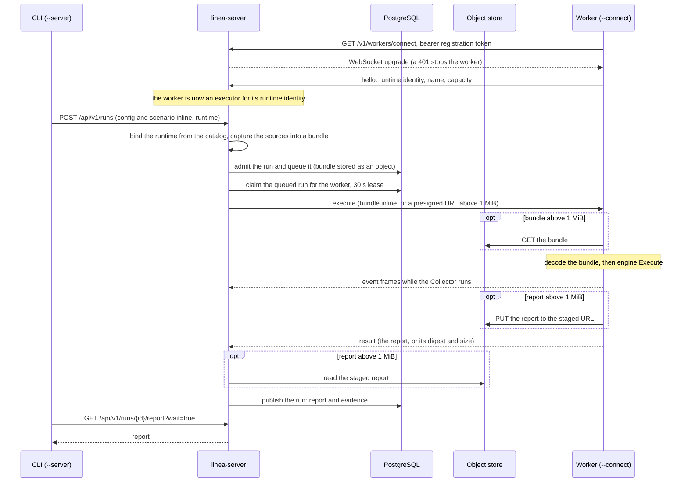

# Running workers

A runtime (see [building debug Collectors](runtime-builds.md)) is an image whose
entrypoint is the debugger's worker. In the CLI's direct commands, the debugger
starts it as a local Docker container for each runtime it uses. For a [team
server](team-server.md) you deploy the same image wherever you like, such as a
Kubernetes cluster, and the worker **dials the server** with `--connect`.

The server never dials a worker, so a worker needs no Service, Ingress,
gateway, port-forward or kubeconfig access: only an outbound connection to the
server and the server's registration token.

The debugger builds the image and pushes it if you ask. Deploying the worker is
yours, under your platform and its policies. The [Helm
chart](deploy-kubernetes.md) deploys a pool worker and a builder beside the
server, and optionally a dedicated worker. [`examples/kubernetes/`](../../examples/kubernetes/)
is a starting point for workers anywhere else. The debugger never applies
either.

| Mode | Flags | What it does |
| --- | --- | --- |
| Standard input and output | none | The debugger starts it as a local Docker container and talks over the pipes. Not meant to be run by hand. |
| Connected | `--connect` | Dials a team server, serves the runs the server queues for its runtime, reconnects until stopped. Only a team server with a `worker_token_file` accepts it. |
| Pool | `--connect --pool` | A [pool worker](#pool-workers): serves the built-in runtime of its release and any runtime the server built for its platform. |

All three speak worker protocol 2. The server refuses a runtime whose worker
speaks another protocol: rebuild it with `linea runtime build`. A worker of
another release than the server serves no built-in runtime.

Each release publishes the `ghcr.io/lineahq/linea-worker` image for the
built-in runtime and pool. The CLI archives do not contain `linea-worker`; build
it from `deploy/docker/linea-worker.Dockerfile` if you need another version.
More: [workers, pools and builders](../internals/debugger-workers.md).

## What a worker needs

```sh
export LINEA_WORKER_TOKEN=$(cat registration-token)
/worker --connect https://linea.example.com --name collector-0.162 --capacity 4
```

`/worker` is the entrypoint of a runtime image. With the published worker
image:

```sh
docker run --rm -e LINEA_WORKER_TOKEN ghcr.io/lineahq/linea-worker:0.1.0 \
  --connect https://linea.example.com --name collector-0.162 --capacity 4
```

| Flag | Meaning |
| --- | --- |
| `--connect` | The server's URL: `https://host[:port][/prefix]`, or `http://` to any host, such as the server's Service inside a cluster. A bare `host:port` is `http` on loopback and `https` otherwise. No credentials, query or fragment. |
| Token (`LINEA_WORKER_TOKEN` or `--token-file`) | The one in the server's `worker_token_file`: at least 32 characters, from `openssl rand -hex 32`. The worker refuses to start without one, and a wrong token stops it instead of retrying. |
| `--name` | Labels the worker in the server's log. A valid runtime name, not the built-in runtime's. The server routes runs by the runtime identity in the worker's hello, through the catalog that `linea runtime register` fills ([registering runtimes](team-server.md#registering-runtimes)), so any number of workers of one image serve its catalog name. |
| `--capacity` | Requests the worker runs at once (default: the CPU count). Size the pod's memory for it. Each request gets its own engine instance; a request beyond the capacity is refused. |
| `--ca-file` | PEM bundle that verifies the server's certificate, for a private CA; needs an `https` URL. Without it the system roots are used. |

`--name`, `--capacity`, `--token-file`, `--ca-file`, `--pool`, `--warm`,
`--idle`, `--cache` and `--cache-dir` need `--connect`; the last four need
`--pool`. A worker accepts no connection: it holds no certificate and serves no
health endpoint.

## Pool workers

A runtime the team server builds itself is a binary in the server's object
storage, not an image. A pool worker serves those runtimes, and the server
names the runtime binary in each request. It dials the same route with the same
registration token as any worker.

A pool also runs its own build, the built-in runtime of its release, with
nothing to download. A pool of the server's release registers the built-in
runtime, so a team server with only a pool runs requests that name no runtime.

```sh
export LINEA_WORKER_TOKEN=$(cat registration-token)
/worker --connect https://linea.example.com --pool --cache-dir /cache
```

For each runtime in use the pool downloads the binary once through a presigned
URL, verifies its size and sha256 digest, keeps it in the cache directory and
runs it as a child process, one per runtime. Besides the flags of any
`--connect` worker (`--name` defaults to `pool`):

| Flag | Default | Effect |
| --- | --- | --- |
| `--capacity` | 8 | Requests the pool runs at once across all runtimes. A request beyond it is refused. |
| `--warm` | 4 | A soft cap on running children. A request is never refused for it, but once a child is idle and more than this many run, the least recently used idle ones are stopped. |
| `--idle` | 10m | Stop a child that no request used for this long; `0` keeps it. |
| `--cache` | 5GiB | The size the cache directory is kept within: whole bytes or a `KiB`, `MiB`, `GiB` or `TiB` size. Over it, the least recently used binaries that no running child uses are removed. |
| `--cache-dir` | `<tmp>/linea-pool-cache` | Where binaries are cached. It must allow executing files (not a `noexec` `/tmp`) and may persist between restarts, so a restarted pool starts its children without downloading again. |

What the pool guarantees:

- A binary with the wrong size or digest, that does not start, speaks another
  protocol or reports another runtime fails the request as `unavailable` and is
  distrusted until the pool restarts. The server records it as suspect on the
  runtime's catalog entry (`catalog.suspect` on the Runtimes page and
  `GET /api/v1/runtimes`: platform, time, cause), and runs on it fail at once
  on every pool until the runtime is built or registered again.
- A damaged cached binary is fetched again. A failed download is not held
  against the binary.
- A child that exits fails the requests it ran as `unavailable`; the next
  request starts it again. A child that runs a request is never stopped for
  `--warm` or `--idle`, and its binary is never evicted.
- A child's environment is the pool's without every `LINEA_*` variable, so the
  registration token never reaches it. Its standard error goes to the pool's
  log.
- When the connection is lost the pool cancels what runs, stops every child and
  keeps the cache. It reconnects like any worker.

Size the pool's memory for `--capacity` requests spread over up to `--warm`
idle runtimes plus the busy ones: each runtime is a full Collector process.

## Behavior



A run on a connected worker. A pool worker's execute request also names the
runtime binary, which the pool downloads and runs as a child process.

- The worker reconnects with a backoff of 1 s to 30 s. A run whose lease ends
  while it is disconnected is requeued once, then lost, and a requeued run
  executes as a new attempt (its event stream sends `restart`).
- With several server instances behind a load balancer, the worker dials the
  balancer and any instance may serve it; the queue is in PostgreSQL. On
  SIGTERM an instance hands the worker's unfinished runs back to the queue; a
  killed instance's runs are requeued after 30 s. See [team server
  instances](team-server.md#instances).
- A run bundle or report over 1 MiB moves through a presigned URL, so a worker
  needs network access to the object store the server presigns for, besides the
  server.
- Inspections and OTTL previews on the runtime use a free slot of a connected
  worker, ahead of queued runs; with none answering within 30 seconds they fail
  as `unavailable`.

The server-side details (leases, pings, transfer lifetimes) are in [team server
mechanisms](../internals/debugger-team-server.md#worker-connection).

## The default runtime's worker image

`deploy/docker/linea-worker.Dockerfile` builds `linea-worker` from this module,
so the image runs the built-in runtime (`build/linea-runtime.yaml`) and carries
the label `io.linea.runtime=default` that `linea runtime register` accepts. The
[Compose stack](deploy-compose.md) uses it. A worker of the server's own release
registers itself as the built-in runtime when it connects, which is the default
runtime until the team chooses another with
`linea runtime default NAME --server URL`. For other Collector releases or
components, build a runtime with `linea runtime build`.

## Deploying on Kubernetes

The manifests in `examples/kubernetes/base/` are one Deployment of connecting
workers, its token Secret (generated from a `token` file you create, never
committed) and a NetworkPolicy:

```sh
linea runtime push mine registry.example.com/team/linea-runtime:mine
linea runtime register registry.example.com/team/linea-runtime:mine --name mine --server https://linea.example.com
# Set the image in examples/kubernetes/base/kustomization.yaml, and the
# server URL and worker name in worker.yaml, first.
cp /path/to/worker-token examples/kubernetes/base/token
kubectl create namespace linea
kubectl apply -k examples/kubernetes/base
linea runtime list --server https://linea.example.com
```

The `token` file holds the registration token the server's `worker_token_file`
holds. `runtime list` shows the entry confirmed with the connected workers once
they say hello. `--runtime NAME` then works in `inspect`, `run`, `test`, `diff`
and `upgrade-check`, over HTTP and MCP, and in the web client's runtime
selector.

## What leaves the server

A run on a connected worker sends the worker its bundle:

- the configuration, the inputs and the mock files;
- environment values only for names a scenario declares. Any other `${env:...}`
  reference becomes a stand-in.

The server reads no host file for a request, and the worker never reads files of
its own. Reports name the runtime as kind `remote` with its name and no
endpoint, so a reader knows the run left the server. The built-in runtime is the
exception: on a team server it always runs on a worker of the server's release,
and reports name it as kind `built_in`.

## Isolation

Isolation of a worker is its operator's. The example keeps the local worker
container's limits:

| Control | Setting |
| --- | --- |
| Root file system | Read-only; `/tmp` is an `emptyDir` |
| User | 65534, no capabilities, no service account token |
| Memory | 2 GiB limit |
| NetworkPolicy | Denies all ingress; allows egress only to the team server and DNS, since a run's inputs arrive over the connection and its exporters are captured |

A worker that gets payloads over 1 MiB also needs the object store the server
presigns for, so its policy must admit that destination when the store is not
behind the server's own address.

See also: [building debug Collectors](runtime-builds.md), the [runtime
prerequisites](../internals/runtime-prerequisites.md), [the team
server](team-server.md#connecting-workers) and [deploying on
Kubernetes](deploy-kubernetes.md).
