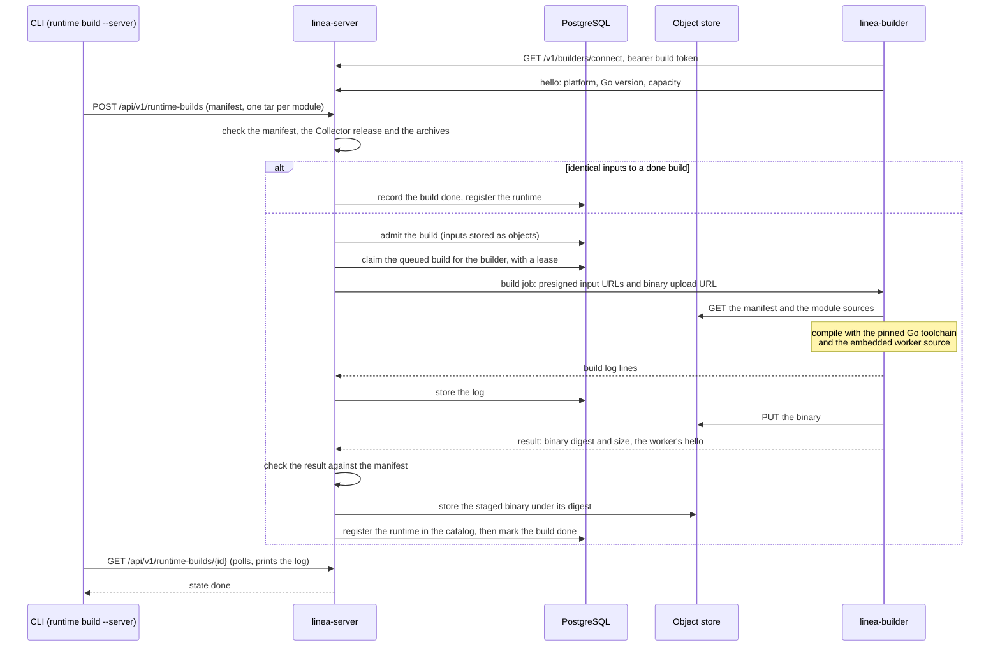

# Building debug Collectors

The debugger runs every configuration on its built-in runtime: the Collector
release and components of `build/linea-runtime.yaml`. To debug another release,
another component set or your own components, build a runtime from an
OpenTelemetry Collector Builder (OCB) manifest. The debugger ships no
Collectors; it builds the one your manifest describes and runs it in a
container.

| Where it builds | How |
| --- | --- |
| This machine | `linea runtime build`, in your Docker |
| A team server | `linea runtime build --server URL`: the server's builders compile it ([Building on a team server](#building-on-a-team-server)) |
| Elsewhere | Push the image, start workers of it and register it in the server's catalog ([Using a runtime on a team server](#using-a-runtime-on-a-team-server)) |
| Into the CLI | `linea build`: a `linea` binary whose in-process Collector is the manifest's, with no Docker and no server ([A CLI of your own](#a-cli-of-your-own)) |

Runtimes are Docker images (`linea-runtime:<name>`). `runtime list` shows the
images on this machine, or with `--server URL` a team server's catalog. Runs,
inspections and OTTL previews name one with `--runtime` (CLI), `runtime` (HTTP
and MCP) or the web client's runtime selector. Every report names the runtime
it ran on, its Collector release and whether that release is verified. Build
mechanics: [workers, pools and builders](../internals/debugger-workers.md) and
the [runtime build notes](../internals/runtime-builds.md).

## Which releases build

| Release | What happens |
| --- | --- |
| Before 0.160.0 | Refused before building: `unsupported_collector_version`. |
| A verified release | Builds with the release's dependency set: every module is pinned to the versions the debugger was verified with. |
| Newer than every verified release | Builds **unverified**: modules resolve through your module source at the manifest's versions. The build, the runtime and every report say so. |

| Command | HTTP | MCP |
| --- | --- | --- |
| `linea runtime versions`: the oldest release, the verified releases and the built-in runtime's release | `GET /api/v1/collector-versions` | `linea_get_collector_support` |
| `linea runtime catalog [--version V]`: a verified release's component catalog | `GET /api/v1/collector-versions/{version}/catalog` | `linea_get_collector_catalog` |

The other runtime commands that act on a server have MCP tools too:
`linea_get_runtime`, `linea_delete_runtime`, `linea_push_runtime`,
`linea_import_runtime`, `linea_retarget_manifest`, `linea_get_runtime_storage`,
`linea_get_default_runtime`, `linea_set_default_runtime`,
`linea_prune_runtimes` and, for server builds, `linea_build_runtime`,
`linea_get_runtime_build`, `linea_list_runtime_builds` and
`linea_cancel_runtime_build`.

## Writing a manifest

Write a manifest by hand, take your own, or let the debugger write one from a
verified release's catalog:

```sh
# Every component the debugger supports at the newest verified release.
linea runtime manifest --preset all --out all.yaml
# The built-in runtime's manifest.
linea runtime manifest --preset built-in --version 0.162.0
# The components a configuration uses, plus picked ones.
linea runtime manifest --config collector.yaml --component processors/transform --out mine.yaml
```

- `runtime manifest`, `runtime retarget` and `runtime catalog` use the newest
  verified release unless you pass `--version V`. Pass it whenever the manifest
  must match the Collectors you run.
- A configuration may use a component's deprecated type (`otlp`, `filelog`):
  the manifest gets the component and a warning names its current type. A type
  the catalog does not know is a warning.
- Your own components come from their source: `--source MODULE=DIR` or
  `--git MODULE=URL[#REF[:SUBDIR]]`, as for `runtime build` below, adds an entry
  for every component package found in the module. The entries name the module
  at `v0.0.0` without `path:`; build with the same sources. With `--server`, the
  team server reads no host directory, so it takes `--git` sources of remote
  repositories only, each at most its `limits.git_clone_size` (default 256 MiB,
  [team server](team-server.md#limits)). A source whose `go.mod` declares another module, or with no
  component package, is refused.

```sh
linea runtime manifest --component receivers/otlp --component exporters/debug \
  --source github.com/lineahq/linea/collector/livecapture=<repo>/collector/livecapture --out mine.yaml
```

The result is an ordinary manifest: edit it, save it as a saved source
(artifact kind `manifest`) or build it with your own OCB. HTTP:
`POST /api/v1/manifests`; MCP: `linea_compose_manifest`.

The debugger never changes your manifest's bytes. Fields that only steer OCB's
own build, such as `dist.output_path`, are ignored with a warning in the build
log. To use a runtime in CI, see [`--runtime`](ci.md#your-own-collector-build---runtime).

## Building

```sh
linea runtime build --name v0162 --manifest mine.yaml
```

- The manifest and its sources are checked before the build is queued. Modules
  off the release (for a verified release), a release before 0.160 and
  unreadable sources are refused with diagnostics.
- Builds have their own queue and never delay runs. The command follows the
  build's log; an interrupt cancels the build. Exit 0 built, 1 failed or
  cancelled. It has no `--detach`.
- Builds compile in the pinned official Go image with a memory and CPU limit.
  Modules come from your module source: `GOPROXY`, `GOPRIVATE`, `GONOPROXY`,
  `GONOSUMDB`, `GOSUMDB` and `GOINSECURE` pass through from the debugger's
  environment, or `--module-proxy URL` sets `GOPROXY` for one build.
- `--offline` builds without network access from the module cache volume
  (`linea-gomod`); a module missing from it fails the build, naming the module.
- With `--server URL` the build is queued on a team server instead.

## Custom components

A custom component is a Go module the manifest names. Supply its source in one
of three ways:

| Source | Meaning |
| --- | --- |
| `path:` entry or `replaces` line with a directory in the manifest | Read relative to the manifest file. |
| `--source MODULE=DIR` | A directory holding the module's `go.mod`. |
| `--git MODULE=URL[#REF[:SUBDIR]]` | A repository cloned with this machine's `git` and credentials, at a branch, tag or commit (default `HEAD`), the module in `SUBDIR`. |

```sh
linea runtime build --name mine --manifest mine.yaml \
  --git example.com/stampprocessor=https://example.com/stamp.git#v1.2.0:processor
```

- Directories are read from this machine, without restriction. A git ref is
  resolved to its commit when the build starts; the runtime and every report
  record each custom module with its source and commit.
- A custom module's own requirements may not move a Collector module off the
  release: such a build is refused, naming the module and both versions. Build
  at the release the module's `go.mod` requires, or lower its requirements.
- Custom component code runs during the build and in the worker container with
  whatever the container allows. Build only sources you trust.

### Debugger providers

A module can also tell the debugger how to drive its components during a run: a
package exporting `func DebuggerProvider() provider.Provider` from the
[provider SDK](provider-sdk.md). A build finds such packages in the supplied
sources and compiles them in.

- `runtime manifest` names the providers found, `runtime list` names each with
  its package, and reports name them in `runtime.providers` and in the run's
  mocks declarations.
- A scenario configures a provider under `mocks.providers.<name>`.
- A module requiring a newer SDK than this debugger embeds is refused before
  the build resolves.

## A CLI of your own

`linea build` compiles the `linea` CLI with a manifest's Collector release and
components. Its direct commands run that Collector in process, with no Docker,
no worker and no network:

```sh
linea build --manifest mine.yaml --docker --out ./linea-mine
./linea-mine test --config collector.yaml --scenario scenario.yaml
```

Manifests, releases and custom components follow the rules on this page.
[A CLI with your components](custom-cli.md) covers building, checking and
using one.

## In the web client

| Control | What it does |
| --- | --- |
| Runtime selector beside Run | Chooses the runtime for runs, validation and OTTL previews. An unverified runtime shows an "unverified" badge while selected; every run overview names the runtime its report records. |
| Runtimes... | Opens the Runtimes page: the server catalog's runtimes with their components, push, import and remove, the upgrade check and disk space. |
| Build a runtime | Queues a build on the team server's builders. Pick components from a release's catalog or import an OCB manifest; choose a folder for each module the manifest builds from a local directory (packed in the browser and uploaded with the build). The build page streams the log, cancels, rebuilds and, once done, offers "Run on" the new runtime. A runtime built elsewhere is registered with `linea runtime register`. |
| Check upgrade | Checks the current configuration and scenario drafts from one runtime to another and shows the verdict, diagnostics, feature gates and each scenario with a link to its two runs in Compare runs. Leaving the page abandons a check and cancels its runs. |
| Disk space | Measures runtime images and build caches when asked; prunes after an inline confirmation naming what goes ([Disk space](#disk-space)). |

## Moving to another release

```sh
linea runtime retarget --manifest ocb.yaml --version 0.160.0 --out ocb-0.160.yaml
linea upgrade-check --from mine --to mine-0160 --config collector.yaml --tests scenarios/
```

- `runtime retarget` gives each core and contrib module the target release's
  version and leaves the rest of the text, comments included, as written.
- It warns about modules the release does not have (a removed or renamed
  component: replace or remove it before building) and about custom modules,
  which keep their version.
- `upgrade-check` compares the two runtimes; see [CI](ci.md#collector-upgrades-upgrade-check)
  for its verdicts and exit codes.
- Over HTTP: `POST /api/v1/manifests/retarget` and `POST /api/v1/upgrade-checks`;
  over MCP, `linea_compare_versions`.

## Managing runtimes

```sh
linea runtime list
linea runtime push mine registry.example.com/team/linea-runtime:mine
linea runtime import registry.example.com/team/linea-runtime:mine --pull
linea runtime rm mine
```

- Without `--server` these act on the images in this machine's Docker.
- `list` and `rm` also take `--server URL` to act on a team server's catalog. A
  server stores no images, so `push` and `import` with `--server` fail as
  `unavailable`.
- A runtime in use by a queued or running run cannot be removed.

### Disk space

Runtime images are small (about 70 MB each), but rebuilding a runtime under the
same name leaves the previous image behind, untagged. The build caches are
large: the Go module cache (`linea-gomod`, about 5 GB for one release's contrib
modules) and the compiler cache (`linea-gocache`). The debugger never removes
anything on its own.

```sh
linea runtime storage            # images with state and size, caches, leftovers
linea runtime prune              # replaced images and stopped containers
linea runtime prune --stale      # also runtimes this debugger can no longer run
linea runtime prune --caches     # also both build caches
```

| Image state | Meaning |
| --- | --- |
| `named` | Its name selects it. |
| `replaced` | A rebuild took its name and nothing else tags it. |
| `tagged` | Its name moved on, but a pushed or imported reference still names it. Prune never removes it. |
| `stale` | Built for another worker protocol, so this debugger refuses it. |

- `runtime list` shows every state but `replaced`.
- A prune keeps images with queued or running runs and anything Docker refuses,
  saying why. It removes only stopped build and worker containers, and refuses
  `--caches` while a build is queued or running.
- After `--caches` the next build downloads its modules again, and an
  `--offline` build fails until one has.
- Only the debugger's own objects are touched: images with its runtime label,
  its two cache volumes and containers named `linea-build-*` or `linea-worker-*`.
- Over HTTP: `GET /api/v1/runtime-storage` and
  `POST /api/v1/runtime-storage/prune` (`{"replaced": true, "stale": false,
  "caches": false}`). No MCP tool removes anything.

## Building on a team server

A team server queues builds for its builders. `linea runtime build --server URL
--name NAME --manifest ocb.yaml` packs every local module directory the manifest
uses (`path:` entries and local replaces, or `--source MODULE=DIR`) into an
uncompressed tar, uploads it with the manifest and follows the build.
`--go-image`, `--module-proxy`, `--offline` and `--git` are refused: clone a git
source and pass it with `--source`. `linea runtime builds --server URL` lists
builds, newest first (`--limit`, `--cursor`, `--all`).



The CLI only queues and follows the build; the builder reaches the inputs and
returns the binary through presigned URLs.

| Topic | Behavior |
| --- | --- |
| Permissions | Queueing needs `runtime.build` (engineers and admins). You see and cancel your own builds; `runtime.manage` sees and cancels all. |
| Web client | The Runtimes page queues, lists, follows and cancels builds with the same API. The server returns no manifest, so Rebuild starts from what that browser remembered. |
| Limits | At most 2 unfinished builds per principal and 20 on the server. The last 100 finished builds keep their logs. |
| Storage | A built binary counts toward `store.storage_limit`. Each queued or running build reserves an eighth of it, at most 128 MiB, so a build is refused at queueing (`limit`) rather than after compiling. |
| Archives | Regular files and directories only, at most 20,000 files and 64 MiB, with the module's `go.mod` at the root. |
| Reuse | A build of inputs identical to an earlier done build (manifest, sources, Go image, builder version) is done at once and marked reused, without saying whose build it reused. |
| Image export | With `builds.export.repository` in the server config, the builder also pushes each runtime as an image tagged with the build's name. The build shows it by digest (`image`), or why the push failed (`export_error`), which does not fail the build. A reused build shows the earlier build's image. |

`runtime build --server` ends by printing the exported image by digest, or a
warning naming why the export failed, and exits as the build did. CI runners run
that image without Docker or a team server
([CI](ci.md#your-own-collector-build---runtime)).

A builder (`linea-builder`) compiles queued builds and registers each runtime,
which the server's pool runs. On SIGTERM or Ctrl-C it lets its builds finish, up
to their 30-minute deadline, and claims nothing new; builds still queued wait
for another builder. A second signal cancels the builds, and each is retried
once by the next builder. The server serves the build queue's counts for
autoscaling ([scaling builders](deploy-kubernetes.md#scaling-builders)).

A builder downloads modules from the module source in its own environment,
which the operator sets and no request can change:

| Variable | For |
| --- | --- |
| `GOPROXY`, `GOPRIVATE`, `GONOPROXY`, `GONOSUMDB`, `GOSUMDB`, `GOINSECURE` | The module source, as for local builds |
| `NETRC`, `GOAUTH` | A proxy or git host that needs credentials |
| `SSL_CERT_FILE`, `SSL_CERT_DIR` | A proxy or git host whose certificate a private CA signed |

No other variable of the builder's environment reaches a build. The Helm chart
sets these from `builder.modules` ([module
source](deploy-kubernetes.md#module-source)).

An internal proxy such as Artifactory, Nexus or Athens is
`GOPROXY=https://proxy.example.com/...` with its credentials in a netrc file
(`machine proxy.example.com login USER password TOKEN`, with `:port` when the
URL names one). Go reaches `sum.golang.org` through the proxy when the proxy
serves it; set `GOSUMDB=off` only where it does not.

## Using a runtime on a team server

A runtime built on the server needs nothing more: its pool runs it. A runtime
built as a Docker image elsewhere reaches the server's dedicated workers in four
steps. Steps 1, 2 and 4 need Docker on your machine:

1. **Build** the image: `linea runtime build --name NAME --manifest ocb.yaml`.
   Without `--server` it builds on this machine. Use the `linea` of the server's
   release: the server refuses an image whose worker speaks another protocol
   (`unsupported_build`).
2. **Push** it to a registry the workers can pull from:
   `linea runtime push NAME TARGET`.
3. **Start workers** of that image, where you deploy them: a Compose service,
   Helm values (see [deploying on Kubernetes](deploy-kubernetes.md)) or
   `examples/kubernetes/`. Each runs
   `linea-worker --connect URL --name LABEL --capacity N --token-file FILE`
   with the server's registration token. The worker dials the server; nothing
   connects one from the CLI, HTTP, MCP or the web client.
4. **Register** the image in the server's catalog:
   `linea runtime register TARGET --name NAME --server URL`. It starts the image
   with your local Docker only to read its hello, so the image must be in
   Docker's store here (`--pull` pulls it first).

```sh
linea runtime build --name mine --manifest mine.yaml
linea runtime push mine registry.example.com/team/linea-runtime:mine
# start workers of that image with the server's registration token, e.g.
linea-worker --connect https://linea.example.com --name mine-0 --capacity 4 --token-file registration-token
linea runtime register registry.example.com/team/linea-runtime:mine --name mine --server https://linea.example.com
linea runtime list --server https://linea.example.com
linea run --server https://linea.example.com --config config.yaml --scenario scenario.yaml --runtime mine
```

- Registering before the workers connect is fine: runs on the name queue until
  a worker of the image says hello, which confirms the entry.
- The built-in runtime needs no registering: a worker or pool of the server's
  release registers it, as on the [Compose stack](deploy-compose.md).
- Runs on a connected worker send it their configuration, inputs and mock
  files. Environment values go only for names a scenario declares, and neither
  the server nor the worker reads a host file for a request.
- Reports name the runtime as kind `remote` with its name and no endpoint; the
  built-in runtime is kind `built_in` wherever it runs.
- Any number of workers can serve one name, each running up to its `--capacity`
  requests at once. `runtime list` shows a connected worker's runtime, and the
  web client's runtime selector offers it.
- Workers, with their flags and a Kubernetes example, are in [running
  workers](remote-workers.md) and [the team
  server](team-server.md#connecting-workers).

The default runtime is the runtime of every request that names none. The team
chooses it with `linea runtime default NAME --server URL`, where NAME is
`built-in` or a registered runtime; it is the built-in runtime until then. See
[the default runtime](team-server.md#the-default-runtime) for permissions, HTTP
and MCP.

The CLI's direct commands (`run`, `test`, `diff`, `upgrade-check`, `inspect`
without `--server`) use the images in this machine's Docker with `--runtime
NAME`, and need no server or worker.

See also: [runtime prerequisites](../internals/runtime-prerequisites.md).
