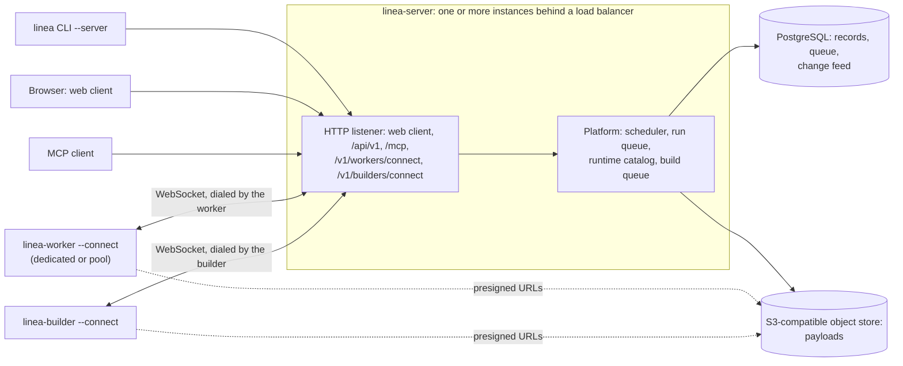

# Running a team server

A team server is one `linea-server` that a platform team shares. It is the only
server mode. It is configured by a [server config](#the-server-config), a file
(`--config`), [environment variables](#environment-variables) or both;
`linea-server` with neither is refused. It authenticates every
request, authorizes it by role bindings, and can be reached from other
machines. It runs the same platform as the CLI, web client and MCP, so every
capability works the same way in all three.

Run it on one machine with the [Docker Compose stack](deploy-compose.md), or on
a cluster with the [Kubernetes chart](deploy-kubernetes.md). Both run the same
server with the same config: sign-in, roles, storage and limits do not depend
on which you choose. Compose sets the config through [environment
variables](#environment-variables) from `.env` and reads its secrets from
files, the chart writes it from its values. The mechanisms
behind this page are in [team server
mechanisms](../internals/debugger-team-server.md).

## What you need

| Need | Detail |
| --- | --- |
| PostgreSQL and an S3-compatible bucket | The server creates its tables, but not the database; it needs ownership of that database, not superuser rights. It creates the bucket only with `store.objects.create_bucket: true`. |
| Sign-in | An OIDC identity provider, or an authenticating proxy that sends identity headers. |
| Runtime workers | At least one, which dials the server. Add a runtime builder if people build runtimes on the server. The server itself runs no Collector. |
| One release | Server, workers and builders of one release. Each release publishes the `linea-server`, `linea-worker` and `linea-builder` images to `ghcr.io/lineahq/`; you can also build them from `deploy/docker/`. A builder of another release is refused. |

The Compose stack and the Helm chart provide all of this.



- The server never dials a worker or a builder.
- Neither holds database or bucket credentials: they reach the object store
  only through presigned URLs the server hands them.
- Clients authenticate with an API token or a sign-in.

```sh
linea-server --config config.yaml --addr 0.0.0.0:7070 \
  --tls-cert-file tls.crt --tls-key-file tls.key --mcp
```

## The server config

The server config is the only source of host state for a team server. It is a
YAML file, `--config <file>`, or [environment variables](#environment-variables)
that set the same keys, or both. A file's relative paths resolve against the
file's directory. Unknown keys in the file are refused.

```yaml
version: 1
store:                                  # required: PostgreSQL and object storage
  database_url_file: /etc/linea/store/database-url   # holds a postgres:// URL, password included
  # Or give the URL without a password and the password apart, so the URL
  # can be plain configuration; give one of the two ways, not both:
  # database_url: postgres://linea@postgres:5432/linea?sslmode=disable
  # database_password_file: /etc/linea/store/database-password
  objects:
    endpoint: https://s3.example.internal   # http:// or https://
    bucket: linea
    create_bucket: false  # true: create the bucket at startup if it is missing (default false)
    prefix: ""            # optional key prefix
    region: ""            # optional
    path_style: true      # SeaweedFS and most self-hosted stores need it
    access_key_file: /etc/linea/store/access-key
    secret_key_file: /etc/linea/store/secret-key
  storage_limit: 4GiB                 # default 256MiB
  run_limit: 32MiB                    # default 16MiB
retention:                  # optional; terminal runs the server keeps
  runs: 10000               # default 10000, at most 1000000
  age: 30d                  # default 30d; days (Nd) or a duration of at least 1h
# Optional. The registration token of workers that dial the server
# (linea-worker --connect): one line, at least 32 characters, no spaces.
# Without it the server accepts no workers.
worker_token_file: worker-registration-token
# Builders that compile server builds (linea-builder) present this
# token to /v1/builders/connect: same rules as the worker token, and it must
# differ from it. Without it queued builds wait for a builder.
builds:
  token_file: builder-token
  # export:                 # optional: builders also push each built runtime as an image
  #   repository: registry.example.com/team/linea-runtimes
authentication:             # at least one of admin, oidc and trusted_headers
  admin:                    # the built-in admin account (Signing in)
    password_file: admin-password  # one line, at least 16 characters; read at startup
  oidc:
    issuer: https://dex.example.com
    client_id: linea           # the web client, a confidential client
    client_secret_file: dex-secret     # read at startup; never inline
    redirect_url: https://debugger.example.com/auth/callback
    cli_client_id: linea-cli   # optional: a public client with the device flow
    # audiences: [linea, linea-cli]  # bearer token audiences; default both client IDs
    # scopes: [openid, profile, email, groups]       # default openid, profile, email
    # groups_claim: groups              # a list or comma-separated string
    # name_claim: name                  # then preferred_username, then email
    # session_ttl: 12h                  # web sessions, at most 168h
  trusted_headers:          # an authenticating proxy, such as oauth2-proxy
    proxies: [10.0.0.0/8]   # addresses or CIDR prefixes; others are ignored
    issuer: oauth2-proxy    # names this identity source in user IDs
    user: X-Forwarded-User
    groups: X-Forwarded-Groups      # optional, comma-separated
    name: X-Forwarded-Preferred-Username  # optional, for display
bindings:                   # required unless only the admin account signs in
  - group: platform
    role: engineer
    scope: "*"              # "*" or project:<id>
  - principal: service:ci
    role: engineer
    scope: "*"
  - group: platform-admins
    role: admin
    scope: "*"
limits:                     # optional; the counts below each 1 to 1024
  queue: 64                 # runs waiting for the worker, server-wide
  runs_per_principal: 32    # reserved, queued or running runs per person or service
  captures_per_principal: 1 # captures not yet ended per person or service
  connections: 1024         # open API connections, 16 to 65536
  git_clone_size: 256MiB    # each git source the server clones
```

### Environment variables

Every key of the server config has an environment variable. The name is
`LINEA_` plus the key's path in upper case, the segments joined by `_`:

| Key | Variable |
| --- | --- |
| `store.storage_limit` | `LINEA_STORE_STORAGE_LIMIT` |
| `store.objects.bucket` | `LINEA_STORE_OBJECTS_BUCKET` |
| `store.objects.create_bucket` | `LINEA_STORE_OBJECTS_CREATE_BUCKET` |
| `store.database_url_file` | `LINEA_STORE_DATABASE_URL_FILE` |
| `authentication.oidc.issuer` | `LINEA_AUTHENTICATION_OIDC_ISSUER` |
| `retention.age` | `LINEA_RETENTION_AGE` |
| `bindings` | `LINEA_BINDINGS` |

- **Values.** A string is taken as written. A number, `true` or `false` is
  read as YAML, as the file reads it, and the sizes and durations are the
  file's (`64MiB`, `7d`, `12h`). A list or an object is one YAML flow value:
  `LINEA_BINDINGS='[{group: admins, role: admin, scope: "*"}]'` or
  `LINEA_AUTHENTICATION_OIDC_SCOPES='[openid, profile, groups]'`. A flow list
  replaces the file's list; it does not add to it.
- **Secrets are files.** A secret has no variable of its own: its `*_file` key
  is the variable that names the file (`LINEA_STORE_DATABASE_URL_FILE`,
  `LINEA_STORE_OBJECTS_SECRET_KEY_FILE`, `LINEA_BUILDS_TOKEN_FILE`,
  `LINEA_AUTHENTICATION_OIDC_CLIENT_SECRET_FILE`), as with the official
  PostgreSQL image's `POSTGRES_PASSWORD_FILE`. A relative path in a variable
  resolves against the server's working directory; a file's relative paths
  still resolve against the file.
- **Precedence.** A variable overrides the same key in the file. A variable
  that is empty, or only blanks, counts as not set: it does not override the
  file and does not switch a section on (`LINEA_AUTHENTICATION_OIDC_ISSUER=`
  leaves OIDC off), so Compose may pass `${NAME:-}`. Keys combine one by
  one: a variable can change one OIDC key of the file's `oidc` section.
- **No file.** Without `--config` the whole server config comes from the
  environment. `linea-server` with no file and no variable that sets a key is
  refused; one that lacks a required key says which variables to set.
- **Not keys.** The file's `version` has no variable, and other `LINEA_*`
  variables, such as `LINEA_VERSION` of the images, are ignored: a misspelled
  variable of an optional key is not reported, so check the startup notices.
- **Errors** about a value that came from a variable name the variable, not
  the key: `server config (environment): LINEA_STORE_STORAGE_LIMIT: invalid size "lots"...`.
  A message about a value from the file names its key.
- **Database URL.** `store.database_url` (`LINEA_STORE_DATABASE_URL`) is a
  `postgres://` URL that must not carry a password, nor a `password`
  parameter. `store.database_password_file` supplies it: the file's content
  without its trailing line breaks, set as the URL's password and escaped
  (the URL needs a user name for that). Give exactly one of `database_url_file`
  and `database_url`; `database_password_file` goes only with `database_url`.

An example for Docker Compose, with the secrets mounted as files:

```yaml
services:
  linea:
    image: ghcr.io/lineahq/linea-server:${LINEA_VERSION}
    command: ["--addr", "0.0.0.0:7070", "--allow-http", "--mcp"]
    environment:
      LINEA_STORE_DATABASE_URL: postgres://linea@postgres:5432/linea?sslmode=disable
      LINEA_STORE_DATABASE_PASSWORD_FILE: /run/secrets/postgres_password
      LINEA_STORE_OBJECTS_ENDPOINT: http://seaweedfs:8333
      LINEA_STORE_OBJECTS_BUCKET: linea
      LINEA_STORE_OBJECTS_CREATE_BUCKET: "true"
      LINEA_STORE_OBJECTS_PATH_STYLE: "true"
      LINEA_STORE_OBJECTS_ACCESS_KEY_FILE: /run/secrets/s3_access_key
      LINEA_STORE_OBJECTS_SECRET_KEY_FILE: /run/secrets/s3_secret_key
      LINEA_STORE_STORAGE_LIMIT: 4GiB
      LINEA_WORKER_TOKEN_FILE: /run/secrets/worker_token
      LINEA_BUILDS_TOKEN_FILE: /run/secrets/builder_token
      LINEA_AUTHENTICATION_OIDC_ISSUER: https://dex.example.com
      LINEA_AUTHENTICATION_OIDC_CLIENT_ID: linea
      LINEA_AUTHENTICATION_OIDC_CLIENT_SECRET_FILE: /run/secrets/oidc_client_secret
      LINEA_AUTHENTICATION_OIDC_REDIRECT_URL: https://linea.example.com/auth/callback
      LINEA_BINDINGS: '[{group: platform-admins, role: admin, scope: "*"}]'
    secrets: [postgres_password, s3_access_key, s3_secret_key, worker_token, builder_token, oidc_client_secret]
```

### Roles

| Role | Permissions |
| --- | --- |
| `viewer` | Read runs, artifacts, captures, fleet and runtimes; manage your own API tokens. |
| `engineer` | `viewer`, plus submit and delete runs, save artifacts, start captures and build runtimes. |
| `fleet-operator` | `engineer`, plus write fleet configs and start rollouts. |
| `raw-capture` | Read raw capture data. Bind it beside another role. |
| `admin` | Everything, including `runtime.manage`, `token.manage`, `audit.read`, `access.manage`, `project.manage` and `library.publish`. |

A binding names a group from the identity source or a principal ID: `user:`
plus a hash, as `token list` and the audit log show it, or `service:<id>`.

### Managing bindings on the server

The server config's bindings are fixed until the file changes and the server
restarts. An admin (`access.manage`) can add more while the server runs, from
the web client's Access page or the CLI:

```sh
linea access list --server https://debugger.example.com [--roles]
linea access grant --server https://debugger.example.com --group sre --role engineer [--scope project:payments]
linea access grant --server https://debugger.example.com --principal service:ci --role viewer
linea access revoke --server https://debugger.example.com --binding <id>
```

| Rule | Detail |
| --- | --- |
| Form | One group or principal, a built-in role and a scope (`*` or `project:<id>`), like the server config's. At most 1000 per server. |
| Effective permissions | The union of the config's bindings and the managed ones. |
| Config bindings | Listed with source `config` and IDs `config-1`, `config-2`, ...; they cannot be revoked from the server. Keep an admin binding in the config so access can always be recovered by editing it. |
| Timing | Every instance applies a change within a second. |
| Conflicts | `grant` and `revoke` read the current revision first, or take `--revision N`. An older revision is refused as a conflict, as is granting what a binding already grants. |
| Self-lockout | Nobody can revoke the binding that gives them `access.manage`; another admin can. |
| Audit | `AddRoleBinding`, `RemoveRoleBinding`. Managed bindings are not part of an artifact export. |

A binding names a group, but when a principal's groups are read depends on how
they signed in, so a change to a group's members reaches them at different
times. A changed binding applies to every request at once.

| Credential | Groups come from |
| --- | --- |
| Web session (`oidc`) | The ID token at sign-in; sign in again for new groups |
| Personal API token | The creator's session when the token was created |
| OIDC bearer token (CLI `login`, MCP) | The token on every request |
| Trusted headers | The proxy's header on every request |

## Projects

A project is one team's space on a shared server: its runs, suites, saved work
and captures. Two always exist:

| Project | Holds |
| --- | --- |
| `default` | The work of every request that names no project. |
| `library` | The configurations, fixtures and scenarios an admin publishes for other projects ([The library](#the-library)). |

An admin (`project.manage`) creates the others from the web client's Access →
Projects page or the CLI:

```sh
linea project list --server https://debugger.example.com
linea project create payments --server https://debugger.example.com --name Payments \
  [--default-runtime contrib-0162] [--retention-runs 200] [--retention-age 336h] [--storage-limit 536870912]
linea project update payments --server https://debugger.example.com --name Payments --retention-runs 100
linea project archive payments --server https://debugger.example.com
linea project unarchive payments --server https://debugger.example.com
```

| Setting | Meaning |
| --- | --- |
| ID | 1 to 64 lowercase letters, digits and hyphens, starting with a letter or digit. At most 1000 projects. |
| `--default-runtime` | The runtime of the project's requests that name none. |
| `--retention-runs`, `--retention-age` | Replace the server's retention policy for the project's runs. |
| `--storage-limit` | Bytes of the project's run evidence and bundles; retention removes its oldest runs beyond it. Cannot exceed the server's limit. |
| Defaults | A project's settings default to the server's. `update` replaces the name and settings; a flag you leave out keeps its value. |
| Archived | Takes no new runs, saved work or captures; its work can still be read and deleted. The built-in projects cannot be archived. |
| Revisions | Like role bindings, each change names the revision of the project set (`--revision N`, by default the current one); an older one is a conflict. Every instance applies it within a second. |
| Audit | `CreateProject`, `UpdateProject`, `ArchiveProject`, `UnarchiveProject` |

Bind a team to its project with a project scope; the role then applies only to
that project's work:

```sh
linea access grant --server https://debugger.example.com --group payments-oncall --role engineer --scope project:payments
```

In the web client, Access → Projects lists who is bound in each project, and
its Grant access opens the binding form scoped to that project. An `admin`
binding in scope `project:payments` delegates access management for that
project: its holders see and revoke only that project's bindings and grant only
roles whose permissions they hold there.

### Working in a project

Every request works in one project. With none named, it works in `default`.

| Interface | How to name it |
| --- | --- |
| CLI | `--project P` or `LINEA_PROJECT`, on every command that talks to a server, such as `linea test --server ... --project payments` |
| Web client | The project switcher in the rail (shown once you can use more than one project). The choice is kept per browser; `?project=` in a link opens that project. |
| HTTP API | The `project` query parameter, such as `GET /api/v1/runs?project=payments`. Naming it twice is refused. |
| MCP | The `Linea-Project` header, or `?project=` on the MCP URL. `linea_list_projects` lists the projects the caller can use. |

Lists of runs, suites, saved work and captures show only the named project's
work. With no project named they show every project you may read, which is
what the CLI and API do without `--project` or `?project=`. Opening a run or
artifact by its ID works from any project you may read it in, so a link to it
keeps working after you switch.

A project you hold no permission in is refused as forbidden, as is reading
another project's run or artifact by its ID.

### The library

The library is where an admin shares work with other projects. Only an admin
with `library.publish` can change it; a binding in the `library` project grants
nobody write access there.

1. **Publish.** Copy saved work into the library: a configuration, fixture or
   scenario, such as a fixture derived from a capture. The copy keeps its
   provenance.

   ```sh
   linea library publish <artifact> --server https://debugger.example.com [--label "Checkout traffic"]
   ```

   In the web client: Saved work → Library → "Publish from this project".
2. **Share.** A published item is shared with no project until its audience is
   set: some projects, or `*` for every project, now and later.

   ```sh
   linea library share <artifact> --server https://debugger.example.com --projects payments,checkout
   linea library share <artifact> --server https://debugger.example.com --projects '*'
   linea library share <artifact> --server https://debugger.example.com --projects ''   # stop sharing
   ```

3. **Use.** In a project the item is shared with, anyone who can read the
   project's work lists it (`linea library list --project payments`, the
   Library page, or MCP `linea_list_library`). They can run it as a saved
   source, or copy it into their project to change it:

   ```sh
   linea library copy <artifact> --server https://debugger.example.com --project payments
   ```

   A copy is the project's own artifact and does not follow later revisions of
   the library item. MCP clients use `linea_copy_artifact`.

Admins list the whole library with `--project library`. An item not shared with
a project is not found from it. Changing an audience (`SetLibraryAudience`)
and copying (`CopyArtifact`) are audited.

### Sharing runtimes

A registered runtime is available to every project until an admin
(`runtime.manage`) limits it:

```sh
linea runtime share contrib-0162 --server https://debugger.example.com --projects payments,checkout
linea runtime share contrib-0162 --server https://debugger.example.com --projects ''   # every project again
```

The web client's Runtimes page shows each runtime's projects and edits them
with "Share...". In a project the runtime is not available to:

- Runs, suites, inspection, OTTL previews and upgrade checks on it are refused
  as forbidden.
- With no runtime named, requests use the project's default runtime, else the
  server's.
- Listing runtimes needs `runtime.read`, which only a binding in scope `*`
  grants. A team bound only to its project can still run on a runtime by name.

### What a project isolates

Projects organize work and access to it; they do not isolate runtime code.
**One team server is one trust boundary.** Use a separate server for teams
that must not trust each other's Collector components.

- Every `engineer` can build a runtime, and the components it names run as
  code on the server's workers.
- The server checks the project on every read of runs, artifacts and
  captures. Code inside a runtime is not bound by those checks.

Where runtime code runs, and what it is kept from:

| Tier | Setup | Runtime code cannot reach | It shares |
| --- | --- | --- | --- |
| Shared pool (default in the chart and Compose) | A [pool worker](remote-workers.md#pool-workers) with `--child-user` | The registration token and the pool's cache | The child user, with every other run in the pool |
| Dedicated worker | A runtime image as its own `--connect` worker, in its own container or pod | The processes and files of other workers | The registration token, which the worker process holds: with it the code could connect as another worker |
| Separate server | One team server per trust boundary | Anything of the other servers | Nothing |

A sandbox per child (a user namespace or gVisor) is not available yet.

## Storage

The `store` block is required. Backing up, restoring and rotating its
credentials are in [Operating a team server](operations.md).

| Where | What |
| --- | --- |
| PostgreSQL (`database_url_file`) | Records: saved sources, run history, evaluations, suites, captures, the audit log, API tokens, web sessions. |
| S3-compatible bucket (`objects`) | Payloads, addressed by SHA-256: source revisions, input bundles, evidence, capture segments. |

- Each `*_file` names a file whose trimmed content is the secret: a
  `postgres://` URL, the access key, the secret key (static credentials only).
  A file that cannot be read, or is empty, refuses startup. The database
  password of `database_password_file` loses only trailing line breaks.
- At startup the server applies its embedded migrations and checks that the
  bucket exists. With `objects.create_bucket: true` it creates a missing bucket
  (`HeadBucket` answers not found, then `CreateBucket`; a start of another
  instance that wins the race is accepted). Any other failure, such as access
  denied or an unreachable endpoint, never creates anything. The database, and
  the bucket unless it is created, are yours to run, back up and secure.
- The server listens before it opens its storage, so it can start before
  the database and the bucket do. While it cannot reach them, or the bucket
  is missing or refused, it says why on stderr and tries again after 1 s,
  doubling up to every 30 s. Meanwhile `GET /healthz` answers 200,
  `GET /readyz` answers 503 `starting`, and every other request answers 503
  with `Retry-After: 5` (see also [readiness](#readiness-and-server-metrics)
  once it runs). A migration newer than the binary, a changed
  migration, or a configuration or secret file it cannot use refuses startup
  at once.
- The layout and limits are in [artifact
  storage](../internals/artifact-storage.md).

| Limit | Default | Bounds |
| --- | --- | --- |
| `storage_limit` | 256MiB | Bytes of stored objects. Each queued or running server build reserves an eighth of it, at most 128 MiB, for its binary. |
| `run_limit` | 16MiB | One run's evidence: at least 2MiB, at most the storage limit. |

Both are checked when the server writes and never raised by a request.

`retention` bounds run history. Every 5 minutes, and soon after admissions, the
server removes the oldest terminal runs while:

- there are more than `retention.runs`,
- they were admitted longer than `retention.age` ago, or
- stored objects exceed `storage_limit`.

It never removes a run that is kept, in a suite, or the origin of a saved
source's current revision. Admission counts removable runs as free, so a full
history never refuses a run. Each pass is audited as the `system` principal
(`EvictRuns`). Removed runs read as deleted for a day, then as unknown; their
objects go at the next sweep.

## Workers

The server runs no Collector and needs no Docker. Runs execute on runtime
workers that dial the server; the server never dials a worker and the server
config lists none.

### Registering runtimes

A request selects a runtime by a name in the server's runtime catalog. Build
and push the image where Docker runs, then register it:

```sh
linea runtime build --name collector-0.162 --manifest ocb.yaml
linea runtime push collector-0.162 registry.example.com/team/linea-runtime:0.162
linea runtime register registry.example.com/team/linea-runtime:0.162 --name collector-0.162 --server https://linea.example
```

| Topic | Behavior |
| --- | --- |
| `register` | Starts the image's worker with your local Docker only to read its hello, then sends the name, image reference, digest and hello to the server (permission `runtime.manage`). `--pull` pulls the image first. |
| Routing | The catalog records the runtime's identity. Runs on the name go to connected workers of that identity, whatever their `--name`. |
| Replace, remove | Registering a name again replaces it. `linea runtime rm NAME --server URL` removes it unless runs on it are queued or running. The catalog holds at most 256 names. |
| Status | An entry is confirmed when a connected worker of its identity first says hello. `linea runtime list --server URL` and the Runtimes page show each entry's image, identity, confirmation and connected workers. |
| No worker yet | A run queues until a worker connects. Inspections and OTTL previews need one connected, and a name outside the catalog, both fail as `unavailable`. |
| Docker images | The server builds, stores, pushes and imports no image; those fail as `unavailable`. It does queue [builds a builder compiles](runtime-builds.md#building-on-a-team-server). |

### The default runtime

The default runtime is the runtime of every request that names none: a run, an
inspection, an OTTL preview or a suite. The server config does not set it.
Until the team chooses one, it is `built-in`, the built-in runtime on workers of
the server's own release.

```sh
linea runtime default                  --server https://linea.example
linea runtime default collector-0.162  --server https://linea.example
```

- Without a name the command prints the default and who chose it when. With
  one it makes that runtime the default; the Runtimes page does the same ("Make
  default"). Over HTTP, `GET` and `PUT /api/v1/runtime-default`; over MCP,
  `linea_get_default_runtime` and `linea_set_default_runtime`.
- Reading needs `runtime.read`; choosing needs `runtime.manage`. The name is
  `built-in` or a catalog runtime, otherwise the answer is 404.
- Every instance follows the choice without a restart. `linea runtime list`
  marks the default with ` (default)`. Each choice is audited
  (`SetDefaultRuntime`).
- Removing the default's catalog entry is refused with 409 `conflict`: make
  another runtime the default first.

### Connecting workers

A worker dials the server (worker protocol 2). The server needs no URL or
Service per worker, and any number of workers can serve one runtime. Flags, pool
workers and a Kubernetes example are in [running workers](remote-workers.md).

```sh
export LINEA_WORKER_TOKEN=$(cat registration-token)
linea-worker --connect https://linea.example --name collector-0.162 --capacity 8 --ca-file ca.pem
```

| Topic | Behavior |
| --- | --- |
| Registration token | `worker_token_file` holds it: generate a long random one (`openssl rand -hex 32`). Without it the worker route answers 404; a wrong token gets 401 and the worker stops instead of retrying. Browsers cannot open the route. |
| Built-in runtime | A worker of this server's own release (the release's `linea-worker` image, not a runtime build) registers the built-in runtime itself: requests that name `built-in`, or no runtime while it is the default, run on it, and nobody runs `runtime register` for it. A pool of the release does too; a pool of an earlier debugger does not. The server logs `built-in runtime registered`. |
| Rolling upgrades | Each release keeps its own built-in entry, so instances of two releases each run it on workers of their own release. |
| Failed worker | While a worker stays connected the server renews its runs' leases. If it disconnects, a run whose 30 s lease ends is requeued once, then lost. A requeued run executes as a new attempt: its event stream sends `restart`, and the new attempt's events replace the earlier ones. |
| Large payloads | Run bundles and reports over 1 MiB move through presigned URLs, so workers need network access to the object store `endpoint` the server presigns for. |
| Inspections, previews | Use a free slot on a connected worker, ahead of queued runs. With no worker connected to any instance, or none answering within 30 seconds, they fail as `unavailable`. |
| Other protocol | A runtime whose worker speaks another protocol than this release is refused (`unsupported_build`): rebuild it with `linea runtime build`. |
| Instances | A worker may dial any instance. Connected-worker and slot counts include every instance; a killed instance's workers count for up to one lease (30 s). |

## Instances

A team server may run several identical instances (`linea-server --config`) behind
one load balancer. They share PostgreSQL and the object store and need no sticky
sessions; runs, events, suites, sessions, OIDC sign-ins and MCP work on any
instance. One instance at a time does housekeeping and run retention.

| Event | Behavior |
| --- | --- |
| SIGTERM or Ctrl-C | The instance drains: it stops claiming runs and jobs, waits for the runs on its workers for up to `--drain-timeout` (default 25 s), hands the rest back to the queue without spending an attempt, then closes. Give the process a grace period longer than the timeout; the chart uses `server.drainSeconds` plus 20 s. |
| Killed instance | It loses its runs' 30 s leases; another instance requeues them once, as a new attempt. |
| Leader lost | Another instance takes over housekeeping within 5 minutes. |
| MCP | Stateless: every `POST /mcp` stands alone. `GET` and `DELETE` answer 405. |
| CLI waits | The connected CLI retries a report wait that gets a lost connection, or a 502, 503 or 504 without an operation error code, for up to 30 s of such failures, so it reaches another instance. |
| CLI requests | The connected CLI sends any request again, a submission included, that gets a 503 without an operation error code (an instance waiting for its storage, or a load balancer with no instance ready), after its `Retry-After`, for up to 30 s of such refusals. Such a refusal handled nothing; a 502 or 504 may follow a handled request and is not resent. |

[Docker Compose](deploy-compose.md) runs one instance on one machine; the
[Kubernetes chart](deploy-kubernetes.md) runs `server.replicas` instances.

## Readiness and server metrics

`GET /readyz` answers 503 `storage unavailable` once the database has not
answered the instance's lease scan for a whole run lease (30 s; the scan
runs every 10 s), and 200 again at the next answer. `GET /healthz` stays
200, so an orchestrator takes the instance out of rotation without
restarting it.

`linea-server` records metrics about itself with the OpenTelemetry SDK and
exports them over OTLP. They describe the server and its queue, never a
Collector it debugs, and name no run, runtime, worker or principal. Export
is off until the standard OpenTelemetry environment variables ask for it:

| Variable | Effect |
| --- | --- |
| `OTEL_EXPORTER_OTLP_ENDPOINT`, `OTEL_EXPORTER_OTLP_METRICS_ENDPOINT` | Either one turns export on. The shared endpoint also turns on [traces](#server-traces). |
| `OTEL_METRICS_EXPORTER` | `otlp` turns export on (to `localhost` without an endpoint); `none` turns it off. Any other exporter refuses startup. |
| `OTEL_EXPORTER_OTLP_PROTOCOL`, `OTEL_EXPORTER_OTLP_METRICS_PROTOCOL` | `http/protobuf` (the default) or `grpc`. `http/json` refuses startup. |
| `OTEL_SDK_DISABLED` | `true` turns export off. |
| `OTEL_METRIC_EXPORT_INTERVAL` | Milliseconds between exports, default 60000. |
| `OTEL_SERVICE_NAME`, `OTEL_RESOURCE_ATTRIBUTES` | Override the resource: `service.name` `linea-server`, `service.version` the release and a random `service.instance.id` per process. |

The other `OTEL_EXPORTER_OTLP_*` variables (headers, certificates,
compression, timeout) work as the OpenTelemetry specification says. A failed
export is logged as a warning and retried at the next interval; the server
never logs the headers. The chart passes these variables with
`server.extraEnv`.

| Metric | Kind | Unit | Attributes | Meaning |
| --- | --- | --- | --- | --- |
| `linea.run.queue.size` | UpDownCounter (observed) | `{run}` | | Queued runs this instance knows of; with the shared store, the installation's queue. |
| `linea.run.claim.wait` | Histogram | `s` | | Time from a run's admission to its first claim, for the runs this instance claimed. |
| `linea.run.lease.renewals` | Counter | `{renewal}` | `outcome`: `renewed`, `failed` | Lease renewals, one per executor every 10 s. |
| `linea.run.lease.lost` | Counter | `{run}` | | Runs this instance stopped because their lease ended before it was renewed. |
| `linea.run.lease.expiries` | Counter | `{run}` | `result`: `requeued`, `lost` | Runs whose lease ended that this instance queued again, or ended as lost after their last attempt. |
| `linea.worker.connections` | UpDownCounter (observed) | `{worker}` | | Workers connected to this instance. |
| `linea.worker.slots` | UpDownCounter (observed) | `{run}` | | Runs those workers take at once. |
| `linea.builder.connections` | UpDownCounter (observed) | `{builder}` | | Builders connected to this instance. |
| `linea.builder.slots` | UpDownCounter (observed) | `{build}` | | Builds those builders run at once. |
| `linea.runtime.builds` | UpDownCounter (observed) | `{build}` | `state`: `queued`, `running` | The installation's unfinished runtime builds; left out of a collection when the store cannot be read. |
| `linea.storage.ready` | Gauge | `1` | | 1 while the store answers, 0 while `/readyz` answers `storage unavailable`. |
| `linea.audit.append.failures` | Counter | `{event}` | | Audit events this instance could not record; the operations themselves stood. |

The names, units and attributes are a contract: a release changes them only
with a changelog entry. The server serves no metrics endpoint of its own.

### Server traces

`linea-server` also exports spans about itself over OTLP, with the same
resource. Export follows the same rules with the trace variables:
`OTEL_EXPORTER_OTLP_ENDPOINT` or `OTEL_EXPORTER_OTLP_TRACES_ENDPOINT` turns
it on, `OTEL_TRACES_EXPORTER` takes `otlp` or `none`, and
`OTEL_EXPORTER_OTLP_TRACES_PROTOCOL` picks the protocol. Setting only the
shared endpoint exports metrics and traces; set `OTEL_TRACES_EXPORTER=none`
for metrics alone. The SDK reads the sampler from `OTEL_TRACES_SAMPLER`
(default `parentbased_always_on`) and the batch settings from `OTEL_BSP_*`.
A request with a W3C `traceparent` header continues that trace.

| Span | Kind | Attributes | Covers |
| --- | --- | --- | --- |
| `{method} {route}`, such as `GET /api/v1/runs/{id}`; the method alone for a request no route serves | Server | `http.request.method`, `http.route`, `http.response.status_code` | One API, MCP, sign-in or web request. Error status on 5xx. Worker and builder connections get no span. |
| `linea.run` | Internal, a root span | `linea.run.id`, `linea.run.mode` (`quick`, `scenario`), `linea.run.attempt`, `linea.runtime.id` (a built runtime's ID; absent for the built-in one), `linea.run.state` (`done`, `error`, `cancelled`, `lost`, or `released` when the instance handed the attempt back to the queue), `linea.error.code` (`run_failed`, `storage_error` or another platform error code) | One run attempt on this instance, from its claim to its published outcome. Linked to the span of the request that submitted the run, whichever instance took it: the run stores that span's trace and span IDs. Error status when the run ended in an error. |
| `linea.run.execute` | Internal, child of `linea.run` | `linea.worker.phases` (how many phases the execution reported; 0 from a worker of an earlier release) | Executing the run: from sending it to its worker to holding the decoded report. Error status when the execution failed. |
| `linea.worker.<phase>` | Internal, child of `linea.run.execute` | none | One timed phase of the execution (below). Error status when the phase failed. |
| `linea.run.publish` | Internal, child of `linea.run` | `linea.run.evidence` (whether the evidence was written) | Writing the outcome to the database and object store. Error status when no write succeeded. |
| `linea.run.prepare` | Internal, child of the request | `linea.runtime.remote` (whether a pooled worker prepares it) | Preparing a run before its admission: waiting for a preparation slot, resolving the input and the configuration, and encoding the bundle. |
| `linea.inspect` | Internal, child of the request | `linea.runtime.remote` | Inspecting a configuration on a runtime. |
| `linea.run.wait` | Internal, child of the request | `linea.run.id` | A request waiting for a run to end (`wait=true`, a comparison, an upgrade check). The run itself has its own trace, linked to the request that submitted it. A run that already ended has no wait span. |
| `linea.suite.wait` | Internal, child of the request | `linea.suite.id`, `linea.suite.runs` (how many runs it waited for) | A suite report waiting for its runs to end. |
| `linea.build` | Internal, a root span | `linea.build.id`, `linea.build.attempt`, `linea.build.verified`, `linea.build.state` (`done`, `failed`, `cancelled`, or `released` when the attempt was left to expire: the builder or its lease was lost, or the server stopped), `linea.build.failure` on a failed build (`builder`: the builder reported an error; `timeout`; `rejected`: the server refused the result; `inputs`: preparing the inputs failed) | One runtime build attempt on the instance its builder is connected to, from its claim to its outcome. Linked to the span of the `BuildRuntime` request. A build reused from an identical one has no attempt and no span. Error status when the build failed. |
| `linea.build.execute` | Internal, child of `linea.build` | `linea.builder.phases` (how many phases the builder reported) | Sending the job to the builder until its result. Error status when the builder failed, timed out or was lost. |
| `linea.builder.<phase>` | Internal, child of `linea.build.execute` | none | One timed phase of the build (below). Error status when the phase failed. |
| `linea.build.publish` | Internal, child of `linea.build` | none | Checking and storing the binary, registering the runtime and writing the outcome. Error status (`storage`) when a write failed. |
| `SELECT`, `INSERT`, `UPDATE`, `DELETE`, `WITH`, …, `BATCH`, `COPY` | Client, child of the span whose work made it | `db.system.name` (`postgresql`), `db.operation.name`, `db.query.text` (the statement with its `$n` placeholders), `db.operation.batch.size` for a batch, `db.response.status_code` (the SQLSTATE) on an error | One PostgreSQL statement, batch or copy. Error status carries the SQLSTATE. |
| `s3 Put`, `s3 Get`, `s3 Open`, `s3 Stat`, `s3 Copy`, `s3 Delete`, `s3 List` | Client, child of the span whose work made it | `rpc.system` (`aws-api`), `rpc.method`, `linea.object.bytes` where known | One object storage call. `s3 Open` lasts until its caller closes the object, so it includes reading it. A missing object is not an error. Presigning makes no call and has no span. |

The worker exports nothing. It times its phases and sends them with the
run's result. The server places them under `linea.run.execute`, counting
from when it sent the run, so worker and server clocks need not agree. It
keeps at most 16 phases, under the names below only:

| Phase | Covers |
| --- | --- |
| `runtime.acquire` | A pool worker finding or starting the runtime's process |
| `bundle.fetch` | Downloading the run bundle from object storage, for a large bundle |
| `bundle.decode` | Decoding and checking the bundle |
| `config.resolve` | Reading the input and resolving the configuration |
| `collector.run` | The Collector run: start, input, drain and shutdown |
| `analysis` | Explaining the run: stages, lineage, recommendations and assertions |
| `collector.reference` | The reference run of a comparison |
| `result.encode` | Encoding the report |
| `result.upload` | Uploading a large report to object storage |

A builder times its phases the same way and sends them with its result;
the server places them under `linea.build.execute`:

| Phase | Covers |
| --- | --- |
| `inputs.download` | Downloading the manifest and every source archive |
| `runtime.build` | Generating the module, `go build`, and starting the worker for its hello |
| `binary.upload` | Uploading the binary |
| `image.export` | Pushing the runtime image, when the server asks for one |

Database and object storage spans are recorded only under another span, a
request, a run attempt or a build attempt: the change feed's polling, lease
renewals, presence and upkeep run every few seconds and record nothing. A
request that reads or changes runs or suites first applies the changes other
instances committed, so its trace starts with that change feed read; an
operation that composes others, such as an upgrade check, reads it once. They never
carry statement arguments, the connection string, the database user or
host, the bucket, an object key or the endpoint.

Spans never record a path value, query, header, user agent, client address,
caller, error message, runtime or builder name, module path, URL, digest,
build log, configuration or telemetry. Span and attribute names
are a contract like the metric names.

## Limits

| Limit | Behavior |
| --- | --- |
| Worker capacity | A connected worker runs as many runs at once as its `--capacity`. |
| `queue` | Other runs wait in a queue of this many runs. |
| `runs_per_principal` | Each principal may hold this many queued or running runs, so one person cannot fill the queue. Instances sharing a database count a principal's runs together. A suite needs a slot for every member and is admitted whole or refused whole; the default of 32 fits the largest suite. |
| `captures_per_principal` | Captures that have not ended; every capture ends within 280 seconds. |
| `connections` | Open connections to the API listener, counting browser tabs, CLIs, workers and builders; one beyond it is closed at once. |
| `git_clone_size` | A git source the server clones for `runtime manifest --server`, its history and checkout together. The clone stops when it grows past the limit, and the request names the limit. |

Every connection also has fixed bounds: 10 s to send a request's headers
(64 KiB at most), 5 minutes to send its whole body, and 2 minutes idle
between requests. Event streams and worker and builder connections are not
cut by them.

Every response carries `Content-Security-Policy: frame-ancestors 'none'`,
`X-Frame-Options: DENY`, `X-Content-Type-Options: nosniff` and
`Referrer-Policy: no-referrer`: no other site can frame the web client.

A request beyond a limit is refused as `resource_exhausted`, retryable, naming
the limit's key.

## Fleet and live capture

A team server reaches fleet with one management token, a fleet operator
credential (`--fleet-url`, `--fleet-token-file`; `--fleet-allow-http` allows
plain HTTP to a non-loopback fleet on a protected network). The deployments
generate it, and keep a separate fleet admin token for whoever administers
fleet. On each call for a signed-in principal it also
sends who it acts for, which fleet records as attribution on its events. Fleet
still authorizes the debugger's token, and the debugger's audit log stays the
authoritative record. The debugger's fleet event feed (Fleet → Events,
`GET /api/v1/fleet/events`, `linea_list_fleet_events`) shows the acting user.
Headers and details: [team server
mechanisms](../internals/debugger-team-server.md#fleet-attribution).

Raw capture data is guarded twice. The plugin's `raw_principals` decides
whether the debugger's credential may capture raw points at all. The
debugger's `capture.raw` permission (the `raw-capture` role, or `admin`)
decides which people may:

| Case | Result |
| --- | --- |
| Capture of explicit Collectors or agents with raw selected points on any of them | Refused as `forbidden`, naming the permission and the project. |
| Group or selector capture | Keeps only the Collectors whose selected points are redacted and sends them to fleet as explicit targets. With none left it is refused as `forbidden`. |
| Reading records of a capture that holds raw data, exporting them, or deriving a fixture or scenario from them | Needs `capture.raw`. The capture's metadata stays readable with `capture.read`. |
| Deriving or exporting a fixture or scenario from any capture | Also needs `run.submit`, because it inspects the destination configuration. A viewer can read records but not turn them into inputs. |

A Collector serves one capture at a time:

- Another capture that selects it explicitly is refused as `conflict`, naming
  the Collector, who holds it (the holder's principal and capture ID when you
  may read its project, else "another capture") and when the holder's capture
  expires.
- A group or selector capture skips held Collectors.
- When a capture from another client of fleet holds a Collector, fleet refuses
  with `collector_busy` and the debugger answers `conflict` without naming the
  holder.
- Different Collectors can be captured at the same time, by different people.

## What a team server refuses

| Refused | Detail |
| --- | --- |
| Settings outside the server config | It sets the limits and the store; `linea-server` has no flags for them. A `runtime` key is refused too: the default runtime lives in the database. |
| Host files | A request's files come from the client, inline or as a saved revision (the library shares saved files between projects). The connected CLI reads `--config`, `--fixture`, `--scenario` and the files the scenario names (`inputs[].file`, `mocks.files[].file`, `mocks.kubernetes.files`) on your machine and sends them inline. Over HTTP, send `config_yaml` and a self-contained `scenario_yaml`: a request that names a path is refused as 400, and a scenario that still names a file as 403. A configuration's own `${file:...}` reference stands in unread, unless the scenario mocks that path in `mocks.files`. A runtime source is a git repository the server clones; a local one (`file://` or a path) is refused, as is any scheme but `https://`. |
| Host environment variables | `${env:NAME}` reads the scenario's or setup's declared value, then the URI default; any other name gets a stand-in. |
| A non-loopback `--addr` without TLS | Pass `--allow-http` only behind a TLS-terminating proxy on a protected network. |
| A request without a credential (401) | Also a signed-in principal without a binding (403). Each 401 is logged as "authentication refused" with its request ID (`X-Request-Id`), client address, interface and reason, never the credential. |
| Invalid `limits` | Counts outside 1 to 1024, `connections` outside 16 to 65536, a `git_clone_size` that is not a size, and `runs_per_principal` above `queue`. |
| Insecure OIDC settings | An issuer or redirect URL that is not https (plain http only on loopback), a redirect URL not ending in `/auth/callback`, and a provider that cannot be reached at startup. |
| Running a Collector in process | The built-in runtime runs only on connected workers. |
| Docker | Building, storing, pushing or importing runtime images. |
| Dialing | A worker, a kubeconfig or a remote runtime file. |

## Signing in

The server has a built-in account, `admin`, when
`authentication.admin.password_file` (`LINEA_AUTHENTICATION_ADMIN_PASSWORD_FILE`)
names a file with its password. It holds the `admin` role on `*` without a
binding, so a server whose only sign-in method is this account needs no
`bindings`. The web client's sign-in page, `/sign-in`, asks for its user name
and password; `linea login` asks for the password and stores an API token.

- The password is never stored: the server compares it with the file's, read
  at startup, in constant time.
- Each instance accepts 5 failed sign-ins a minute per client address and 20
  in total, then answers 429 for the rest of the minute. A refusal is logged
  with the client address, never the attempt.
- Remove the setting once a group from your identity provider holds `admin`:
  the server then refuses the password, and the account's sessions and API
  tokens stop working.
- Changing the password does not end what the old one started: the account's
  web sessions and API tokens stay valid until they expire. After rotating it,
  run `linea-server revoke-admin [--config <file>]` with the same
  configuration as the server. It revokes the account's API tokens, ends its
  web sessions in the server's database, which every running instance checks on
  each request, records one audit event with the two counts, and prints them.
  It works whether or not the account is enabled and is safe to run again.

With `oidc`, people open the web client and sign in at the identity provider.
Register `redirect_url` at the provider. With both, the sign-in page offers
the password form and "Sign in with" the provider.

- The server keeps the session in its database and the browser holds only a
  random cookie, so signing out ends it at once.
- A session keeps the groups the user had at sign-in and lasts `session_ttl`.
- The web client shapes what it offers to the session's permissions: actions
  the role lacks stay in view, disabled, and name the missing permission.
  Destinations the role cannot use are hidden from the rail (the OTTL
  playground without `run.submit`, the audit log without `audit.read`, Access
  without `access.manage`). The server still checks every request.
- Someone signed in whom no binding names sees a "No access yet" page.
- The settings menu names the signed-in user and signs them out.
- A 401 shows a sign-in prompt whose button opens `/auth/login`: the provider
  when `oidc` is the only method, otherwise the sign-in page. Without `admin`
  or `oidc`, browser access needs an authenticating proxy that sends trusted
  headers. API tokens serve the CLI and CI, not browsers.

The CLI signs in with the device flow when `cli_client_id` is set, or with the
built-in admin account's password when the server accepts it:

```sh
linea login --server https://debugger.example.com
# To sign in, open https://dex.example.com/device?user_code=... and enter the code ...
linea runs --server https://debugger.example.com
linea logout --server https://debugger.example.com
```

- `login` keeps the sign-in in `linea/credentials.json` under the user's
  config directory, readable by the user only, one sign-in per server.
- Later `--server` commands present the ID token and renew it when it expires.
- `logout` forgets the sign-in on this machine; it does not revoke the refresh
  token at the provider.
- Admin password: `linea login` asks the server (`GET /auth/cli`) which methods
  it offers. With the device flow it uses the device flow; with only the
  admin password it prompts for the password on the terminal without echo.
  When the server offers both, `--admin` picks the password, and
  `--password-stdin` (which implies `--admin`) reads it from the first line of
  standard input for scripts:

  ```sh
  linea login --server https://debugger.example.com --admin
  printf '%s\n' "$LINEA_ADMIN_PASSWORD" | linea login --server https://debugger.example.com --password-stdin
  ```

  Without a terminal and without `--password-stdin`, `login` fails rather than
  read the password silently. The server answers an API token for the admin
  account (`POST /auth/password`); `login` stores that token and its expiry, with
  no refresh token, so later commands present it until it expires and you then
  sign in again. A wrong password, or too many failed sign-ins (the error names
  how many seconds to wait), exits 1 and stores nothing.
- `$LINEA_TOKEN` takes precedence over a stored sign-in.
- For a server or identity provider whose certificate a private CA signs, pass
  `--ca FILE` (PEM) to `login`. The CLI trusts it beside the system roots, keeps
  it with the sign-in, and uses it for every later `--server` command to that
  server, also when `$LINEA_TOKEN` supplies the token. A later `login` without
  `--ca` keeps the stored CA.
- Against a server without CLI sign-in, `login` stores nothing. If the server
  already signs requests in, as an authenticating proxy does, it says that no
  sign-in is needed and exits 0; otherwise it asks for an API token in
  `$LINEA_TOKEN` and exits 1.

MCP clients and scripts may also present the provider's ID or access tokens
(JWTs) as bearer tokens, accepted only for the configured audiences.

With `trusted_headers`, people sign in through an authenticating proxy.
Identity headers are accepted only from the `proxies` addresses, so the proxy
must set or strip them on every request it forwards.

## API tokens

CI and other automation present API tokens. A signed-in user creates a personal
token, which acts as that user with the groups they had at creation. An admin
(`token.manage`) creates tokens for service principals:

```sh
export LINEA_TOKEN=$(linea token create --server https://debugger.example.com --label laptop)
linea runs --server https://debugger.example.com
linea token create --server https://debugger.example.com --label pipeline --service ci --expires-in-days 30
linea token list --server https://debugger.example.com [--all]
linea token revoke --server https://debugger.example.com --token <id>
```

- `create` prints the secret once on stdout and the token's record on stderr.
- A token lives 1 to 365 days (90 by default) and stops working when revoked.
- With `$LINEA_TOKEN` set, `--server` also accepts a team server's `https` URL.
  A token is never sent over plain HTTP to another machine.
- MCP clients send the token as `Authorization: Bearer <token>` to `/mcp`. MCP
  has no token or role binding tools, so an agent can neither mint more tokens
  nor widen its own access.

Every operation, allowed or denied, is recorded in the audit log (`linea audit`,
`audit.read`).
