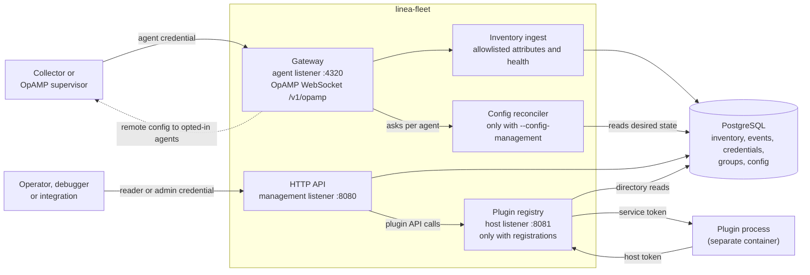

# Linea fleet

Linea fleet is a standalone OpenTelemetry fleet server. Collectors report to
it over OpAMP and it keeps an inventory of them. It runs without the debugger
or plugins.

- **Interfaces:** an authenticated HTTP API and an OpAMP WebSocket gateway.
- **Storage:** PostgreSQL holds inventory, change events, scoped credentials
  and revisioned groups.
- **Enrollment:** deployment bearer tokens.
- **Extensions:** optional process-separated [plugins](plugins.md).
- **Default behavior:** reporting only. Fleet sends no configuration,
  package, restart or capture commands. [Config
  management](#optional-config-management) is an opt-in.
- **Not supported:** HTTP polling, interactive SSO, multiple organizations.

| Term | Meaning |
| --- | --- |
| Agent | A Collector (or an OpAMP supervisor) that connects to fleet |
| Credential | A bearer token. An *agent* credential lets Collectors enroll and report. A *reader* or *admin* credential calls the management API |
| Group | A named set of agents: a static list or a selector |
| Plugin | A separate process that extends fleet, such as live capture |

## How it fits together

Fleet is one process with two authenticated listeners and separate
credentials, backed by PostgreSQL. Plugins and config management are opt-in.



*The ports are the Compose defaults. Both published ports bind to host
loopback. The plugin host listener (8081) exists only with plugin
registrations and stays on an internal network. The dotted arrow is the only
path that sends configuration.*

| Listener | Port | Takes | Credential |
| --- | --- | --- | --- |
| Agent | 4320 | OpAMP at `/v1/opamp` | Agent |
| Management | 8080 | HTTP API, `/metrics`, probes | Reader or admin |
| Plugin host | 8081 | Plugin host services | Plugin host token |

One server holds up to 10,000 Collectors. For availability, use
`compose.ha.yaml` (three replicas tested with protocol clients up to 20,000
sessions; real Collectors at that scale were not tested). The base Compose
file runs one replica; see [High availability](deployment.md#high-availability).

## Deploy with Docker

You need Docker with Compose v2 and Linux containers. No host Go is needed.
The `curl` examples also need `jq`. Run the commands from
`deploy/compose/fleet`.

The fleet image is `ghcr.io/lineahq/linea-fleet:${FLEET_VERSION}`. It
defaults to this checkout's release; `docker compose pull fleet` fetches it.
To build from your checkout, set `FLEET_VERSION=dev` on every command and run
`docker compose build fleet` instead of `pull`.

```sh
sh ../../../scripts/fleet/new-deployment-secrets.sh
docker compose pull fleet                   # or, with FLEET_VERSION=dev: docker compose build fleet
docker compose up -d --wait postgres
docker compose run --rm -T migrate
umask 077
docker compose run --rm -T bootstrap > ../../../.local/deployment/admin.json
docker compose up -d --wait fleet
ADMIN="Authorization: Bearer $(jq -r .token ../../../.local/deployment/admin.json)"
curl -s -H "$ADMIN" http://127.0.0.1:8080/api/v1/server
```

- **Windows:** use PowerShell 7 and the commands in [First
  installation](deployment.md#first-installation).
- **Admin token:** bootstrap discloses it once. Keep the secret directory and
  the PostgreSQL volume across restarts. To keep secrets outside the
  checkout, see [Secrets outside the
  checkout](deployment.md#secrets-outside-the-checkout).
- **Endpoints:** management on [localhost:8080](http://127.0.0.1:8080/healthz),
  OpAMP on `ws://127.0.0.1:4320/v1/opamp`.

Next steps: [Docker operating guide](deployment.md) (ports, TLS ingress,
restart, upgrade, backup, restore), the [livecapture
plugin](livecapture.md) (its own image, database and public consumer API; core
runs without it), [operational metrics](operations-metrics.md), the [capacity
harness](../../tools/fleet-capacity/README.md), and the [OpAMP
simulator](../../tools/fleet-capacity/simulator.md) for hundreds of
connections without hundreds of Collector processes.

## Public API

Data and metrics endpoints need a reader or admin database credential. Agent
credentials enroll and report for many Collectors and cannot read the
management API. JSON requests are strict and at most 64 KiB. Failed requests
return an error object with `code` and `message`.

| Endpoint | Access / behavior |
| --- | --- |
| GET /healthz, GET /readyz | Anonymous process liveness, database readiness |
| GET /api/v1/server | Identity, version, storage, limits and plugin discovery |
| GET /api/v1/agents | Keyset inventory: `limit`, `after`, `connected`, `healthy`, `selector`, `sort` |
| GET /api/v1/agents/{id} | Current agent detail: attributes, health, components, config hash |
| GET /api/v1/summary | Inventory aggregates, optionally `group_by` a promoted attribute |
| GET /api/v1/plugins, GET /api/v1/plugins/{id} | Configured plugin identity, permissions and readiness |
| GET /api/v1/plugins/{id}/status | Reader/admin; bounded plugin-owned status |
| POST /api/v1/plugins/{id}/lifecycle | Admin; durable drain, disable or enable with `If-Match` revision |
| /api/v1/plugins/{id}/api/{path} | Authenticated opaque JSON ingress; the plugin owns schemas and domain authorization |
| GET /api/v1/events | Bounded meaningful changes: `cursor`, `limit`, `wait` (long-poll up to 30 s) |
| GET /api/v1/groups, GET /api/v1/groups/{id} | Group metadata; static members or canonical selector |
| GET /api/v1/groups/{id}/agents | Current members as agent pages |
| PUT /api/v1/groups/{id}, DELETE /api/v1/groups/{id} | Admin; static `agent_ids` or selector; quoted `If-Match` revision required |
| GET /api/v1/credentials, GET /api/v1/credentials/{id} | Admin; metadata only, never tokens or hashes |
| POST /api/v1/credentials, DELETE /api/v1/credentials/{id} | Admin; one-time issuance, persistent revocation |
| PATCH /api/v1/credentials/{id} | Admin; sets the `remote_config` opt-in ([config management](config-management.md)) |
| GET /api/v1/openapi.json | [OpenAPI 3.1 contract](../../internal/fleet/api/openapi.json) |
| GET /metrics | Authenticated, fixed-cardinality Prometheus metrics |

Reading data:

- Lists default to 100 items and cap at 500. Pass `next_after` back with the
  same filters. Pages are current state, not snapshots.
- Events arrive in commit order and are observations, never commands.
  Cursors survive restarts and work on any replica.
- A cursor answers 410 after a retention gap or a restore into another
  cluster. Refresh state and start again without a cursor.
- Connectivity, health and telemetry delivery are separate facts. A crashed
  replica's agents read as disconnected within 10 s, with health preserved.
- A second connection with an active UID takes over and advances
  `generation`. Three takeovers within a minute flag `identity_conflict`
  (cloned identities).

## Register Collectors with a deployment token

With the admin token, issue one reusable agent token for the whole
deployment. No Collector UID or per-pod registration is needed.

```sh
API=http://127.0.0.1:8080/api/v1
curl -s -H "$ADMIN" -H 'Content-Type: application/json' -X POST $API/credentials -d '{
  "id": "'$(openssl rand -hex 16)'", "name": "production-collectors", "role": "agent",
  "expires_at": "'$(date -u -d '+30 days' +%FT%TZ)'"}'
```

`date -d` is GNU date; on macOS use `date -u -v+30d +%FT%TZ`. The response
holds the token once. In PowerShell:

~~~powershell
$fleetKeyID = [Guid]::NewGuid().ToString('N')
$fleetRequest = @{
    id = $fleetKeyID
    name = 'production-collectors'
    role = 'agent'
    expires_at = [DateTime]::UtcNow.AddDays(30).ToString('o')
} | ConvertTo-Json
$fleetAgent = Invoke-RestMethod -Method Post http://127.0.0.1:8080/api/v1/credentials -Headers $fleetHeaders -ContentType application/json -Body $fleetRequest
~~~

On every Collector of that deployment:

| Setting | Value |
| --- | --- |
| `LINEA_FLEET_AGENT_TOKEN` | The returned `token` |
| `LINEA_FLEET_OPAMP_ENDPOINT` | `ws://127.0.0.1:4320/v1/opamp` for local Compose |
| Collector config | The [same file](../../examples/fleet-collector.yaml) for every replica; the OpAMP extension generates a distinct instance UID |

Each first authenticated report registers its Collector. Credentials have no
UID binding.

Identity:

- Automatic UIDs change when the Collector restarts. For a stable inventory
  identity, set a unique `instance_uid` per instance locally. Fleet still
  needs no pre-registration.
- The token authenticates deployment membership; the UID is self-reported. A
  second connection with the same UID replaces the first.
- The example is verified with the official Collector Contrib 0.162.0 Linux
  image over WebSockets. It disables sensitive config reporting and restart
  capability.
- The server discards arbitrary config, descriptions and free-form health
  details.

Credential rules:

| Rule | Detail |
| --- | --- |
| IDs | Caller-chosen, exactly 32 lowercase hex characters (a GUID in `N` format). Anything else, such as a name, is refused with 400 `invalid_argument` and `invalid request: id must be 32 lowercase hexadecimal characters`. Group, config and rollout IDs use the same format |
| Error messages | Every `invalid_argument` names the field and the rule it broke, never the submitted value |
| Retry | Retrying a successful create returns 409 and does not disclose the token again. After an uncertain disclosure, query, revoke and reissue with a new ID |
| Expiry | Required, at most 365 days |
| `agent_id` | Not accepted by the credential API |
| `labels` | Up to 16, used by plugins and config management ([labels](plugins.md#serving-an-unchanged-collector-component)) |
| Revocation | Closes every session using the credential and blocks new registrations and state publication |
| Rotation | Issue another agent token, update the deployment's secret, then revoke the old token |
| Capacity | At most 1,000 credentials, revoked metadata included |

## Groups

A group is static or selector-based (`kind`). A request has a `name` and
exactly one of `agent_ids` or `selector`. The group ID is a 32-hex ID you
choose.

| Kind | Content |
| --- | --- |
| Static | `agent_ids`: up to 1,000 agent UIDs (32 hex each) |
| Selector | `selector`, evaluated whenever the group is read: a comma-separated AND of up to 8 terms over promoted and allowlisted attributes. Each term is `key=value`, `key in (a,b)` or a bare `key` (present). No regexes or other forms |

Send a quoted `If-Match` of `"0"` to create, and the current quoted revision
to replace or delete. At most 1,000 groups.

```sh
GROUP=$(openssl rand -hex 16)
curl -s -H "$ADMIN" -H 'If-Match: "0"' -H 'Content-Type: application/json' -X PUT $API/groups/$GROUP   -d '{"name": "shop", "selector": "k8s.namespace.name=shop,service.name in (cart,checkout)"}'
curl -s -H "$ADMIN" $API/groups/$GROUP/agents
```

In PowerShell:

~~~powershell
$fleetGroupID = [Guid]::NewGuid().ToString('N')
$fleetGroup = @{ name = 'shop'; selector = 'k8s.namespace.name=shop,service.name in (cart,checkout)' } | ConvertTo-Json
Invoke-RestMethod -Method Put "http://127.0.0.1:8080/api/v1/groups/$fleetGroupID" -Headers ($fleetHeaders + @{ 'If-Match' = '"0"' }) -ContentType application/json -Body $fleetGroup
Invoke-RestMethod "http://127.0.0.1:8080/api/v1/groups/$fleetGroupID/agents" -Headers $fleetHeaders
~~~

Operations that target a group, such as captures, resolve it to a fixed set
of agents at admission and record that snapshot. Later edits do not change an
admitted operation. Fleet owns these definitions.

## Optional config management

By default the server never sends configuration, and Collectors keep
whatever config management you already use. With `--config-management`,
supervised Collectors (the official OpAMP supervisor with the unmodified
Collector) whose credential is opted in receive versioned, layered config
through rollouts in waves, while every other Collector keeps reporting
([mixed fleets](config-management.md#mixed-fleets)).
[`compose.supervised.yaml`](../../deploy/compose/fleet/compose.supervised.yaml)
adds the flag and an example supervised Collector. The [operator
guide](config-management.md) covers setup and operation.

## Optional plugins

Plugins are separate processes with authenticated manifests, discovery, a
durable admin lifecycle and an opaque public API. They use generic host
services: an agent directory, attribute and group resolution, and
introspection of agent credentials (whose labels carry plugin allowances). A
Collector component plus a registered plugin service works without changes to
core or the component. Fleet starts with zero plugins.

| Resource | Use |
| --- | --- |
| [Plugin guide](plugins.md) | The full contract |
| [Plugin SDK](../../pluginsdk/README.md) | The contract in Go |
| [`examples/fleet-agent-summary-plugin`](../../examples/fleet-agent-summary-plugin) | A complete template with a Dockerfile and a Compose overlay |
| [Livecapture plugin](livecapture.md) | Capture execution and consumer delivery over the unchanged Collector extension's gRPC control and OTLP wire. Collectors authenticate with their fleet agent credential; captures can target agents, groups or selectors. Its module, image, authorization and database are independent of core |

## Run without Docker (development)

Go 1.27 or later is needed only for source development. Fleet can run in
memory with tokens from the environment:

```sh
export LINEA_FLEET_API_TOKEN=$(openssl rand -hex 32)
export LINEA_FLEET_AGENT_TOKEN=$(openssl rand -hex 32)
go run ./cmd/linea-fleet --storage memory --server-id local-fleet
```

~~~powershell
$env:LINEA_FLEET_API_TOKEN = [Convert]::ToHexString([System.Security.Cryptography.RandomNumberGenerator]::GetBytes(32))
$env:LINEA_FLEET_AGENT_TOKEN = [Convert]::ToHexString([System.Security.Cryptography.RandomNumberGenerator]::GetBytes(32))
go run ./cmd/linea-fleet --storage memory --server-id local-fleet
~~~

- Memory mode keeps nothing across restarts and has no group, credential or
  event administration.
- PostgreSQL mode rejects these two variables. Unset them before starting the
  durable server and issue tokens through the credential API.
- Runtime flags bound agents, connections, messages and retained events (see
  [server flags](deployment.md#server-flags)). These are admission bounds,
  not capacity claims.

Tests and validation scripts are in [fleet
verification](../internals/fleet-verification.md).

## Documentation

- [Docker installation, backup, restore and upgrades](deployment.md)
- [Config management operator guide](config-management.md)
- [Public OpenAPI contract](../../internal/fleet/api/openapi.json)
- [Plugins: registration, lifecycle and host protocol](plugins.md), the
  [plugin SDK](../../pluginsdk/README.md) and the [example
  plugin](../../examples/fleet-agent-summary-plugin)
- [Livecapture plugin](livecapture.md)
  ([module README](../../internal/fleetplugins/livecapture/README.md))
- [Operational metrics and capacity limits](operations-metrics.md)
- [Capacity harness](../../tools/fleet-capacity/README.md) and [agent
  simulator](../../tools/fleet-capacity/simulator.md)
- Developer notes: [server internals](../internals/fleet-server.md), [plugin
  host](../internals/fleet-plugin-host.md), [config
  management](../internals/fleet-config-management.md),
  [livecapture](../internals/fleet-livecapture.md), [verification](../internals/fleet-verification.md)
