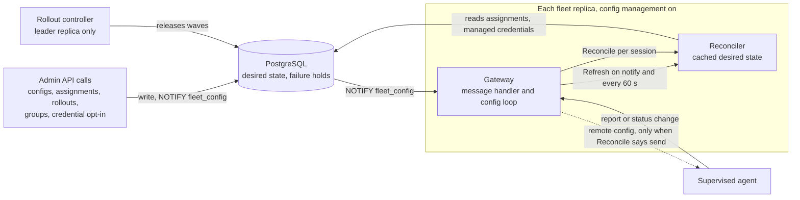
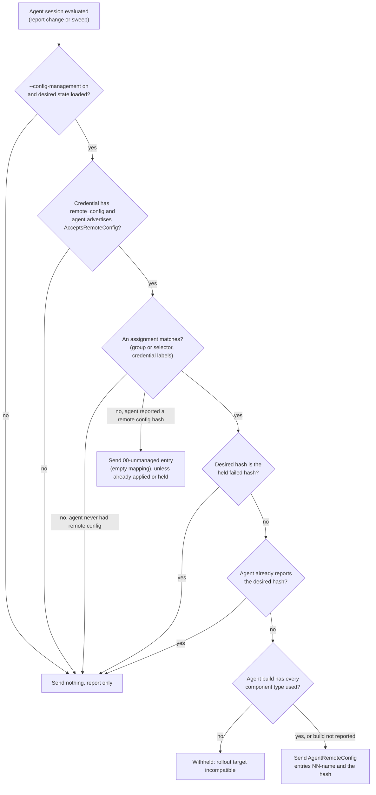

# Config management operator guide

Config management is optional. Without it, fleet only reports: it never
sends configuration, and Collectors are configured by whatever you already
use (Helm, the OpenTelemetry Operator, Ansible, GitOps, images). This guide
covers turning it on, connecting supervised Collectors and changing
configuration safely.

- API reference: [`internal/fleet/api/openapi.json`](../../internal/fleet/api/openapi.json).
- The examples use `curl` and `jq` against the default loopback ports.
- How the server decides and sends: [internals](../internals/fleet-config-management.md).

## How it fits together

| Part | Role |
| --- | --- |
| Collector host | The official [OpAMP supervisor](https://github.com/open-telemetry/opentelemetry-collector-contrib/tree/main/cmd/opampsupervisor) runs the unmodified Collector. It receives config, merges it over its local files, validates it, restarts the Collector and rolls back locally if the Collector does not stay healthy. Fleet never embeds or requires a supervisor |
| Server | You store immutable config versions and assign them to agents as layers. Every change reaches agents through a rollout in waves, which pauses or rolls back when agents fail |
| Delivery | No commands are queued. Desired state lives in PostgreSQL; the replica holding an agent's session sends its config when the desired hash differs from the reported one. Replica restarts, kills and database failovers lose nothing and send nothing twice |



*Admin changes and the rollout controller only change desired state in
PostgreSQL. Each replica sends config itself, in the reply to a report from
an agent it holds or in a paced sweep of its own sessions; the API never
sends anything.*

An agent receives remote config only when all four hold; otherwise it only
reports:

1. The server runs with `--config-management` (PostgreSQL only).
2. The agent's credential has `remote_config: true` (admin-set, default
   false).
3. The agent advertises `AcceptsRemoteConfig`: a supervisor with
   `capabilities.accepts_remote_config: true`. The contrib `opamp` extension
   never does.
4. At least one assignment matches the agent.



*The send rule for one session. A hash is also not sent again for 30 s while
the agent has not reported it, and delivery waits up to 10 s after a
reconnect for the agent's full state and up to 10 s for a requested
component list.*

- Fleet sends no restart, package or connection-settings commands in any
  mode.
- Mixed fleets are normal: opted-in supervised Collectors are managed and
  everything else keeps reporting.
- Turning the flag off stops all sends at once. Agents keep running what they
  last applied, and supervisors keep it across restarts.
- A Collector or supervisor talks to exactly one OpAMP server, so an agent
  managed by another OpAMP server cannot also report here.

## Turn it on

With the debugger's deployments, set `LINEA_FLEET_CONFIG_MANAGEMENT=true`
for the Compose stack with fleet
([settings](../debugger/deploy-compose.md#fleet-and-live-capture)) or
`fleet.deploy.configManagement: true` in the Helm chart
([Fleet and live capture](../debugger/deploy-kubernetes.md#fleet-and-live-capture)).
For fleet's own Compose files, the overlay
[`compose.supervised.yaml`](../../deploy/compose/fleet/compose.supervised.yaml)
adds `--config-management` to fleet and one example supervised Collector: the
official `opentelemetry-collector-opampsupervisor` image with the official
contrib Collector binary copied in
([`deploy/docker/linea-fleet-supervised-collector.Dockerfile`](../../deploy/docker/linea-fleet-supervised-collector.Dockerfile)).
After the [first installation](deployment.md#first-installation), run from
`deploy/compose/fleet`:

```sh
docker compose -f compose.yaml -f compose.supervised.yaml up -d --wait fleet
ADMIN="Authorization: Bearer $(jq -r .token ../../../.local/deployment/admin.json)"
API=http://127.0.0.1:8080/api/v1
curl -s -H "$ADMIN" $API/server | jq .config_management   # true
```

Use the same `-f` files on every later Compose command for this project. On
an existing deployment, recreating fleet with the overlay is enough; the
config tables exist in every mode. Without the flag, the config routes
(`/api/v1/configs`, `/api/v1/config-assignments`, `/api/v1/rollouts`,
`/api/v1/agents/{id}/config`) answer 404 `config_management_disabled`.

## Opt in a credential

Agent credentials are reusable across Collectors. Issue one for the
Collectors fleet may manage, or opt in an existing one:

```sh
curl -s -H "$ADMIN" -H 'Content-Type: application/json' -X POST $API/credentials -d '{
  "id": "'$(openssl rand -hex 16)'", "name": "supervised-prod", "role": "agent",
  "remote_config": true, "labels": {"env": "prod"},
  "expires_at": "'$(date -u -d '+90 days' +%FT%TZ)'"}' > ../../../.local/deployment/supervised.json
# or: PATCH $API/credentials/{id} with {"remote_config": true}
```

- The token is disclosed once: keep it in your secret manager.
- Labels are optional, set by admins and verified by the server. Agent
  attributes are self-reported, so assignments that matter should also
  require `credential_labels`, not attributes alone.

## Connect supervised Collectors

The example Collector reads the token from its environment:

```sh
LINEA_FLEET_AGENT_TOKEN=$(jq -r .token ../../../.local/deployment/supervised.json) \
  docker compose -f compose.yaml -f compose.supervised.yaml up -d collector
```

On other hosts, run the same image (or the supervisor binary next to a
Collector) with a supervisor config like
[`supervisor.yaml`](../../deploy/compose/fleet/supervisor/supervisor.yaml):

| Setting | Value |
| --- | --- |
| `server.endpoint` | `wss://<fleet>/v1/opamp` through TLS |
| `server.headers.Authorization` | `Bearer ${env:LINEA_FLEET_AGENT_TOKEN}`. The supervisor expands `${env:...}`; the token is never written to a file |
| `capabilities` true | `accepts_remote_config`, `reports_effective_config`, `reports_health`, `reports_heartbeat`, `reports_available_components` |
| `capabilities` false | `accepts_restart_command`, `accepts_opamp_connection_settings` |
| `agent.validate_config` | `true`: an invalid config is reported failed and the running one stays |
| `agent.automatic_config_rollback` | `true`: a crashing config is rolled back locally |
| `agent.config_apply_timeout` | `30s`. A config is reported applied only after the Collector stayed healthy that long, so it also sets the minimum time per rollout wave. The supervisor's default of 5 s can report a slow-starting Collector as failed |
| `agent.config_files` | The local base that remote layers merge over, and what runs when the agent is unmanaged. The Collector needs at least one pipeline; [`local.yaml`](../../deploy/compose/fleet/supervisor/local.yaml) is a placeholder that does nothing |
| `storage.directory` | On a persistent volume: keeps the instance UID and the last applied config across restarts |

`GET $API/agents/{id}/config` shows whether an agent can be managed
(`credential_remote_config`, `accepts_remote_config`), its desired layers and
hash, what it reported, and `in_sync`.

## Mixed fleets

One server with `--config-management` serves managed and reporting-only
Collectors at once. The mode follows from each agent's credential and the
OpAMP client it runs; there is no per-agent switch on the server.

| | Reporting only | Managed |
| --- | --- | --- |
| Credential | An agent credential with `remote_config` false (the default) | A separate agent credential with `remote_config: true` and a label such as `{"managed": "fleet"}` |
| OpAMP client | The contrib `opamp` extension in the Collector config ([example](../../examples/fleet-collector.yaml)) | The supervisor ([above](#connect-supervised-collectors)) with `accepts_remote_config: true` |
| Config source | Your existing tooling (Helm, the OpenTelemetry Operator, GitOps) | Fleet layers merged over the supervisor's local `config_files` |

- Add the managed credential's label to every assignment as
  `credential_labels`, so previews and rollout targets count only managed
  agents.
- A reporting Collector cannot be managed by mistake. A plain Collector with
  the managed token still only reports, because the `opamp` extension never
  advertises `AcceptsRemoteConfig`. A supervisor with the reporting token
  also only reports.
- To move a Collector to managed, run it under the supervisor with the managed
  token. Put the config it must keep running into the supervisor's local
  `config_files`, so it runs before any assignment matches and after the
  agent is unmanaged.
- To move one Collector back to reporting, set `accepts_remote_config: false`
  in its supervisor or give it the reporting token. It keeps its last applied
  config. Turning off `remote_config` on a shared credential returns every
  Collector using that token to reporting.
- Each Collector or supervisor talks to one OpAMP server, so both groups
  connect to this fleet.

## Store config versions

A config is a named container of immutable, numbered versions:

```sh
curl -s -H "$ADMIN" -H 'Content-Type: application/json' -X POST $API/configs \
  -d '{"id": "'$CONFIG'", "name": "base", "description": "OTLP to the gateway"}'
curl -s -H "$ADMIN" -H 'Content-Type: application/json' -X POST $API/configs/$CONFIG/versions \
  -d "$(jq -n --rawfile body base.yaml '{body: $body, message: "initial"}')"
```

| Rule | Detail |
| --- | --- |
| Body | Collector YAML up to 128 KiB with only the top-level keys `receivers`, `processors`, `exporters`, `connectors`, `extensions`, `service`. The server does not merge or render YAML; the supervisor validates against the real Collector |
| Secrets | Must be `${env:...}` or `${file:...}` references resolved on the host. Literal values under secret-looking keys, header values and URL passwords are rejected with 422 `inline_secret` |
| Component allowlist | `--config-allowed-components receiver:otlp,processor:batch,...` restricts the component types versions may use (422 `invalid_config`). Unset allows any |
| Visibility | Bodies are readable only with `admin` and never appear in events, logs or metrics |
| Retention | Each config keeps its newest 100 versions plus every version an assignment references |
| Count | At most 1,000 configs |

## Assign versions as layers

An assignment targets exactly one of a group (`group_id`) or a selector over
stored attributes (`selector`, for example
`k8s.namespace.name=shop,service.name in (cart,checkout)`), optionally
narrowed by `credential_labels`.

- Its `layer` (0 to 99) orders it. Each matching assignment becomes one
  config entry named `NN-<name>`. The supervisor merges entries in name
  order, so higher layers override lower ones key by key, over the local
  `config_files`.
- At most 8 assignments may match one agent. An agent matching more is sent
  nothing new (a reconcile error) and its view reports `too_many_layers`.
- At most 1,000 assignments.
- Creating an assignment starts its first rollout.

```sh
curl -s -H "$ADMIN" -H 'Content-Type: application/json' -X POST $API/config-assignments -d '{
  "id": "'$ASSIGNMENT'", "name": "base", "config_id": "'$CONFIG'", "version": 1,
  "layer": 10, "selector": "deployment.environment=prod",
  "credential_labels": {"env": "prod"},
  "rollout": {"waves": [{"percent": 5}, {"percent": 25}, {"percent": 100}]}}'
```

`POST $API/config-assignments/{id}:preview` lists the agents an assignment
targets now, with the desired config each would receive, before or after you
create it.

## Roll out changes

Every change is a rollout: `POST $API/rollouts` with `to_version` moves an
assignment, `delete: true` removes it.

```sh
curl -s -H "$ADMIN" -H 'Content-Type: application/json' -X POST $API/rollouts -d '{
  "assignment_id": "'$ASSIGNMENT'", "to_version": 2, "canary_group_id": "'$CANARIES'",
  "bake_seconds": 300, "max_failure_percent": 2, "on_failure": "rollback"}'
```

| Field | Default | Meaning |
| --- | --- | --- |
| `waves` | 1 agent, 5 %, 25 %, 100 % | Cumulative boundaries by `count` or `percent`, up to 10 |
| `canary_group_id` | none | This group's targets form wave 0, before the waves |
| `bake_seconds` | 120 | How long a target must stay applied and healthy to succeed |
| `wave_timeout_seconds` | 900 | Connected targets of the current wave that have not applied by then time out |
| `max_failures`, `max_failure_percent` | 0, 5 | The rollout breaches when failures exceed the larger of the two, per wave or in total |
| `on_failure` | `pause` | `pause` or `rollback` on a breach |

The target set is fixed when the rollout starts. Target outcomes:

| Outcome | Meaning | Counts against thresholds |
| --- | --- | --- |
| `succeeded` | Applied and stayed healthy | no |
| `failed`, `unhealthy`, `timed_out` | Failure | yes |
| `offline` | Disconnected | no, and does not block waves |
| `unmatched` | No longer targeted | no |
| `incompatible` | Build lacks a component type ([below](#component-compatibility)) | no |

Watch with `GET $API/rollouts/{id}` and
`GET $API/rollouts/{id}/targets?outcome=failed`. Control with
`POST $API/rollouts/{id}:<action>`:

| Action | Effect |
| --- | --- |
| `:pause` | Stops releasing waves |
| `:resume` | Continues; accepts the failures seen so far |
| `:rollback` | Returns every released target to the assignment's previous version at once; ends `rolled_back` when they report it |
| `:cancel` | Ends the rollout at once with the same desired state |

Limits and rules:

- A cancelled or rolled-back rollout that created its assignment removes it.
- An agent is in at most one active rollout. An overlapping rollout answers
  409 `rollout_conflict`.
- A rollout targets at most 20,000 agents. At most 50 run at once. The newest
  100 finished rollouts are kept.
- The leader replica runs the controller. After a leader change the next
  leader resumes from the database.

## Failures, holds and retries

| Situation | Result |
| --- | --- |
| Supervisor rejects a config | Reported `failed`; the Collector keeps its previous config |
| Config crashes the Collector | The supervisor rolls back locally and reports the previous config as applied |

- In both cases the server holds the failed hash (`reported.held_hash`) and
  does not send it again, so a supervisor and the server never loop.
- The hold ends when the desired config changes, or with
  `POST $API/agents/{id}/config:retry`, which sends it exactly once more.
- The supervisor's error text can quote config, so it is stored only with
  `--store-health-errors`, redacted and truncated to 256 bytes.

## Component compatibility

Supervisors with `reports_available_components: true` report which component
types their Collector build contains. The server asks for the full list once
per build.

- A version using a type the build lacks is not released to that build's
  agents. Their rollout targets end `incompatible`, which neither blocks
  waves nor counts as a failure. Nothing is sent to fail on the host.
- `GET $API/agents/{id}/config` lists `missing_components`, for example
  `receiver:kafka`.
- Agents that do not report components are not checked. The supervisor's own
  validation still catches unknown types.

## Unmanage an agent

When a managed agent stops matching any assignment (deleted assignment,
changed selector, removed from the group), the server sends a single
`00-unmanaged` entry with an empty document. The supervisor then runs only
its local `config_files`. The server never sends an empty config map, which
would stop the Collector.

To stop managing a Collector entirely, turn off `remote_config` on its
credential or `accepts_remote_config` in its supervisor. It then keeps its
last applied config and only reports.

## Monitor

On `/metrics` (fleet read access):

| Metric | Meaning |
| --- | --- |
| `linea_fleet_config_sends_total{path}` | Configs sent, in replies to reports or pushed asynchronously (at most 200/s per replica) |
| `linea_fleet_config_holds_total` | Failure holds set |
| `linea_fleet_config_incompatible_total` | Sends withheld for a build that lacks a component type |
| `linea_fleet_config_component_sets_requested_total`, `..._stored_total` | Builds asked for and stored |
| `linea_fleet_config_reconcile_errors_total`, `linea_fleet_config_storage_errors_total` | Decisions or hold writes that failed; nothing is sent then |
| `linea_fleet_config_body_cache_bytes` | Version bodies cached per replica (64 MiB bound) |
| `linea_fleet_rollout_controller_errors_total` | Controller ticks that failed on the leader |

The event stream carries:

| Group | Events |
| --- | --- |
| Rollout | `rollout.created`, `rollout.wave_released`, `rollout.paused` (reason `operator` or `threshold`), `rollout.resumed`, `rollout.rolling_back`, `rollout.rolled_back`, `rollout.completed`, `rollout.cancelled` |
| Config | `config.created`, `config.updated`, `config.deleted`, `config.version_created`, `config.assignment_changed`, `config.held`, `config.hold_cleared` |

Agents' reported config status changes arrive as agent changes, like other
inventory.

## Troubleshooting

| Symptom | Check |
| --- | --- |
| Agent never gets config | Its view: `credential_remote_config`, `accepts_remote_config`, `desired`. No `desired` means no assignment matches; `:preview` the assignment |
| Rollout target `incompatible` | `missing_components` in the agent view: deploy a build with those types, or change the version |
| Target `failed` | `reported.status` and, with `--store-health-errors`, `reported.error`. Fix the version and roll out again, or `:retry` |
| Target `timed_out` | The Collector did not stay healthy for the supervisor's `config_apply_timeout` within `wave_timeout_seconds` |
| Rollout `paused` with reason `threshold` | `targets?outcome=failed`, then `:resume` to accept or `:rollback` |
| Config routes return 404 `config_management_disabled` | Fleet runs without `--config-management` |
