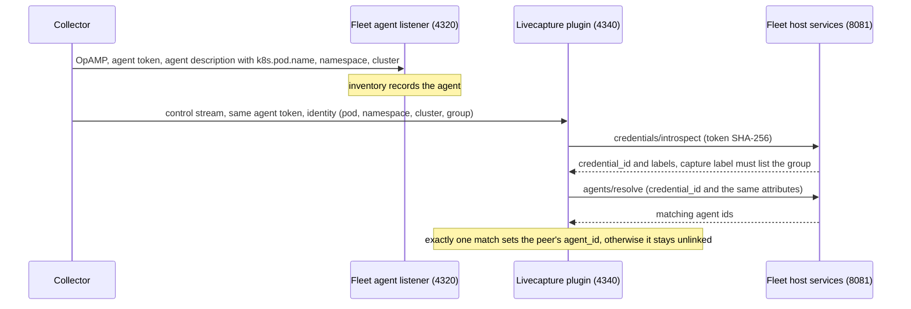
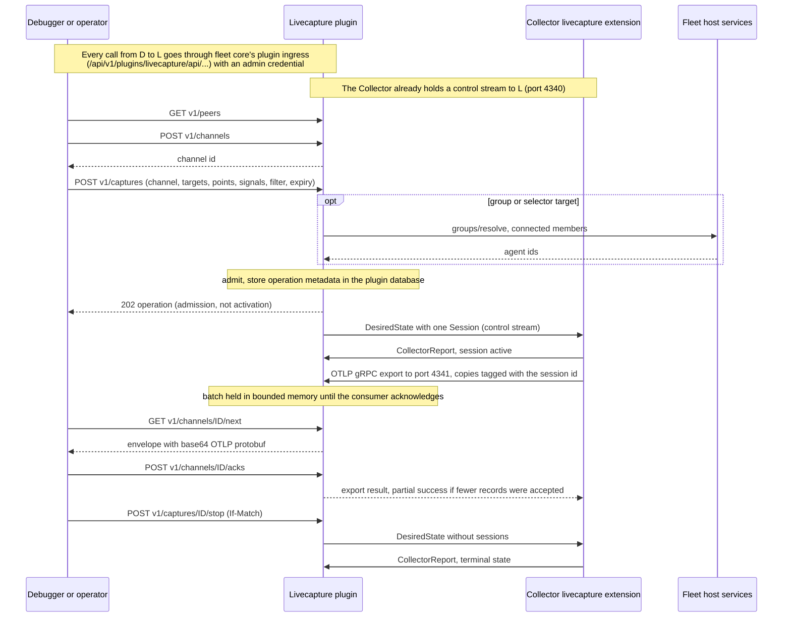

# Optional livecapture plugin

Livecapture is an optional fleet server plugin, usable without a debugger.
Core supplies generic registration, authentication and opaque API forwarding.
The plugin owns everything else about capture.

| Topic | Detail |
| --- | --- |
| Plugin owns | Capture authorization, schemas, execution, gRPC and OTLP listeners, consumer delivery, its own PostgreSQL database |
| Collector side | Unchanged components. Collectors authenticate with fleet agent credentials, so one core revocation stops both reporting and capture |
| Targets | Fleet agents, groups or selectors |
| Versions | Plugin 0.4.0, API schema 2.3.0, on [host protocol 3](plugins.md) |
| Without it | Fleet reporting stays independently usable |

Related: [operational metrics](operations-metrics.md), [how the plugin works
inside](../internals/fleet-livecapture.md).

## Install with Docker

Start from the [fleet installation](deployment.md). You need Docker Compose
v2 with Linux containers. From `deploy/compose/fleet` (script paths are
relative to it), with the defaults (secrets in `.local/livecapture`, Compose
project `linea-fleet`, no env file):

```sh
sh ../../../scripts/fleet/livecapture/new-secrets.sh
capture_compose="--project-name linea-fleet -f compose.yaml -f compose.livecapture.yaml"
docker compose $capture_compose pull fleet livecapture-plugin
docker compose $capture_compose up -d --wait capture-postgres
docker compose $capture_compose run --rm -T capture-migrate
docker compose $capture_compose stop fleet
docker compose $capture_compose run --rm -T migrate
docker compose $capture_compose up -d --wait fleet
docker compose $capture_compose up -d --wait livecapture-plugin
```

In PowerShell 7 (not Windows PowerShell 5.1):

```powershell
../../../scripts/fleet/livecapture/new-secrets.ps1
$captureCompose = @('--project-name','linea-fleet','-f','compose.yaml','-f','compose.livecapture.yaml')
docker compose @captureCompose pull fleet livecapture-plugin
docker compose @captureCompose up -d --wait capture-postgres
docker compose @captureCompose run --rm -T capture-migrate
docker compose @captureCompose stop fleet
docker compose @captureCompose run --rm -T migrate
docker compose @captureCompose up -d --wait fleet
docker compose @captureCompose up -d --wait livecapture-plugin
```

- **Existing installation:** use your project name, env file (add
  `--env-file PATH` after the project name), server ID and secrets. Back up
  first. No new bootstrap is needed.
- **Versions are separate:** core database schema 10; plugin database schema
  3 (own roles, volume and checksummed migrations 001 to 003); plugin 0.4.0;
  plugin API schema 2.3.0.
- **Registration:** grants `agents.read` and `credentials.introspect`.
- **Combined plugins:** several plugins need one explicit registration file
  and distinct mounted directional credentials for each.
- **Startup order:** core can become healthy before the plugin. Check
  authenticated discovery too.

| Variable | Default | Meaning |
| --- | --- | --- |
| `CAPTURE_VERSION` | this checkout's release | Tag of `ghcr.io/lineahq/linea-fleet-livecapture` (core uses `FLEET_VERSION`) |
| `CAPTURE_CONTROL_PORT` | 4340 | Host loopback gRPC control port |
| `CAPTURE_DELIVERY_PORT` | 4341 | Host loopback OTLP delivery port |
| `FLEET_LIVECAPTURE_SECRET_DIR` | `.local/livecapture` | Plugin secret files |

To build both images from the checkout, set `FLEET_VERSION=dev` and
`CAPTURE_VERSION=dev` on every command and run
`build fleet livecapture-plugin` instead of `pull`. `up` and `run` use an
existing image and build only a missing one.

Secret factory:

- Needs `openssl` and refuses to overwrite `.local/livecapture`.
- Builds the files beside the target and moves them into place only when all
  exist. If it fails (for example when `openssl` cannot write the TLS
  identity) it prints the reason and leaves no directory: run it again.
- The directory holds credentials and the server private key. Protect it and
  its backups.

To keep secrets outside the checkout, give the factory an absolute directory
that does not exist yet and set `FLEET_LIVECAPTURE_SECRET_DIR` to the same
path, together with `FLEET_SECRET_DIR` for the core secrets
([deployment](deployment.md#secrets-outside-the-checkout)). Example env file
`/srv/fleet/compose.env`, used with `--env-file` on every command:

```sh
sh ../../../scripts/fleet/livecapture/new-secrets.sh /srv/fleet/secrets/livecapture
printf 'FLEET_SECRET_DIR=/srv/fleet/secrets/deployment\nFLEET_LIVECAPTURE_SECRET_DIR=/srv/fleet/secrets/livecapture\n' > /srv/fleet/compose.env
capture_compose="--project-name linea-fleet --env-file /srv/fleet/compose.env -f compose.yaml -f compose.livecapture.yaml"
```

The PowerShell equivalent, with `C:\fleet\compose.env`:

```powershell
../../../scripts/fleet/livecapture/new-secrets.ps1 -Directory C:\fleet\secrets\livecapture
Set-Content C:\fleet\compose.env "FLEET_SECRET_DIR=C:/fleet/secrets/deployment`nFLEET_LIVECAPTURE_SECRET_DIR=C:/fleet/secrets/livecapture"
$captureCompose = @('--project-name','linea-fleet','--env-file','C:\fleet\compose.env','-f','compose.yaml','-f','compose.livecapture.yaml')
```

If Docker reports `all predefined address pools have been fully subnetted`,
add an IPAM override file as the last `-f`
([deployment](deployment.md#docker-address-pools)).

### Containers and ports

- The plugin runs as UID 65532 with a read-only root, two CPUs and 512 MiB.
- Its database is on a separate private network with no published port.
  Neither runtime can reach the other's database network.
- Plugin HTTP (8090) and fleet host (8081) are private.

| Port | Use | Published |
| --- | --- | --- |
| 4320 | Fleet OpAMP | loopback by default |
| 4340 | Plugin gRPC control | loopback by default (`CAPTURE_CONTROL_PORT`) |
| 4341 | Plugin OTLP delivery | loopback by default (`CAPTURE_DELIVERY_PORT`) |

Collectors on other hosts or in a cluster need all three listeners. The
debugger needs only fleet's management listener. Expose them through your
ingress or load balancer.

### TLS

- The generated 90-day local certificate covers `localhost`, `127.0.0.1` and
  `livecapture-plugin`. Collectors reaching the plugin by another name need a
  certificate naming it.
- For remote deployment use managed PKI, matching DNS names and protected
  ingress.
- Collectors verify the server certificate and present their fleet agent
  credential as a bearer token. This is not mutual TLS. Keep verification
  enabled; `test_insecure` is a fixture option.
- The private host and service HTTP links explicitly allow protected
  plaintext. Remote links need a protected transport.

## Connect existing Collectors

Merge the [configuration
fragment](../../examples/fleet-livecapture/collector-fragment.yaml) into a
distribution containing the existing `livecapture` extension and `capture`
processor (to build one, see [Build a Collector with the
components](../collector-components/README.md#build-a-collector-with-the-components)).

- Preserve its production receivers, processors and exporters.
- Add named capture points to selected pipelines.
- Enable the extension in `service.extensions`. No local-control listener is
  needed.

Collectors use the same fleet agent credential for OpAMP and capture. Issue
it with a `capture` label listing the collector groups it may serve, or `*`:

```sh
curl -s -H "$ADMIN" -H 'Content-Type: application/json' -X POST http://127.0.0.1:8080/api/v1/credentials -d '{
  "id": "'$(openssl rand -hex 16)'", "name": "Edge collectors", "role": "agent",
  "expires_at": "'$(date -u -d '+90 days' +%FT%TZ)'", "labels": {"capture": "edge,gateway"}}'
```

`$ADMIN` is the header from the [fleet quick start](README.md#deploy-with-docker).
In PowerShell:

```powershell
$captureBody = @{id=[Guid]::NewGuid().ToString('N'); name='Edge collectors'; role='agent'
  expires_at=[DateTime]::UtcNow.AddDays(90).ToString('o'); labels=@{capture='edge,gateway'}} | ConvertTo-Json
Invoke-RestMethod -Method Post http://127.0.0.1:8080/api/v1/credentials -Headers @{Authorization="Bearer $adminToken"} -ContentType application/json -Body $captureBody
```

| Item | Detail |
| --- | --- |
| Label key | The plugin option `capture_label` selects another key |
| Collector settings | Provision the plugin CA and the returned token securely. Set matching control and delivery addresses. Supply `LINEA_FLEET_AGENT_TOKEN`, `OTEL_CAPTURE_GROUP`, `POD_NAME`, `CLUSTER_NAME`, `POD_NAMESPACE` |
| Reuse | Every replica can reuse the same credential. No UID binding or per-pod registration |
| Registration | The first authenticated control report registers the capture peer and its catalog. The credential's label must include its reported collector group |
| Refusal | A credential that is not an active agent credential with a valid label is refused (`Unauthenticated`) |
| Revocation | Revoking, expiring or relabeling the credential in core closes affected streams within 10 s |
| Core unreachable | New streams are refused and capture stops with host authority |

**Linking peers to fleet agents.** A peer is linked when the Collector's
OpAMP extension reports the same identity under the same credential:

- `k8s.pod.name` (or `host.name`) equal to the configured pod, plus
  `k8s.namespace.name` and `k8s.cluster.name` when the extension sets them.
  The fragment shows the `agent_description.non_identifying_attributes` to
  add.
- Only a unique match is linked and shown as the peer's `agent_id`.
  Ambiguous or missing matches stay unlinked and remain addressable by peer
  ID.



*The Collector reports the same identity to fleet over OpAMP and to the
plugin over the control stream; the plugin links the two through fleet's host
services, using the shared credential.*

Trust model: a bearer credential proves membership in the credential's
Collectors. Reported pod, cluster, group and catalog fields are assertions by
those Collectors, not independently verified workload identity. A
simultaneous duplicate identity is refused. After disconnection, reconnecting
advances a durable generation and withdraws old execution. No old desired
capture set is restored.

## Use the public API

All paths are under `/api/v1/plugins/livecapture/api/`. The [plugin
OpenAPI](../../internal/fleetplugins/livecapture/openapi.json) is also served
at `v1/openapi.json` through this authenticated ingress.

| Rule | Detail |
| --- | --- |
| Credential | A fleet admin credential. Readers can discover peers and schemas but cannot create channels or captures |
| Ownership | Capture and channel reads and receipts are owner-only, even between admins |
| Raw data | Default selection permits only catalog points marked redacted. Operator `raw_principals` is an explicit grant of credential IDs; admin alone never grants raw |
| Delegating clients | A client acting for its users (a shared team service) may send fleet's `X-Fleet-Acting-ID`, `-Name` and `-Request` headers ([plugins](plugins.md#opaque-public-api)). The plugin records them on the capture as `acting_for` and persists them with the operation (plugin migration 3, API schema 2.2.0) |
| Attribution only | Ownership, receipts and `raw_principals` still use the credential ID, so per-user raw decisions stay with the delegating client |

One capture, end to end. The debugger (or any client) is the consumer: it
opens a channel, admits the capture and polls the channel for batches.



*A capture request reaches the Collector as a desired state on its open
control stream. The Collector sends copies to the delivery endpoint and the
plugin hands each batch to the polling consumer. Telemetry stays in bounded
plugin memory; the plugin database keeps metadata only.*

### 1. Select a peer and create a channel

With curl and jq (`$ADMIN` is the header from the [fleet quick
start](README.md#deploy-with-docker)):

```sh
P=http://127.0.0.1:8080/api/v1/plugins/livecapture/api
curl -s -H "$ADMIN" "$P/v1/peers?limit=16"      # follow next_cursor for more
CHANNEL=$(curl -s -H "$ADMIN" -H 'Content-Type: application/json' -X POST "$P/v1/channels" \
  -d '{"expires_at":"'$(date -u -d '+2 minutes' +%FT%TZ)'"}')
echo "$CHANNEL" | jq .id
```

In PowerShell:

```powershell
$capturePrefix = 'http://127.0.0.1:8080/api/v1/plugins/livecapture/api'
$captureAdmin = Get-Content ../../../.local/deployment/admin.json -Raw | ConvertFrom-Json
$captureHeaders = @{Authorization="Bearer $($captureAdmin.token)"}
$capturePeers = @(); $captureCursor = ''
do {
  $capturePath = "$capturePrefix/v1/peers?limit=16"
  if ($captureCursor) { $capturePath += '&cursor='+[Uri]::EscapeDataString($captureCursor) }
  $capturePage = Invoke-RestMethod $capturePath -Headers $captureHeaders
  $capturePeers += @($capturePage.items); $captureCursor = $capturePage.next_cursor
} while ($captureCursor)
$capturePeer = $capturePeers[0] # explicitly choose the intended peer
$captureChannel = Invoke-RestMethod -Method Post "$capturePrefix/v1/channels" -Headers $captureHeaders -ContentType application/json -Body (@{expires_at=[DateTime]::UtcNow.AddMinutes(2).ToString('o')} | ConvertTo-Json)
```

Peer discovery is paginated: see [Peer discovery
paging](#peer-discovery-paging).

### 2. Run the consumer

Run the independent consumer before admitting a capture. Put the same
management token into a private token file (never a command-line argument).
Build the consumer once from the repository root:

```sh
docker build -f deploy/docker/linea-fleet-livecapture.Dockerfile --target client -t linea-fleet-livecapture-client:dev .
```

In a second terminal, run it immediately with the returned channel ID:

```sh
docker run --rm --cpus 1 --memory 128m --mount "type=bind,source=ABSOLUTE_PRIVATE_TOKEN_FILE,target=/run/token,readonly" linea-fleet-livecapture-client:dev --endpoint http://host.docker.internal:8080/api/v1/plugins/livecapture/api --allow-insecure-http --token-file /run/token --channel CHANNEL_ID --duration 90s
```

- Use a reachable HTTPS endpoint for remote deployment. The localhost example
  explicitly permits protected HTTP and uses Docker Desktop's host DNS.
- The consumer prints counts only. Its library decodes OTLP protobuf and
  explicitly ACKs accepted records. Applications can implement the same
  documented API.

### 3. Admit a bounded capture

While the consumer polls, admit a capture. Choose a point from the peer's
catalog and match its pipeline and signal. `AUTHORITY`, `INSTANCE`, `PEER_ID`
and `GENERATION` are the `authority_id`, `plugin_instance`, `id` and
`generation` fields of the chosen peer.

```sh
curl -s -H "$ADMIN" -H 'Content-Type: application/json' -X POST "$P/v1/captures" -d '{
  "authority_id": "'$AUTHORITY'", "plugin_instance": "'$INSTANCE'",
  "id": "'$(openssl rand -hex 16)'", "channel_id": "'$CHANNEL_ID'",
  "targets": [{"peer_id": "'$PEER_ID'", "generation": '$GENERATION'}],
  "capture_points": [{"pipeline": "traces", "point": "egress"}],
  "signals": ["traces"],
  "filter": {"traces": {"span": ["status.code == STATUS_CODE_ERROR"]}},
  "expires_at": "'$(date -u -d '+30 seconds' +%FT%TZ)'"}'
# GET $P/v1/captures/<id> until the targets are active or terminal, then:
# curl -s -H "$ADMIN" -H 'If-Match: "<revision>"' -X POST "$P/v1/captures/<id>/stop"
```

In PowerShell:

```powershell
$captureRequest = @{
  authority_id=$capturePeer.authority_id; plugin_instance=$capturePeer.plugin_instance
  id=[Guid]::NewGuid().ToString('N'); channel_id=$captureChannel.id
  targets=@(@{peer_id=$capturePeer.id; generation=$capturePeer.generation})
  capture_points=@(@{pipeline='traces';point='egress'}); signals=@('traces')
  filter=@{traces=@{span=@('status.code == STATUS_CODE_ERROR')}}
  expires_at=[DateTime]::UtcNow.AddSeconds(30).ToString('o')
} | ConvertTo-Json -Depth 8
$captureOperation = Invoke-RestMethod -Method Post "$capturePrefix/v1/captures" -Headers $captureHeaders -ContentType application/json -Body $captureRequest
$captureOperation = Invoke-RestMethod "$capturePrefix/v1/captures/$($captureOperation.id)" -Headers $captureHeaders
# Repeat reads until target acknowledgements establish active/failed state.
$captureStopHeaders = @{Authorization=$captureHeaders.Authorization; 'If-Match'='"'+$captureOperation.revision+'"'}
Invoke-RestMethod -Method Post "$capturePrefix/v1/captures/$($captureOperation.id)/stop" -Headers $captureStopHeaders
```

Instead of `targets`, a request may name exactly one of:

| Field | Meaning |
| --- | --- |
| `agents` | Up to 16 fleet agent IDs, each with exactly one linked peer |
| `group_id` or `selector` | A fleet group or selector. The plugin resolves connected members through core (at most 1,000) and admits the linked, idle peers able to serve the points and signals, between 1 and 16. More than 16 eligible peers is refused (`capacity`); none is a conflict |

### Busy Collectors

- A Collector serves one capture at a time.
- A named peer or agent already serving one, or a group or selector whose
  eligible peers are all busy, is refused with HTTP 409 and error code
  `collector_busy`. Other conflicts keep `capture_request_refused`.
- The Collector is free again once its target reports terminal, or 5 s after
  the operation's expiry.

### Outcomes and retries

- Outcomes report each target's `agent_id` when linked, and its `stats`: the
  Collector's last reported counters (selected, enqueued records and bytes,
  filter errors, nonzero drops by reason). They are counts, never telemetry.
- Counters are read live while the operation runs without advancing its
  revision, and are saved with each state change, so a terminal outcome keeps
  the final report.
- 202 confirms admission, not Collector activation. Read operation and target
  outcomes until active or terminal.
- A stop is also asynchronous. Retry with the latest revision on 412 and
  reconcile the terminal outcome.
- After an uncertain transport response, GET or retry with the same ID and an
  identical request. Identical retries return stored metadata without
  resending, including after restart. Changed content conflicts. Never create
  another ID merely because a response was lost.
- The roster is fixed at admission. There is no dynamic group expansion:
  membership changes after admission add or remove no targets.

### Peer discovery paging

`GET .../v1/peers?limit=16&cursor=...` returns `items` and optional
`next_cursor`.

| Rule | Detail |
| --- | --- |
| Page size | `limit` defaults to 16, at most 64 |
| Page bytes | Encoded JSON stays within 512 KiB, catalogs and JSON escaping included, so a large catalog can end a page early |
| Following | Follow `next_cursor` until absent. One page is not the whole peer population |
| Cursor | Binds authority, process instance and last peer ID |
| 400 | Malformed or empty cursor, duplicate or unknown query fields |
| 410 | A cursor from a prior authority or process. Restart from the first page |
| Consistency | Pages reflect current connected peers, not an immutable group snapshot. Admission still rechecks every selected peer generation against its fixed roster |
| Other routes | Take no query fields |

## Delivery and failure behavior

`GET v1/channels/{id}/next` returns 204 or an envelope with authority,
instance, epoch, batch, capture and peer IDs, generation, signal, count and
base64 OTLP protobuf.

| Topic | Behavior |
| --- | --- |
| Polling | Renews a five-second consumer heartbeat. Does not acknowledge data |
| ACK | After accepting a batch, POST `{batch_id,accepted_records}` to the channel's `acks` route. An identical ACK reconciles; changing its count conflicts. Partial acceptance maps to OTLP partial success (the sample consumer's `--accept-ratio` exercises it) |
| No receipt in 2 s | A retryable OTLP error and capture withdrawn with `receipt_uncertain`. Delivery capacity also withdraws capture |
| Duplicates | Exporter retries can produce them: consumers must deduplicate batch IDs |
| Guarantees | No exactly-once claim, disk spool or durable payload store. Payloads exist only in bounded memory and are never logged |
| Client control | Clients cannot select delivery endpoints or assert raw permission |
| Withdrawal | Core loss, drain or disable, epoch replacement, expired or revoked owner credentials, peer loss and consumer loss withdraw desired execution. Epoch changes discard old channels |
| Stop | A stopping target keeps delivering the copies it queued before the stop until it reports a terminal state, so the tail already queued is not lost |
| Expiry | Absolute Collector expiry is the fallback for an unacknowledged stop. It is a hard bound: it marks every unfinished target `expired` and drops later reports |
| Core | Reporting never waits for capture delivery or plugin readiness |

## Bounds and operating limits

One active plugin authority per database. There is no active-active, capacity
or HA claim. Clocks must stay synchronized for absolute expiry. The existing
Collector enforces requested capture limits and redaction; defaults come from
its unchanged wire implementation, and clients may request lower limits.

| Resource | Bound |
| --- | --- |
| Connected peers / durable peer generation identities | Default 256 (operator `max_peers` 1 to 4,096; restart required) / 10,000 |
| Active operations / retained operation IDs | 32 / 10,000 |
| Targets / points / signals per operation | 16 / 64 / 3 |
| Capture and channel absolute lifetime | 5 minutes |
| Channels / pending bytes / pending batches | 32 / 1 MiB each / 16 each |
| Receipt history / receipt deadline | 1,024 per channel / 2 seconds |
| OTLP request / resource groups / concurrent deliveries | 256 KiB / 256 / 16 |
| Per-target requested maximums | 1 MiB/s, 5,000 records/s, 16 MiB total, 10,000 records, 64 KiB/record |
| Filters admitted | 32 expressions per context, 4,096 bytes per expression, 16 KiB total, and within each target's `filter_limits` |
| Cached credential introspections | 1,024 hashes, 10 s (rejections 2 s) |
| Group or selector members resolved / peers admitted | 1,000 / 16 |
| Peer links resolved per 10 s pass | 64 |
| Control TCP / HTTP and data TCP | `max_peers` + 16 handshake reserve / 64 each |
| Peer discovery page | Default 16, maximum 64 peers, encoded JSON at most 512 KiB |
| Generic ingress | 64 KiB request, 1 MiB response, 2 reads + 2 writes, 2-second deadline |

Admission refuses at metadata caps instead of silently losing deduplication
or generation history. Rotate channels before their receipt-history cap.

**Filter limits per Collector.** Each Collector reports the largest filter it
compiles in its identity. Peer discovery shows it as
`identity.filter_limits`:

| Limit | Unit |
| --- | --- |
| Conditions | Count across every list |
| Condition length | Characters (Unicode code points, not bytes) |
| `IsMatch` pattern length | Characters |

- A Collector that reports none, such as one built before the field existed,
  gets the version 1 limits: 16 conditions, 256 characters each,
  256-character patterns.
- Admission refuses a filter larger than a target compiles with 400
  `capture_request_refused` and a message naming the limit.
- A group or selector skips such Collectors. It is refused with that message
  when no other member is left.
- The Collector checks pattern length itself, so a pattern over its limit
  still ends the target failed with `collector_rejected`.

## Rotation, backup, restore and upgrade

Plugin configuration, token and certificate changes need a plugin restart.
Coordinate host and service directional secrets with the core registration;
never reuse the management, OpAMP or database credential.

**Rotate a Collector credential** (it lives in core; no plugin restart):

1. Issue a new labeled agent credential.
2. Roll it out to the Collectors' OpAMP and livecapture headers.
3. Revoke the old one with `DELETE /api/v1/credentials/{id}`. OpAMP
   disconnects immediately and capture streams within 10 s.

**Back up.** Stop the plugin before offline maintenance. With `capture_compose`
(or `$captureCompose` in PowerShell) as above:

```sh
docker compose $capture_compose stop livecapture-plugin
docker compose $capture_compose exec -T capture-postgres pg_dump -U postgres -d livecapture -Fc -f /tmp/capture.dump
docker compose $capture_compose cp capture-postgres:/tmp/capture.dump ../../../.local/livecapture/capture.dump
docker compose $capture_compose exec -T capture-postgres pg_restore --list /tmp/capture.dump > /dev/null
docker compose $capture_compose up -d --wait livecapture-plugin
```

In PowerShell:

```powershell
docker compose @captureCompose stop livecapture-plugin
docker compose @captureCompose exec -T capture-postgres pg_dump -U postgres -d livecapture -Fc -f /tmp/capture.dump
docker compose @captureCompose cp capture-postgres:/tmp/capture.dump ../../../.local/livecapture/capture.dump
docker compose @captureCompose exec -T capture-postgres pg_restore --list /tmp/capture.dump > $null
docker compose @captureCompose up -d --wait livecapture-plugin
```

- Keep the dump, matching image/source, plugin ID, config, TLS identity and
  all secret files. Back up fleet independently.
- The metadata holds owners, hashes, reservations, generations and a stable
  authority ID, but no filters or telemetry.
- A database ownership or session loss exits the plugin. Compose does not
  restart it: restore storage, then start it explicitly. Fleet stays ready
  when this separate database fails.

**Restore** into a fresh plugin volume:

1. Stop the runtime. Use the original secrets and the roles initialized by
   `capture-postgres`.
2. Copy the dump and run
   `pg_restore -U postgres --exit-on-error --dbname livecapture /tmp/capture.dump`.
3. Do this before `capture-migrate`, then start only one authority. Never run
   the original and restored deployments at the same time.

After restore:

- Collector credential revocations live in core and survive a plugin restore.
- Startup records previous live operations as interrupted, retains uncertain
  leases, reconnects peers with empty desired state and never replays
  capture.
- Create a new channel and explicitly select fresh targets for a new
  operation after any reservations expire. Old payloads and receipts cannot
  be recovered.

**Upgrade.** Keep prior images and verified backups. Back up core and the
plugin, then stop the plugin and core and run, from `deploy/compose/fleet`
(add your `--env-file` to the `capture_compose` function, or to
`$captureCompose` in PowerShell, if the installation uses one):

```sh
capture_compose() { docker compose --project-name linea-fleet -f compose.yaml -f compose.livecapture.yaml "$@"; }
capture_compose stop livecapture-plugin fleet
capture_compose pull fleet livecapture-plugin   # or: capture_compose build fleet livecapture-plugin
capture_compose run --rm -T migrate
capture_compose run --rm -T capture-migrate
capture_compose up -d --wait fleet
capture_compose up -d --wait livecapture-plugin
```

In PowerShell 7:

```powershell
$captureCompose = @('--project-name','linea-fleet','-f','compose.yaml','-f','compose.livecapture.yaml')
docker compose @captureCompose stop livecapture-plugin fleet
docker compose @captureCompose pull fleet livecapture-plugin
docker compose @captureCompose run --rm -T migrate
docker compose @captureCompose run --rm -T capture-migrate
docker compose @captureCompose up -d --wait fleet
docker compose @captureCompose up -d --wait livecapture-plugin
```

- Migration checks all installed checksums and refuses unknown versions. The
  runtime cannot run DDL or delete operation history.
- Registration, configuration and image versions must match (API version 2,
  host protocol 3). The public API schema is 2.3.0.
- Clients must follow peer page cursors; the sample two-peer workflows fit a
  default page.
- Roll back with matching images and a pre-upgrade backup in a fresh volume.

**Retention.** Offline purge, with the plugin stopped, uses the migration
role (in PowerShell, use `docker compose @captureCompose`):

```sh
docker compose $capture_compose run --rm -T capture-migrate purge --before 2026-10-01T00:00:00Z
```

- Only operations past absolute expiry plus guard, and eligible expired
  leases, are removed. Generation counters remain.
- Purging forfeits historical ID reconciliation: clients must not retry old
  IDs after the retention boundary.
- The exclusive authority lock prevents a purge while the runtime owns the
  database.

**Remove the plugin:** stop it, remove its registration and override, and
restart core with base Compose. Keep the plugin volume and secrets until
recovery is no longer needed; ordinary `down` preserves volumes.
