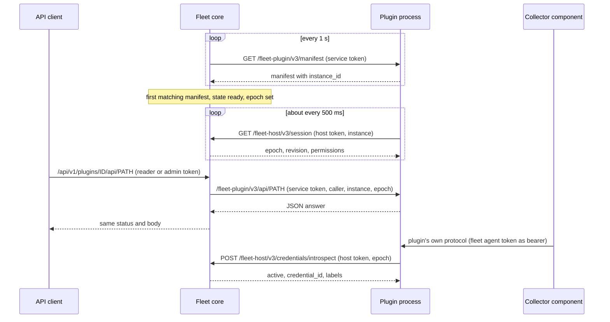

# Plugins

Plugins are separate processes that add a domain to the fleet server without
core knowing about it. [Livecapture](livecapture.md) is the production
plugin. [`examples/fleet-agent-summary-plugin`](../../examples/fleet-agent-summary-plugin)
is a small, complete template. This page is the whole contract for host
protocol 3.

| Reader | Read |
| --- | --- |
| Operator | [How it works](#how-it-works), [Register a plugin](#register-a-plugin), [Discovery and status](#discovery-and-status), [Lifecycle](#lifecycle), [Deploy with Docker Compose](#deploy-with-docker-compose) |
| Plugin developer | Everything. [Plugin contract](#plugin-contract) and [Host services](#host-services) are the wire specification; the [SDK README](../../pluginsdk/README.md) maps it to Go |

A plugin needs no change to fleet and none to the Collector component it
serves. An operator registers the plugin's service; the plugin uses generic
host services (agent directory, attribute and group resolution, agent
credential introspection) to tie its Collector connections to fleet. Core
holds no plugin-specific constants, routes or types.

**Plugin or integration?** A program that only reads or changes fleet data
(alerting, CMDB sync, reports) is an integration. It uses the [public
API](../../internal/fleet/api/openapi.json) with its own reader or admin
credential. Build a plugin when you need one of:

- your own API under fleet's authentication
- fleet's lifecycle control
- access to Collector credentials and the agent directory for your own
  Collector-facing endpoint

## How it works

```
 API client ── /api/v1/plugins/{id}/api/... ──▶ fleet ── /fleet-plugin/v3/api/... ──▶ plugin
 (reader/admin credential)                     │  ▲      (service token, caller,       │
                                               │  │       instance, epoch)             │
                    manifest probe every 1 s ──┘  └── /fleet-host/v3/... ◀─────────────┘
                    (service token)                   (host token, instance, epoch)
                                                                                        ▲
 Collector component (unchanged) ── own protocol, fleet agent token as bearer ─────────┘
```

| Channel | Direction | Listener | Credential |
| --- | --- | --- | --- |
| Manifest, status, public API | fleet to plugin | The plugin's own listener (`endpoint` in the registration) | Service token, sent by fleet |
| Host services | plugin to fleet | Fleet's private host listener (`--plugin-listen`) | Host token, sent by the plugin |
| Collector-facing endpoint (optional) | Collector to plugin | Any listener the plugin owns | The Collector's fleet agent credential, checked by introspection |

- Each registration has its own host and service token. Fleet identifies the
  plugin on the host listener by its host token alone.
- **Instance ID:** the plugin picks a random one at every process start and
  reports it in its manifest.
- **Epoch:** fleet keeps one per plugin and changes it on every lifecycle
  change, plugin restart and loss of readiness. The plugin learns it from the
  host session and sends it on every host request. Fleet sends it on every
  API call. A request with an old epoch is refused with 409 on both sides, so
  work admitted before a drain, disable or restart cannot continue after it.
- **Start:** fleet probes the manifest every second. After the first matching
  answer the plugin is `ready` and its session poll succeeds (it got 409
  until then). Public API calls are forwarded only while the plugin is
  `ready` and its last successful probe is under 3 s old.



*Fleet polls the plugin; the plugin polls fleet for its session and epoch;
core forwards public API calls; the plugin calls the host services it was
granted. A Collector component reaches the plugin directly and never passes
through core.*

How fleet derives readiness and epochs is in [plugin host
internals](../internals/fleet-plugin-host.md).

## Try the example

The example plugin counts agents and resolves groups. This runs it against
fleet in memory mode (Git Bash, from the repository root). Memory mode has no
lifecycle store, so drain and disable need PostgreSQL.

```sh
sh scripts/fleet/new-plugin-secrets.sh .local/agent-summary
openssl rand -hex 32 > .local/api_token; openssl rand -hex 32 > .local/agent_token
cat > .local/plugins.json <<'EOF'
{"plugins": [{"id": "agent-summary", "version": "0.1.0", "api_version": "1",
  "endpoint": "http://127.0.0.1:8090", "enabled": true, "permissions": ["agents.read"],
  "host_token_file": "agent-summary/host_token", "service_token_file": "agent-summary/service_token"}]}
EOF
go build -o bin/linea-fleet ./cmd/linea-fleet
go -C examples/fleet-agent-summary-plugin build -o ../../bin/agent-summary .
LINEA_FLEET_API_TOKEN=$(cat .local/api_token) LINEA_FLEET_AGENT_TOKEN=$(cat .local/agent_token) \
  bin/linea-fleet --storage memory --server-id dev --plugins-config .local/plugins.json &
bin/agent-summary -host-endpoint http://127.0.0.1:8081 \
  -host-token-file .local/agent-summary/host_token -service-token-file .local/agent-summary/service_token &
curl -s -H "Authorization: Bearer $(cat .local/api_token)" http://127.0.0.1:8080/api/v1/plugins/agent-summary
curl -s -H "Authorization: Bearer $(cat .local/api_token)" http://127.0.0.1:8080/api/v1/plugins/agent-summary/api/v1/summary
```

[Deploy with Docker Compose](#deploy-with-docker-compose) runs it with
PostgreSQL storage.

## Register a plugin

Pass `--plugins-config FILE` to fleet.

- One file holds the `plugins` array for the whole installation: at most 16
  entries, at most 64 KiB.
- It is decoded strictly: unknown fields fail startup.
- Configuration and token changes need a restart.

```json
{
  "plugins": [
    {
      "id": "livecapture",
      "version": "0.4.0",
      "endpoint": "http://livecapture-plugin:8090",
      "allow_insecure_http": true,
      "enabled": true,
      "permissions": ["agents.read", "credentials.introspect"],
      "api_version": "2",
      "host_token_file": "host_token",
      "service_token_file": "service_token"
    }
  ]
}
```

| Field | Required | Rules |
| --- | --- | --- |
| `id` | yes | 1 to 64 characters of `a-z`, `0-9`, `-`; unique. Part of the public routes |
| `version` | yes | 1 to 64 characters of letters, digits and `.-+_`. Pins the implementation; the manifest must match |
| `endpoint` | yes | Base URL without path, query or user info. HTTPS, or plain HTTP to a loopback IP |
| `allow_insecure_http` | no | Allows plain HTTP to any host. Only on a protected private network, such as an internal Compose network |
| `enabled` | no | Operator ceiling. `false` keeps the plugin disabled whatever an admin does |
| `permissions` | yes | Array (possibly empty) of the permissions below, each at most once |
| `api_version` | no | Grants the opaque public API. Same format as `version`; the manifest must match. Omit it for a plugin without a public API |
| `host_token_file`, `service_token_file` | yes | Files holding 64 lowercase hex characters (surrounding whitespace ignored). Relative paths resolve beside the registration file |

| Permission | Grants |
| --- | --- |
| `agents.read` | Agent directory, attribute resolution and group resolution |
| `credentials.introspect` | Introspection of agent credentials by token hash |

Tokens and the host listener:

- Every host and service token must differ from each other and from the
  memory-mode management and agent tokens.
- Create a pair with `scripts/fleet/new-plugin-secrets.sh DIR` (or `.ps1`).
  It refuses to overwrite an existing directory and never prints the values.
- The private host listener (`--plugin-listen`, default `127.0.0.1:8081`)
  exists only when registrations are configured. Keep it private: in Compose,
  use an internal network and publish no host port. `--tls-cert` also
  protects it.
- Invalid configuration fails startup. An absent or failing plugin does not.
- Process separation is not a sandbox against malicious code an operator
  installs. Grant only the permissions a plugin documents.

## Discovery and status

`GET /api/v1/plugins` and `GET /api/v1/plugins/{id}` need a reader or admin
credential. They return `id`, the pinned `version`, `protocol_version`, the
`enabled` ceiling, `permissions`, `api_version`, `state`, `desired`,
`revision`, `epoch`, `instance_id` and `checked_at` (last probe).

| State | Meaning |
| --- | --- |
| `disabled` | Operator ceiling is false or an admin disabled it. No probes or host access |
| `draining` | An admin fenced new work and canceled admitted calls. No probes or host access; survives restart |
| `unavailable` | No successful manifest probe in the last 3 s: stopped, stalled, non-200 answer or malformed manifest |
| `incompatible` | The manifest's ID, version, protocol version or API version differs from the registration, or its instance ID is not 32 lowercase hex characters |
| `ready` | A matching manifest answered within the last 3 s |

`GET /api/v1/plugins/{id}/status` (reader or admin) makes one bounded call to
the plugin's status route and returns `{"plugin_id": ..., "data": {...}}`.
The plugin defines `data`. An unavailable plugin returns a sanitized 503.

Inventory, health and Collector reporting never depend on a plugin. Core
exports `linea_fleet_plugins` by state and the plugin API metrics
([operations metrics](operations-metrics.md)), and records `plugin.*` events.

## Lifecycle

Admin lifecycle changes need PostgreSQL storage and a quoted `If-Match`
revision:

```sh
auth="Authorization: Bearer $ADMIN_TOKEN"
rev=$(curl -s -H "$auth" http://127.0.0.1:8080/api/v1/plugins/livecapture | jq .revision)
curl -s -X POST -H "$auth" -H "If-Match: \"$rev\"" -H 'Content-Type: application/json' \
  -d '{"action":"drain"}' http://127.0.0.1:8080/api/v1/plugins/livecapture/lifecycle
```

| Action | Effect |
| --- | --- |
| `enable` | Needs the operator ceiling. Followed by a fresh probe; the plugin is `unavailable` until it answers |
| `drain` | State `draining` |
| `disable` | State `disabled` |

- A missing precondition returns 428, a stale one 412.
- Every change rotates the epoch and cancels admitted calls.
- `draining` and `disabled` survive crashes, restarts and restores.
- **What the plugin sees:** after `drain` or `disable`, session requests get
  403 and requests under the old epoch get 409. It must stop work admitted
  under that epoch. Fleet stops probing it, so the process can keep running.
  After `enable` it gets a session with a new epoch.
- **Replace a plugin version or its tokens:** drain or disable, update the
  registration, tokens and image, restart fleet and the plugin, then enable
  at the current revision.

## Plugin contract

A plugin is any process, in any language, that serves these routes on its
`endpoint`. Every route requires `Authorization: Bearer <service token>`:
compare it in constant time and answer 401 otherwise. The SDK constants are
in [`pluginsdk`](../../pluginsdk/README.md). Fleet never follows redirects
from a plugin and sends no other headers.

| Route | Fleet sends | Plugin answers |
| --- | --- | --- |
| `GET /fleet-plugin/v3/manifest` | Service token only | 200 with the manifest, at most 4 KiB, within 750 ms |
| `GET /fleet-plugin/v3/status` | Service token, caller ID and role | 200 with a JSON object, at most 32 KiB, within 750 ms |
| `/fleet-plugin/v3/api/{path}` (only with `api_version`) | Service token, caller ID and role, instance, epoch, `Content-Type: application/json`, optional `If-Match`, the query string | JSON at most 1 MiB, or 204, within 2 s |

### Manifest and readiness

```json
{"id": "agent-summary", "version": "0.1.0", "protocol_version": "3",
 "instance_id": "292198670168b4a2ea6c81db31dda047", "api_version": "1"}
```

- `instance_id` is 32 lowercase hex characters, new at every process start
  (`pluginsdk.RandomID()`) and constant for the life of the process. A new
  one rotates the epoch.
- `id`, `version` and `api_version` equal the registration. `protocol_version`
  is `"3"`. Omit `api_version` when the registration has none.
- Fleet decodes the manifest strictly. An extra field or trailing data makes
  the answer invalid and the plugin `unavailable`.
- Answer non-200 (503) when the plugin cannot serve, for example while its
  database is down or it is shutting down. Fleet reports it `unavailable` and
  stops forwarding. Going from `ready` to not ready rotates the epoch, so
  admitted work is fenced; the next successful probe makes it `ready` under
  the new epoch.

### Session and epoch

`GET /fleet-host/v3/session` on the host listener, with the host token and
`X-Fleet-Plugin-Instance`, returns:

```json
{"plugin_id": "agent-summary", "instance_id": "292198670168b4a2ea6c81db31dda047",
 "epoch": "06f9cf10037f1ccb8b5ecd000569ac87", "revision": 0, "permissions": ["agents.read"]}
```

| Field | Meaning |
| --- | --- |
| `permissions` | Those granted by the registration. A plugin that cannot work without one should report it in its status and refuse its work |
| `revision` | The lifecycle revision |

- Poll about every 500 ms for the life of the process.
- It answers 409 until fleet's probe has seen this instance ID (up to about a
  second after start), and 403 while the plugin is disabled, draining or not
  ready. Both are normal: keep polling.
- When the epoch differs from the one you hold, or the session request
  fails: cancel everything admitted under the old epoch, forget state derived
  from host answers (for example cached introspection results), then adopt
  the new session.
- Send the current epoch on every other host request.
- The example's `watchSession` shows the pattern with a context per epoch.

### Status

Fleet calls the status route only on `GET /api/v1/plugins/{id}/status`, with
the caller headers but without instance or epoch.

- Answer a JSON object of at most 32 KiB that helps an operator: counts,
  readiness of dependencies, granted permissions. Never include secrets,
  configuration or telemetry.
- Fleet drops the plugin's error body and maps the status: 400, 403, 404 and
  409 are kept, 429 becomes 409, anything else becomes 503.
- If the epoch changed during the call, the caller gets 409.

### Opaque public API

With `api_version` granted, an authenticated request to
`/api/v1/plugins/{id}/api/{path}` reaches `/fleet-plugin/v3/api/{path}`. Core
interprets no domain fields: the plugin owns its schema, validation and
authorization.

Fleet checks before forwarding:

| Check | Rule |
| --- | --- |
| Caller | A management credential with role `reader` or `admin`. Agent credentials never reach the API |
| Method | GET, POST, PUT, PATCH, DELETE |
| Body | At most 64 KiB; valid JSON when present |
| `{path}` | 1 to 512 bytes of segments of 1 to 128 characters from `A-Za-z0-9-_.`. Empty, `.`, `..` and percent-escaped segments are refused |
| Query string | Forwarded unchanged, at most 2048 bytes |
| Concurrency | Two reads (GET) and two writes at once per plugin. Excess requests get 429 with `Retry-After: 1`, not a queue |
| Deadline | 2 s per call, canceled when the epoch changes |
| `If-Match` | One optional header of at most 128 bytes is forwarded |

Headers the plugin receives:

| Header | Content |
| --- | --- |
| `Authorization` | Service token |
| `X-Fleet-Caller-ID` | The credential ID |
| `X-Fleet-Caller-Role` | `reader` or `admin` |
| `X-Fleet-Plugin-Instance`, `X-Fleet-Plugin-Epoch` | Check both equal your current session; answer 409 otherwise |
| `Content-Type` | `application/json` |
| `If-Match` | Optional |
| `X-Fleet-Acting-*` | Optional, validated (below) |

Fleet never forwards user credentials, cookies or other headers.

**Acting for users.** A management client that acts for its own users, such
as a shared team service, may send these headers, each once, as printable
UTF-8 without surrounding space:

| Header | Limit |
| --- | --- |
| `X-Fleet-Acting-ID` | Required with the others; at most 256 bytes |
| `X-Fleet-Acting-Name` | At most 128 bytes |
| `X-Fleet-Acting-Request` | At most 128 bytes |

- Fleet refuses malformed values with 400 `invalid_acting_for`, records the
  value on the request's events (`acting_for`), and forwards only the
  validated headers. Copies a client sends are never passed through.
- Read them with `pluginsdk.ReadActing`.
- They are attribution only: authorize on `X-Fleet-Caller-ID`, never on the
  acting-for value.

What fleet returns to the caller:

| Plugin answer | Caller gets |
| --- | --- |
| 204 with an empty body | 204 |
| 2xx, 400, 403, 404, 409, 410, 412, 413, 428, 429 or 503, with `Content-Type: application/json` and a valid JSON body | The same status and body |
| Any other status (including 401, 405, 422, 500), a non-JSON body, more than 1 MiB, a timeout, or an epoch change during the call | 503 with fleet's generic error |

Fleet keeps only the content type, an `ETag` of at most 128 bytes, and
`Retry-After` when it is `1` on a 429. Use `ETag` with `If-Match` for
optimistic concurrency. Error bodies reach the caller: keep them fixed and
free of request data, secrets and upstream text.

### Authorization inside the plugin

Fleet authenticates the caller and passes its identity. The plugin decides
what each role may do. Livecapture, for example, lets readers list and
admins start captures, and scopes captures to the credential that created
them. The caller ID is stable for a credential: use it as the owner of
records the plugin creates. Document the rules in the plugin's API schema.

## Host services

Fleet serves these on the private host listener.

- Every request carries the host token and `X-Fleet-Plugin-Instance`. Every
  request except the session also carries `X-Fleet-Plugin-Epoch`.
- POST bodies are at most 4 KiB of strict JSON (unknown fields and trailing
  data refused), with no query string.
- Answers have `Cache-Control: no-store`.

| Route | Permission | Result |
| --- | --- | --- |
| `GET /fleet-host/v3/session` | Enabled and ready | Session |
| `GET /fleet-host/v3/agents` | `agents.read` | Directory page |
| `POST /fleet-host/v3/agents/resolve` | `agents.read` | Connected agents matching attributes |
| `POST /fleet-host/v3/groups/resolve` | `agents.read` | Members of a group or selector |
| `POST /fleet-host/v3/credentials/introspect` | `credentials.introspect` | Agent credential by token hash |

### Agent directory

Query parameters, each at most once; others are refused:

| Parameter | Meaning |
| --- | --- |
| `after` | The previous page's `next_after` |
| `limit` | 1 to 100, default 100 |
| `selector` | A [selector](#selectors-ids-and-attributes) |
| `connected` | `true` or `false` |

```json
{"items": [{"id": "0f4f9932b0897023da9ff72cd3e46fc8", "generation": 3, "connected": true,
  "presence": "connected", "connected_at": "2026-10-25T15:50:11Z", "last_report_at": "2026-10-25T15:52:11Z",
  "capabilities": 8199, "health": {"healthy": true, "observed_at": "2026-10-25T15:52:11Z"},
  "attributes": {"service.name": "otelcol-contrib", "k8s.pod.name": "edge-7d9f"}}],
 "next_after": "0f4f9932b0897023da9ff72cd3e46fc8"}
```

- `presence` is `connected` or `disconnected`. `capabilities` is the OpAMP
  agent capability bit set.
- `disconnected_at`, `last_report_at`, `health` and `attributes` are omitted
  when unknown.
- A page is cut short below 1 MiB and continues from its last item. An empty
  `next_after` ends the listing.

### Resolution and introspection

| Service | Request | Result |
| --- | --- | --- |
| Attributes | `{"credential_id": "...", "attributes": {"k8s.pod.name": "edge-7d9f"}, "limit": 16}` | `{"agent_ids": [...], "more": false}`: connected agents whose attributes equal all 1 to 8 terms, optionally only those that connected with `credential_id`. `limit` defaults to 16, at most 100; `more` says more matched. Link a Collector to an agent only on exactly one match |
| Group | `{"group_id": "..."}` or `{"selector": "..."}` (exactly one), optional `"connected": true`, `"limit"` (default and maximum 1000) | `{"agent_ids": [...], "revision": 4}`. `revision` is the group's revision (0 for a selector). A set above the limit returns 422, not a truncated list. An unknown group returns 404 |
| Introspection | `{"token_sha256": "<64 lowercase hex>"}` | `{"active": true, "credential_id": "...", "role": "agent", "labels": {...}, "expires_at": "..."}` for an unrevoked, unexpired agent credential; `{"active": false}` for anything else, including management credentials and unknown hashes |

The plugin hashes the bearer token a Collector presented, so the token itself
never reaches fleet over the host channel.

### Selectors, IDs and attributes

| Item | Rule |
| --- | --- |
| Selector | A comma-separated AND of 1 to 8 terms: `key=value`, `key in (a,b)` (up to 32 values) or a bare `key` (the key exists). Keys: up to 128 characters of `A-Za-z0-9._-/`. Values: up to 256 printable characters, double-quoted (JSON string syntax) when they contain `,()"=`. Example: `service.name=checkout,k8s.namespace.name in (shop,staging)` |
| IDs | Agent, group, instance and epoch IDs are 32 lowercase hex characters |
| Attributes | Those the installation allowlists at ingestion: `service.*`, `host.name`, `host.arch`, `os.type`, `os.description`, `k8s.cluster.name`, `k8s.namespace.name`, `k8s.pod.name`, `k8s.pod.uid`, `k8s.deployment.name`, `k8s.statefulset.name`, `k8s.daemonset.name`, `k8s.node.name`, `cloud.provider`, `cloud.region`, `cloud.availability_zone`, plus keys added with `--agent-attributes` |

### Refusals

Refusals are a fixed JSON error.

| Status | Meaning |
| --- | --- |
| 400 | Malformed |
| 401 | Wrong host token |
| 403 | Not enabled and ready, or permission not granted |
| 404 | Unknown route or group |
| 405 | Wrong method |
| 409 | Stale instance or epoch. Treat as the end of your session |
| 422 | Too many group members |
| 503 | Busy or database unavailable. Retry (also timeouts) with backoff |

Each plugin gets two concurrent host requests; a third gets 503. Each request
has a 750 ms deadline and is canceled when the epoch changes.

## Serving an unchanged Collector component

A plugin often terminates its own Collector-facing endpoint, such as a gRPC
stream from a Collector extension. Such components already send configurable
headers, so the Collector presents its fleet agent credential to the plugin
unchanged.

| Step | How |
| --- | --- |
| 1. Authenticate | The Collector configures its fleet agent token as the component's `Authorization: Bearer` header. The plugin hashes the token, calls introspection and caches the answer briefly (livecapture: 10 s, rejections 2 s, never past `expires_at`). It re-introspects connected credentials periodically and closes connections whose credential was revoked or expired. It clears the cache when the epoch changes |
| 2. Authorize with labels | Agent credentials carry up to 16 labels (`labels` on `POST /api/v1/credentials`: key at most 64 bytes of `A-Za-z0-9._-/`, value 1 to 128 bytes). A plugin documents the label it reads, for example livecapture's `capture=edge,gateway`, so operators grant plugin access per credential without a plugin-owned credential store. Config management also matches assignments on labels: choose a label key that names your plugin |
| 3. Link to fleet agents | To address a connection by fleet agent, group or selector, resolve it with `agents/resolve`, using the introspected `credential_id` and identity attributes the component reports (for example `k8s.pod.name`). Link only a unique match. The Collector's OpAMP extension reports the same attributes through `agent_description.non_identifying_attributes` |
| 4. Target groups | For a group or selector, call `groups/resolve` with `connected: true` and intersect the agent IDs with linked connections. Resolve once when an operation is admitted and keep that set |

Core never forwards plugin traffic to Collectors and never sends commands for
a plugin; reporting stays read-only.

## Limits and timeouts

| Bound | Value |
| --- | --- |
| Registrations | 16 per installation |
| Manifest probe | Every 1 s, 750 ms timeout, 4 KiB; `ready` lasts 3 s after the last success |
| Status call | 750 ms, 32 KiB JSON object |
| Concurrent manifest and status calls | 2 per plugin |
| Public API | 64 KiB request, 1 MiB response, 2 s; 2 reads and 2 writes at once per plugin |
| Host requests | 750 ms, 4 KiB POST body; 2 at once per plugin |
| Directory page | 100 agents, 1 MiB |
| Attribute resolution | 1 to 8 terms, limit 16 by default, 100 at most |
| Group resolution | 1000 members |

## Deploy with Docker Compose

A plugin ships as an image and a Compose overlay next to the base
`deploy/compose/fleet/compose.yaml`. The example's
[`compose.yaml`](../../examples/fleet-agent-summary-plugin/compose.yaml) is
the template.

| Service | What the overlay does |
| --- | --- |
| Fleet | Replaces `command` with the base command plus `--plugins-config /etc/linea-fleet/plugins.json --plugin-listen 0.0.0.0:8081`, mounts the registration, adds the token secrets and an internal `plugins` network |
| Plugin | Joins only the `plugins` network (plus its own database network, if any); publishes no port for fleet traffic; reads both tokens from Docker secrets; runs non-root with a read-only root, dropped capabilities, `no-new-privileges` and CPU, memory and PID limits |
| Registration | Uses `http://<service>:<port>` with `allow_insecure_http: true`, acceptable only because the network is internal |

```sh
# from the repository root
sh scripts/fleet/new-plugin-secrets.sh .local/agent-summary
docker compose -f deploy/compose/fleet/compose.yaml -f examples/fleet-agent-summary-plugin/compose.yaml \
  up -d --wait fleet agent-summary-plugin
```

- Fleet reads one registration file. Running two plugin overlays together
  needs a combined registration that lists both plugins and the secrets of
  both.
- A plugin that serves Collectors adds its own ingress network and published
  ports, as
  [`compose.livecapture.yaml`](../../deploy/compose/fleet/compose.livecapture.yaml)
  does.
- A plugin with a database uses its own database, migration and runtime
  roles, never fleet's.

## Versioning and upgrades

| Version | Meaning |
| --- | --- |
| Protocol `"3"` | Fixed for this host protocol: routes, fields and bounds do not change within it |
| `version` | The plugin build. The registration pins it, so an image upgrade changes the registration too |
| `api_version` | Versions the plugin's public API. Change it on breaking API changes so the operator opts in |

Upgrade: drain, change image, version and registration, restart fleet and
the plugin, enable. A plugin that comes up with a version the registration
does not pin stays `incompatible` and receives no traffic.

## Testing a plugin

- **Unit tests:** serve your handler with `httptest` and fake the host with
  an `httptest.Server` that answers the session and the services you use.
  Cover wrong service token (401), missing caller headers (403), stale epoch
  (409), and host 409, 422 and 503 answers.
- **Against real fleet:** [Try the example](#try-the-example) runs fleet in
  memory mode without Docker. Simulated agents fill the directory:
  `go run ./cmd/linea-fleet-simulator -endpoint ws://127.0.0.1:4320/v1/opamp -allow-insecure-transport -token-file .local/agent_token -agents 5`.
- **Lifecycle and fencing** need PostgreSQL storage: use the Compose overlay,
  drain, then enable, through the lifecycle route. Check that the plugin stops
  admitted work and that calls under the old epoch fail.

## Security checklist

- Compare the service token in constant time on every route, the manifest
  included.
- Accept status and API calls only with exactly one caller ID and a role of
  `reader` or `admin`. Enforce your own per-role rules.
- On API calls, check instance and epoch against your current session.
- Stop admitted work and clear host-derived caches when the epoch changes.
- Bound every request body, page and loop. Refuse rather than queue when busy.
- Never log tokens, Collector credentials, request bodies, configuration or
  telemetry. Keep error bodies fixed.
- Keep the host listener and the plugin's fleet-facing listener on a private
  network. Use HTTPS when they cross hosts.
- Request only the permissions you need, and document the credential labels
  your plugin reads.
